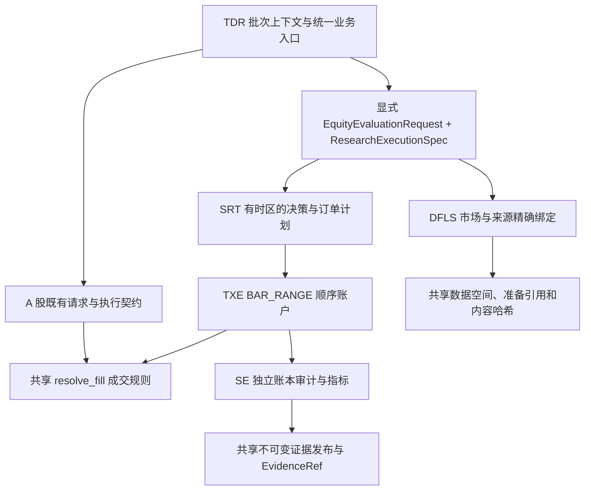

# 美股个股 30 分钟研究契约（v1）

本次能力服务于个股只做多择时研究。决策间隔为 30 分钟，允许同日买卖及隔夜持仓；
决策机会增多不等于独立样本增多，也不要求每根 K 线成交。
这是研究计算与证据发布能力，不能据此推定真实成交、策略达标或获准上线。

## 隔离层与复用层



| 模块 | 隔离责任 | 复用责任 |
| --- | --- | --- |
| TDR | 上下文固定执行合同；拒绝异市场候选及混合请求 | 批次、实验、prepare/evaluate/evaluate_many、run_backtest、publish_evidence |
| DFLS | `InstrumentId`、市场日历、产品、来源及修订精确匹配 | `Dataflows`、`PreparedDataRef`、持久化与不可变内容身份 |
| SRT | `ResearchExecutionSpec`、有时区的决策边界、整数股单位 | 策略规划职责；与既有运行时共用包但不改写 A 股时间契约 |
| TXE | `EquityHistoricalExecutor` 管理区间订单、公司行动及交收 | `resolve_fill`；费用、持仓、现金、应收款和净值的同一会计恒等式 |
| SE | 独立核对美股区间成交和账户事实 | 数值计算职责；不导入 TXE、不调用成交执行器证明自身正确 |

保留原 A 股股票及 ETF 的 `StrategyCandidate`、`EvaluationRequest` 和回测类型。
未指定 `execution_spec` 的既有上下文继续使用这些契约；美股请求必须显式绑定执行合同。
这是按业务能力选择确定的实现，不进行出错降级，也不会把美股请求转成 A 股请求。
`CnEquitySpec` 可以表达市场身份，但本版不接纳 CN 的 BAR_RANGE 执行；A 股走原有执行能力。

## 强类型契约

| 类型 | 关键字段与约束 |
| --- | --- |
| `InstrumentId` | `market/asset_class/symbol`；A 股为 `600722.SH` 等规范代码，美股为 `LITE`，供应商前缀只在适配器生成 |
| `SourceRef` / `ProviderKey` | 来源名、不可变修订；产品 × 市场 × 来源精确寻址，找不到即失败 |
| `TradingSession` | 交易日、市场时区、显式交易段；UTC 存储，根据当地时区生成 30 分钟网格 |
| `ResearchExecutionSpec` | 市场规则版本、频率、币种、现金可用规则、数量步长、价位、买入溢价、滑点、触价与延迟假设 |
| `EquityCandidate` | 批次、候选名、标的、执行合同哈希、实现哈希、预热根数、决策函数 |
| `DecisionPoint` | `observed_through <= decision_at <= execution_interval.start`，时间全部带时区 |
| `EquityEvaluationRequest` | 实验、候选、评价区间、历史起点、四类来源、资金、费率及可选准备引用 |
| `EquityEvaluationResult` | 固定请求哈希、不可变 JSON 字节及内容哈希；读取 `payload` 返回独立副本 |

策略函数签名为 `decide(history, portfolio) -> 0 | 1`：0 表示空仓目标，1 表示可用现金范围内买入并持有。
历史输入为当时已经完成且已经可得的行情副本，账户快照不可变。
`research.runtime.create(candidate)` 使用同一上下文执行合同创建实例；显式美股运行时拒绝 A 股请求。
本版不包含分批建仓、多标的组合、卖空、杠杆、碎股或可变价位制度。
实现身份绑定加载函数及其所在源码文件；外部依赖、全局状态和运行环境仍由研究材料固定，
该身份不是正式候选登记或冻结包的认证替代品。

## 数据产品

四个产品均经现有 DFLS 管理，使用同一准备引用。各产品声明的交易时段必须完全一致。

| 产品 | 必需字段 | 发布时检查 |
| --- | --- | --- |
| `equity.bars` | `Date/BarStart/AvailableDate/Open/High/Low/Close/Volume/Amount` | 完整独立日历网格、OHLC 范围、非负量额、可用时间不早于结束时间 |
| `equity.sessions` | `Date/AvailableDate/SessionDate` 及交易段元数据 | 唯一顺序交易日、市场时区、请求覆盖 |
| `equity.actions` | `Date/AvailableDate/EventId/Kind/Ratio/CashPerShare/PayAt` | 唯一事件、正拆股比例、现金分红金额及支付时点 |
| `equity.constraints` | `Date/AvailableDate/QuantityStep/PriceTick/Tradable` | 逐执行区间完整覆盖、当时可得；不沿用上一段过期约束 |

`Date` 对行情表示区间结束，对约束表示对应执行区间开始，对公司行动表示生效时间。
现金交收模式还要求卖出区间具有 `SettlementAt`。约束来源由宿主显式提供并固定修订；
不能把最新快照、统一一美分假设或自建工作日日历伪装成已核实的历史事实。
约束中的数量步长和价位必须与执行合同相同，遇到制度切换明确拒绝，另行划分合同。

无公司行动也必须有来源核实记录：一条 `Kind=NONE` 和 `no_actions_verified=true`。
缺行情、缺约束、日历冲突、来源修订不符、无合法准备引用等均失败，不补齐、不换源。
执行始终使用未复权价，公司行动另行记账；不把复权价格当作可成交报价。

`futu_equity_bindings(source=..., quote_context=...)` 仅绑定 US 的行情、日历和公司行动。
宿主管理行情连接生命周期，适配器不打开交易连接，不提交券商订单。
历史 K 线使用 RTH 和分页；美东本地时间转换成 UTC，支持正常交易日、半日和夏令时。
适配器记录 `BAR_CLOSE_RESEARCH_ASSUMPTION`，它是研究中的行情可用时间假设，不是历史发布延迟实测。
对 `get_rehab` 的现金分红及复杂行动明确拒绝，因为该产品不足以提供所需支付凭据；
可由宿主绑定具有明确支付日期的独立行动来源。拆股比例遵循已安装 SDK 的新股数/旧股数定义。
接口时区及分页依据见 [Futu 历史 K 线文档](https://openapi.futunn.com/futu-api-doc/quote/request-history-kline.html)。

## 决策与执行语义

1. 在下一执行区间开始前，只暴露已经结束且 `AvailableDate + data_latency_seconds` 不晚于该时点的 K 线。
   预热不足即失败，不静默缩短窗口。半日、跨日及夏令时由交易段决定。
2. 空仓转持仓时，按最近可见收盘价、显式买入溢价及价位向下取整生成限价；
   买入数量按可用现金、费率、数量步长向下取整。持仓转空仓使用市价卖出。
3. 订单只在对应下一段 K 线内有效；未成交记录 `EXPIRED`，新决策可以生成新订单。
   开盘满足限价或段内低价满足声明的触价规则时，调用共享成交函数。
   滑点导致买价超过限价时不成交；停牌约束、零成交量或订单大于整段成交量也不成交。
4. BAR_RANGE 无法还原段内先后顺序和真实成交时刻。段内触价记录 `BAR_INTERVAL`，
   模型开盘成交记录 `MODEL_BAR_OPEN`；不生成假的精确成交秒数，也不模拟部分成交。
5. 拆股同步调整持仓和跨事件订单，不能表示的碎股权益失败。
   同一时点先处理拆股，再按拆股后股数及来源声明的每股金额处理现金分红；来源须按此单位规范化。
   现金分红在权益生效时计应收款，在支付时转成现金，避免凭空增加可用资金。
   生效时间落在执行区间内部的公司行动拒绝执行。
6. `IMMEDIATE_RESEARCH` 明确假设卖出款即时可用；`SETTLED_ONLY` 在 `SettlementAt` 前保留应收款。
   两者均禁止负现金及卖空，不把研究模式自动解释为某种券商账户资格。
7. 每段执行有账户修订号；同计划同事实重复提交不重复记账，事实改变或过期修订拒绝。
   任一转换失败回滚现金、持仓、应收款、事件与证据行。

基准为同标的、同初始资金、同起止点、同预热、同买入规则、同费用及公司行动处理的买入并持有账户。
首个买单未成交时，后续区间继续尝试；不强制按理论起始价持仓，也不在窗口末尾虚构平仓。

## API 调用流程

以下为集成片段；`repository/batch/experiment/quote_context/rule_bindings/action_bindings` 由宿主按已授权范围提供。
真实研究前必须准备交易约束来源；不能直接把测试夹具用于研究。

```python
from dataflows import AssetClass, BarFrequency, InstrumentId, MarketId, ProviderConfig, SourceRef
from dataflows import futu_equity_bindings, TimeInterval
from strategy_runtime import AccountPolicy, CashAvailabilityPolicy, UsEquitySpec
from strategy_runtime import ResearchExecutionSpec, EquityCandidate, equity_implementation_hash
from czsc_trader.application import create_research_context, run_backtest, publish_evidence
from czsc_trader.research_tools import EquitySources, EquityEvaluationRequest, EvaluationEvidenceWrite

spec = ResearchExecutionSpec(
    market=UsEquitySpec(), decision_clock=BarFrequency.M30,
    account=AccountPolicy("USD", CashAvailabilityPolicy.IMMEDIATE_RESEARCH),
    quantity_step=1, price_tick=0.01, buy_premium=0.01, slippage_bp=0,
)
quotes = SourceRef("futu", "host-validated-revision")
providers = ProviderConfig(equity_bindings={
    **futu_equity_bindings(source=quotes, quote_context=quote_context),
    **rule_bindings, **action_bindings,
})
research = create_research_context(repository, batch, providers=providers, execution_spec=spec)
candidate = EquityCandidate(
    batch.strategy_id, "C001", InstrumentId(MarketId.US, AssetClass.STOCK, "LITE"),
    spec.fingerprint, equity_implementation_hash(decide), warmup_bars=60, decide=decide,
)
request = EquityEvaluationRequest(
    experiment=experiment, candidate=candidate,
    window=TimeInterval(start_at, end_at), history_start=history_start,
    sources=EquitySources(quotes, quotes, action_source, rule_source),
    initial_cash=100_000, fee_rate=0.001,
)
prepared = research.evaluation.prepare(request)
result = research.evaluation.evaluate(prepared)
same_contract_result = run_backtest(research, candidate, prepared)
reference = publish_evidence(research, EvaluationEvidenceWrite(experiment, "account", prepared, result))
```

`evaluate_many` 接受同一类请求的非空元组，每项返回 `EvaluationStatus.SUCCEEDED/FAILED` 及结果或结构化错误。
本版 BAR_RANGE 批量计算为顺序执行，不支持并行检查点会话；明确拒绝而非降级。
多个费用场景或窗口通过多份显式请求组织，不能把不同市场请求混装一个批量调用。

## 审计、指标及证据

SE 从序列化事实独立重建现金、持仓、应收款、公司行动及闭合交易，
检查时序、成交价、限价、费率、成交量、交易约束、权益及交收，核对各期账户恒等式。
收益与复合年化使用连续扣费账户，年化按观测交易日数及 252 日惯例计算。
同时报告日末净值回撤与 30 分钟收盘采样回撤；后者不是逐笔或段内最大回撤。
闭合交易按完整入场—退出周期计数，同日多次独立周期分别记录，未平仓不计闭合交易。
完整滚动 60 交易日闭合次数及其中位数单独输出；不足 60 日返回空窗口和 `None`，不当成零频率。
这些是事实与诊断，是否满足研究目标由用户确认的研究合同决定。

结果保存请求、执行合同及哈希、来源/修订、准备清单哈希、各产品内容身份、交易日历元数据、
决策、订单、成交、公司行动、区间账户、日末账户、闭合周期及指标。
请求身份同时绑定本链路的 TDR/SRT/TXE/SE 模块源码哈希及 Python/pandas 版本。
发布复用 `EvaluationEvidenceWrite` 和原有不可变写入流程，返回
`EvidenceRef(schema="equity_research", schema_version=1)`；不能冒充 A 股的 `account_evaluation/v8`。
发布前再次核对准备数据身份和独立审计指标。

当前美股证据可用于研究复核和实验留证；正式候选登记、五阶段数值交付适配、账户诊断、
冻结版本回放及 PTE 接纳尚未接入该证据类型，会由既有类型/模式校验拒绝。
本次不修改历史研究证据、候选资格及冻结包，也不改变生产账户。

## 聚焦验证

新增用例见 [美股公共链路](../tests/functional/test_equity_research.py)、
[DFLS 隔离契约](../packages/dataflows/tests/functional/test_equity_products.py) 和
[Futu 适配器](../packages/dataflows/tests/functional/test_futu_equity.py)。
覆盖同日往返、整数股、下一段执行、未来行情不影响此前决策、资金交收、拆股分红、支付日期缺失、
半日/夏令时、分页异常、数据缺失、跨市场拒绝、重复提交、失败回滚、独立审计及不可变发布。
同时运行原 A 股股票/ETF 执行、数据准备、批量评价与证据发布的相关测试。
验证基于隔离夹具，不等同于真实历史公司行动验证、全仓回归或券商验收。

2026-10-28 开发分支验证：改动前 A 股相关基线 95 项通过；最终运行时/业务入口 115 项、
数据链路 98 项、补充契约 25 项全部通过（补充契约包含重复执行的用例）。
变更 Python 文件 Ruff 及 `git diff --check` 通过。两条 pandas 日期解析警告与基线一致。
JUnit 文件位于 `.tmp/us-stock-30m/`，本次没有运行仓库级全量回归。
