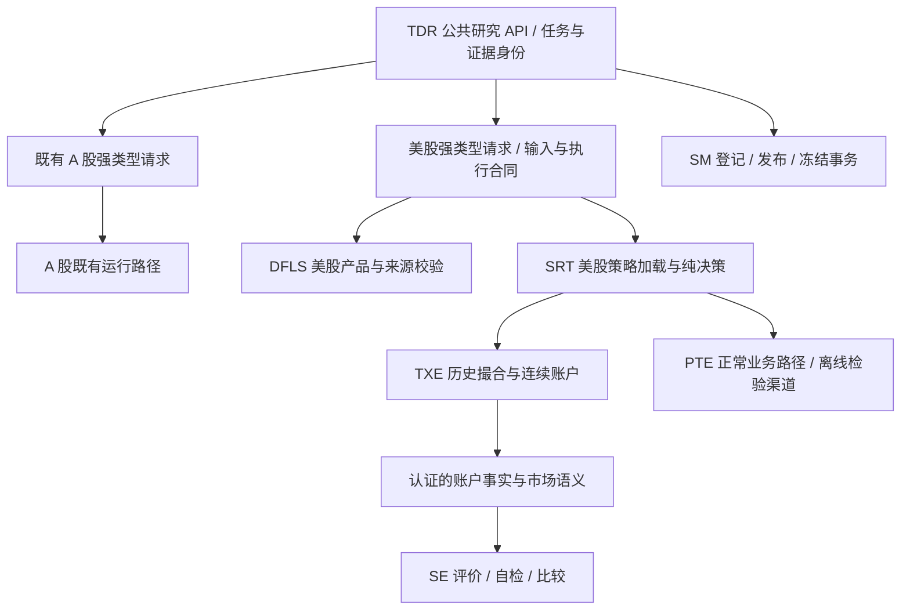

# 美股个股研究闭环：可行性评审与技术方案

状态：待评审，未实施。日期：2026-10-28。角色：DEV。

代码基线：`codex/us-stock-30m-research@19f9347f`。需求依据为本次会话中 RSCH 的 R1—R7；研究政策以 [RSCH 指南](../../../research/RSCH_AGENT.md)及[美股补充](../../../research/guides/US_RESEARCH.md)为准。本文给出拟议契约，不表示这些能力已经可用，不授权研究搜索、阶段推进、真实候选冻结或生产变更。

## 1. 结论与范围

技术上可行。保留已实现的美股 30 分钟计算链路，通过契约扩展接入现有研究生命周期。R1—R6 主要是跨模块身份、证据与评价适配；R7 涉及 PTE 正常业务路径的市场规则及账户事件处理，不能当成单纯的证据格式转换。

目标是研究可以启动并形成完整结论：负面结论和无候选可以正常收口；形成推荐候选时，可以继续完成用户选型、技术检验与获批冻结。软件验收不要求策略盈利，也不替代经济目标验收。

首轮支持范围保持单标的、只做多、不加杠杆、常规时段、30 分钟、整数股、空仓／持有目标、限价买入／市价卖出。分批配置、组合、卖空、杠杆、碎股和延长交易时段不在本方案内。账户资金规则必须显式声明；研究中的卖出款即时可用不能解释为券商账户资格。

生产部署、实际券商渠道接纳、账户启用及持续前瞻观察另行授权。隔离 PTE 技术检验属于本次闭环范围，必须使用正常业务组件和离线渠道，不以自制模拟器代替。

## 2. 已核验的实现边界

| 需求 | 当前实现证据 | 评审结论 |
| --- | --- | --- |
| R1 研究约定 | [benchmark_contracts](../../../src/czsc_trader/backtesting/benchmark_contracts.py) 的 `LimitBuyHold` 强制百股单位和涨跌幅合同；`BenchmarkRequirement` 绑定该体系 | 增加准确的美股基准合同，贯通约定、评价和交付 |
| R2 数据 | [Futu 适配](../../../packages/dataflows/src/dataflows/futu_equity.py) 提供行情、日历和有限行动数据，不提供交易约束，现金分红需补支付事实 | 基础设施可扩展；真实来源是否足够须按首个获准标的和窗口核验，不能承诺由代码解决数据缺失 |
| R3 策略表达 | [equity](../../../packages/strategy_runtime/src/strategy_runtime/equity.py) 保存函数与源码哈希，账户反馈只有现金、数量、应收和修订号 | 需要源码闭包、参数、依赖、决策解释及明确反馈契约 |
| R4 执行 | [evaluation_access](../../../src/czsc_trader/research_tools/evaluation_access.py) 对 equity 顺序执行并拒绝执行会话；现有 worker 假定原请求字段 | 复用进程与检查点基础设施，按请求类型处理计算和序列化 |
| R5 评价 | [assessment](../../../src/czsc_trader/research_tools/assessment.py) 仅支持原评价类型；SE 日频评价和成交核对缺少美股权益事件语义 | 需要事实适配及相关评价契约扩展，不能只改类型校验 |
| R6 交付 | [candidate_service](../../../src/czsc_trader/application/candidate_service.py) 仅接收 `StrategyCandidate`；[delivery](../../../src/czsc_trader/research_tools/delivery.py) 的账户引用只允许旧 schema | 复用登记和发布事务，增加严格的美股内容与引用校验 |
| R7 技术检验 | [inspection_contracts](../../../src/czsc_trader/application/inspection_contracts.py) 绑定原回放输入；PTE 合同、存储和检验输入存在百股限制、A 股代码和时段规则 | 必须贯通 SRT 加载、PTE 正常订单与账户路径及冻结格式 |

风险最高的交叉处是：候选身份贯穿多进程与冻结、评价的时间与权益语义、PTE 持久状态与恢复。设计和测试优先覆盖这些位置。

## 3. 模块边界：在哪里隔离，在哪里复用



| 模块 | 隔离责任 | 复用责任与限制 |
| --- | --- | --- |
| DFLS | 市场、来源、日历、价格角色、行动及约束数据 | 资产空间、准备引用、内容身份；不增加第二套缓存 |
| SRT | 市场执行规则、因果输入、策略定义和加载、决策与计划 | 候选内容身份、源码闭包校验、解释结构；不承担账户记账 |
| TXE | 历史成交模型及美股权益、资金时序 | 现有成交规则和事务保证；不负责 PTE 渠道成交事实 |
| SE | 认证事实适配后的时间、币种、权益与采样语义 | 目标计算、自检、排序和诊断；不调用执行器作为自身正确性证明 |
| SM | 保存运行契约的显式类型与内容身份 | 一套候选登记、发布身份和冻结事务；不解释策略金融含义 |
| TDR | 根据明确请求、运行契约及证据 schema 路由 | 批次、实验、资源、发布、交付和技术检验入口 |
| PTE | 市场时段、交易单位、账户资金和权益事件 | 单写账户、订单状态、成交增量、幂等、恢复与审计 |

只设置有限、明确的类型分派，不建设动态插件框架；不按代码字符串猜市场，不在失败后换回另一条路径。市场规则与历史成交模型分别表达：PTE 消费 SRT 计划和渠道回报，不能把 `BAR_RANGE` 触价推断当成真实渠道成交。

## 4. R1—R3：输入、策略身份与执行合同

### 4.1 数据与基准

保留 `EquityDataRequest`、`EquitySources`、`SourceRef`、`PreparedDataRef` 和现有四类产品。准备结果复用既有逐项状态，补充准确的缺口定位；不新增独立的“研究准入服务”。

- 固定标的、预热及评价范围、来源修订、交易时段、数量与价格单位、费用、资金政策和信息可得假设。
- 数据缺失明确到产品、区间和原因；区分休市、真实停牌、无成交和供应商缺数据。遇到无法表示的情形明确受阻，不静默补 K 线或缩短区间。
- 区分决策时已知约束与事后执行事实。盘中发生的停牌不能提前暴露给策略；同一事实的 `effective_at`、`available_at` 与实际到账时间不得混用。
- 行情可得时间与交易约束的研究假设必须显式记录；供应商无记录不能自动证明没有公司行动。对所需区间不能取到支付证据的现金分红，保持显式失败。
- 成交使用原始价格；分析输入若需要调整价格，声明转换和时点规则，验证未来公司行动不会改变此前决策。此次不默认加入更多数据源或因子目录。

在 TDR 的 `EvaluationBenchmark.execution` 中增加强类型 `EquityBuyHold`，引用市场执行合同、输入口径和基准政策版本；不填充虚假的 A 股涨跌幅参数。美股请求显式携带同一 `EvaluationBenchmark`，`BenchmarkRequirement`、请求身份、策略／基准结果和阶段四绑定使用同一指纹。原 `NextOpenBuyHold` 与 `LimitBuyHold` 的字段、校验和指纹保持原样。

### 4.2 可序列化候选

修订美股 `EquityCandidate`：使用 `CandidateKey`，以 `EquityStrategyDefinition` 取代裸函数作为持久定义。复用源码清单、相对入口、精确依赖版本及参数合法性校验机制；不序列化函数闭包，也不通过可变模块变量传递试验参数。

`EquityStrategyDefinition` 的最小字段：

| 字段 | 业务语义 |
| --- | --- |
| `runtime_kind / contract_version` | 显式标识美股运行契约及版本 |
| `instrument` | 强类型市场、资产类别、标的 |
| `implementation` | 相对模块入口、源码文件清单和源码闭包哈希 |
| `parameters / parameter_schema` | 全部有效参数及类型、合法域；实例创建时固定 |
| `dependencies` | 精确版本的运行依赖；研究依赖不自动打包 |
| `input_spec / warmup_bars` | 所需输入角色、分析转换、预热及可得时间规则 |
| `execution_spec` | 明确的市场、账户、订单和执行时序合同 |
| `feedback_mode / explanation` | 无账户反馈或确认执行反馈的声明，以及解释结构 |

候选内容身份覆盖以上有效字段、源码和依赖，不包含机器绝对路径、试验次数或候选名称。请求身份另行绑定数据、窗口、费用场景、引擎与解释器版本。有效参数、源码、依赖或固定执行合同改变，必须改变内容身份；追加评价不改变候选身份。

SM 沿用 `CandidateRegistration`、`CandidateDerivation`、`CandidateKey` 和不可变存储；在 payload 的运行描述中显式区分类型。登记必须核验证据里的美股内容身份，不能把未知 schema 当成普通附件后跳过候选匹配。源码依赖闭包核对本地导入和声明包，未声明依赖明确失败；该校验不宣称可以沙箱证明任意 Python 代码无副作用。

### 4.3 决策和状态

拟议策略入口为 `decide(context: EquityDecisionContext) -> EquityDecision`。上下文包含已完成且可得的历史、不可变参数、当前交易点及按反馈声明提供的账户快照。输出包含 0/1 目标和引用当次条件、数值、参数的解释；沿用现有解释定义和快照机制。

确认执行反馈只暴露实际已生效的持仓数量、可用现金、应收款、开仓周期、成交时间精度及成本；不能把发单时刻当作实际入场时刻。BAR_RANGE 来源保持区间成交精度，PTE 来源是渠道确认。两种反馈来源分别标记，决策逻辑共用，经济结果不保证相同。

首轮不引入任意可变策略私有状态；持有和退出所需状态从因果行情与权威执行事实导出。未成交、部分成交、重复回报、隔夜到账和拆股对周期状态的影响须明确。SRT 只做纯计算；TXE/PTE 各自推进账户事实和修订。同一请求重复决策不重复推进状态。状态格式和解释契约纳入候选身份及冻结包。

新增 `EquityInputBinding`，最小包含 DFLS 准备引用、输入计划、市场日历和数据内容身份、预热、信息截止边界。研究、回放、冻结及隔离 PTE 均使用该类型，禁止从临时文件重新猜输入。

## 5. R4：多进程、检查点与性能

复用 `ExecutionResources`、`ResearchExecutionSession`、执行器和 `CheckpointStore`；修改私有 worker 传输与结果 codec，使其根据明确类型承接美股请求。不是再造一套任务系统。

1. 父进程执行 prepare、固定源码和数据身份、生成请求哈希；只传定义及引用，不传行情连接和可变策略实例。
2. Windows `spawn` worker 使用独立导入命名空间加载候选；只读指定 DFLS 准备资产，不向供应商补数据，不写正式证据。
3. 同一账户按时间顺序执行，不拆分其持仓路径；只在独立候选／窗口／场景间并行。worker 原生线程默认 1，总并发受资源预算约束。
4. 父进程核对结果身份并收集状态；正式发布仍由显式 API 执行。取消先终止并回收 worker；未确认结果标记 UNKNOWN，不当作失败策略或成功任务。
5. 扩展结果状态和 codec，覆盖 SUCCEEDED、FAILED、CANCELLED、UNKNOWN，每项都有稳定请求哈希。检查点保存非可执行结果，不从磁盘恢复 pickle 函数。
6. 恢复时重新核验候选、输入、执行合同和引擎身份；缓存损坏或身份不符明确失败。已完成结果可复用，失败与未知项由调用方显式重提，不自动重试。
7. 临时文件只在 `.tmp/`，沿用单写锁；检查点与正式发布状态分别记录，恢复不能重复发布。

Optuna 的 Study、预算、参数提议与回填由 RSCH 主进程负责，平台不增加搜索服务。基准测试固定候选数、历史长度、窗口、场景和资源配置，分别记录准备、计算、序列化、发布耗时及内存。先验证计算等价，再报告测得性能；本方案不预先承诺提速倍数。

## 6. R5：统一事实、目标、自检和诊断

### 6.1 事实层

保留各市场原始证据 schema。TDR 使用闭合的 `(schema, version)` 路由进行认证，再向 SE 提供类型化事实；不把美股证据重命名为 `account_evaluation/v8`。SE 负责对事实做独立核对，不能调用 TXE 复算作为独立审计。

扩展既有 `AssessmentEvidence`、账户点和周期事实，新增明确的市场、时区、币种、采样语义及版本；日账户和区间账户分开传递。保留成交顺序、区间时间精度、公司行动、应收生成与支付、闭合周期及期初状态。账户恒等式为现金加应收加持仓市值，不能把未到账款伪装成现金。

日频账户提供年化、滚动窗口和统计重抽样；30 分钟账户提供独立回撤及路径事实。给评价协议增加明确的回撤口径字段，参与上下文身份。策略、基准、邻域和压力条件须使用同一口径；比较拒绝混合口径。历史 A 股版本保持原日频定义。

年度和滚动窗口在连续账户上切片，保留期初持仓和权益；只有明确声明的新投入账户才重置本金。同日多个周期独立计数、按退出所在市场交易日归属，跨日周期不拆分；窗口不足返回证据不足。

### 6.2 计算与业务入口

- `build_assessment_evidence` 增加美股请求／结果分支，验证内容、数据、基准、窗口、场景、派生与参数设计身份。
- `assess_candidates`、`compare_candidates` 沿用现有业务入口，消费扩展后的 SE 契约；不另写一套美股目标判断器。
- 目标集合按阶段一绑定，支持条件基准、严格／包含边界、双频率、适用邻域和费用压力的全部条件。不能用中位数替代频率覆盖率，也不能用插值分位数替代达标窗口比例。
- 五项自检复用既有算法。时间稳定性和统计重抽样以明确的日账户序列为输入，不将 30 分钟行数乘上 252 年化。参数项不适用、缺失、失败分别表达；研究族选择偏差单独计算，不自动成为候选经济硬门。
- 收益集中性从认证的周期损益及权益事件计算；核对闭合、开放周期与期末权益合计，避免漏算分红或重复到账。应收支付只转移科目，不产生第二次收益。
- `diagnose_accounts` 增加美股引用，保留原账户与切片身份，输出损益、持仓及交易路径事实；条件成员和因果解释由 RSCH 提供。诊断不能从账本删除亏损交易后冒称新策略回测。
- `run_backtest` 与评价使用同一 SRT/TXE 逻辑；多窗口和费用场景沿用多份明确请求，不为此次需求新增复杂场景编排器。

### 6.3 需要在验收前固定的口径

本次发现一个现存语义差异：指南称“最大盈利交易贡献比例”，而 `research_assessment._concentration` 当前计算盈利闭合交易中前 `ceil(10% × 数量)` 笔的贡献比例。当盈利交易超过 10 笔时，这不等于最大单笔贡献。

由 RSCH 明确采用哪种定义后，绑定独立指标语义版本及排序协议；不能在适配美股时悄悄更改公式，也不能顺带重算 A 股历史资格。正式比较前还须在阶段一固定回撤验收口径和研究资金政策。上述确认不阻塞接口设计，但阻塞对应正式验收。

## 7. R6：登记、交付与证据版本

保留现有 API 名称和事务边界，参数扩展采用封闭的强类型联合。以下是拟议签名轮廓，不是当前可直接执行的代码：

```python
Candidate = StrategyCandidate | EquityCandidate
EvaluationInput = EvaluationRequest | EquityEvaluationRequest
EvaluationOutput = EvaluationResult | EquityEvaluationResult

StrategyRuntime.identify(candidate: Candidate, *, dependencies) -> CandidateContentIdentity
register_candidate(repository, request: CandidateRegistrationRequest) -> CandidateRegistration
load_candidate(repository, key: CandidateKey) -> Candidate

research.evaluation.prepare(request: EvaluationInput) -> EvaluationInput
research.evaluation.evaluate(request: EvaluationInput) -> EvaluationOutput
research.evaluation.evaluate_many(requests, *, execution=None) -> tuple[EvaluationOutcome, ...]
build_assessment_evidence(request: EvaluationInput, result: EvaluationOutput) -> tuple[AssessmentEvidence, ...]
diagnose_accounts(repository, request: AccountDiagnosisRequest) -> AccountDiagnosisResult

# publish_evidence / assemble_delivery / validate_delivery
# 保留当前业务入口，新增的引用类型经对应 schema 认证器严格校验。
```

同一批量请求仍必须属于同一运行契约；跨市场批量混装明确拒绝。`EvaluationOutcome` 可容纳两类结果但验证请求／结果类型匹配，所有状态绑定请求哈希。

交付沿用五阶段类型，扩展 `EvaluationEvidenceRef` 支持新的美股证据版本，并同步所有读取、候选匹配、数值复算、报告引用和研究概览路径。不能只放宽构造器而遗漏服务端验证。完整目标绑定、基准指纹、原型引用、中心／扰动派生关系必须传播到最终交付。

没有账户的探索材料可以沿用已有报告／普通证据入口；不能用该入口规避拟推荐原型的账户要求。负面、无候选、技术受阻和未完成结果沿用真实状态交付，API 成功不等于研究达标。

版本策略：

| 对象 | 处理原则 |
| --- | --- |
| 既有 A 股请求、identity、account_evaluation/v8 | 保留原字段、默认、校验与哈希规则，不整体重签或迁移 |
| 新美股候选定义与身份 | 新运行契约及身份版本；SM/TDR 按版本认证。旧函数式请求不自动获得登记资格 |
| 新美股账户证据 | 使用 `equity_research/v2`，增加完整身份、输入绑定、解释、评价语义与事件事实；v1 原件保留，不能凭空补字段升级 |
| SE 事实、交付及检查点 | 变更持久语义的对象升级对应 schema，读取按显式版本分派；旧 A 股字段语义保持。版本号在实施首次修改时固定并测试 |
| 冻结版本与 manifest | 新运行契约明确记录在包内；若现有 schema 无法表达则升级 schema，不伪装成旧契约。既有 A 股包字节和加载路径不变 |

已有美股 v1 正式结果若需进入新交付，必须从已认证源码及输入重新评价并发布新证据；不是读取旧指标后补签。是否重跑具体研究由其授权决定。v1 支持保留和识别，不承诺新增正式交付能力。

## 8. R7：冻结回放与 PTE 正常路径

### 8.1 回放和发布包

复用 `inspect_candidate`、`record_research_decision`、`freeze_candidate`、`get_freeze_result`。增加 `EquityInspectionReplay` 强类型分支，携带 `EquityInputBinding`、执行合同、资金和费率，可选原评价引用；不强制依赖阶段一至四研究档案。

先构造最终格式发布包，再分别加载登记候选和同一发布包，以相同技术输入运行 SRT/TXE。比较信号解释、计划、订单、成交、公司行动、现金／应收／持仓、净值和周期；只归一化纯运行身份，离散数量、状态和时间精度严格一致。

### 8.2 PTE 的具体改造位置

| 位置 | 所需改造 |
| --- | --- |
| `account_binding`、加载与发布契约 | 绑定强类型标的、币种、时区、市场规则及运行契约，拒绝包／账户不一致 |
| `contracts`、`inspection_contracts`、`store` | 将无条件百股检查改为由认证账户规则确定的数量检查；A 股规则仍强制原单位 |
| `trading_window`、`account_engine`、`srt_advice_client` | 时段、会话归属和决策间隔来自对应规则及准备日历，不使用北京时间判断美股；新 equity 分支加载同一策略定义 |
| 状态与账本 | 增加美股应收、支付、拆股和周期反馈持久事件，事件 ID、来源身份及账户修订控制幂等；事务中更新账户与事件 |
| 订单执行与离线渠道 | 复用实际订单、回报和成交增量处理，支持整数股及部分成交事实；生产 Futu 通道的 A 股限制保持，不自动扩展实盘市场 |
| 隔离检验 | 沿用许可、私有数据、数据库和离线渠道，覆盖正常及故障状态；禁止用检验专用业务分支跳过正常校验 |

市场规则契约由 SRT 持有并由 TXE/PTE 使用，PTE 不导入 TXE 充当账户引擎。两者各自处理历史模拟或渠道事实，使用一致的事件语义并接受独立核对。已有 A 股记录由旧 schema 的明确规则解释，不通过未知市场缺省值兜底。

PTE 当前只允许特定 `MARKET_INTENT` 反馈，新美股确认执行反馈必须通过独立版本契约接入；不能全局解除旧限制。BAR_RANGE 未模拟部分成交，并不允许 PTE 忽略部分成交回报：必须正确记账、避免重复开仓，退出仅卖出实际可卖数量。持有目标的补买／终止行为固定为合同内容，不由检验随意选择。

到账或公司行动在决策前生效时，宿主先按明确事件次序更新账户再生成上下文；决策后发生的事件只影响执行和后续决策。重复事件不重复记账。重启恢复须对比连续运行的账户、周期和待处理事件。

两目标分别是候选／发布包历史行为等价与 PTE 运行可靠性，不要求 BAR_RANGE 回测收益等于离线渠道账户收益。技术检验通过仅产生可审批计划；冻结提交被检验的同一包字节，状态只有 COMMITTED 才表示完成。

代码中的存储扩展只在开发和隔离数据库验证。本次不打开生产数据库，不触发生产迁移、服务重启、账户重绑或渠道下单。正式部署前另行安排升级评审。

## 9. 交付顺序与完成标准

依赖顺序为 A → B → C → D；数据来源核验可与 A 并行，但真实数据不足不能用夹具宣称研究已可启动。

| 交付 | 范围 | 完成标准 |
| --- | --- | --- |
| A：研究启动与原型交付 | R1/R2、R3 的完整身份／输入／解释、R6 的原型引用 | 研究约定可绑定美股基准；首个获准标的数据准备；简单原型和基准产生认证账户，发布并完成原型交付 |
| B：搜索与候选交接 | R4、R6 登记加载、R5 中心目标核验 | 同一小批候选串并行等价，取消／恢复可核验；登记候选重新加载复算；全部中心目标准确绑定并形成候选交付 |
| C：自检与选型 | R5 完整自检／诊断／比较、R6 评价交付 | 标准、费用压力、适用及不适用邻域、五项自检和排序完整；权益事件及窗口切片核对通过，负面及证据不足可交付 |
| D：技术检验与冻结闭环 | R7 | 候选／包等价和正常 PTE 隔离检验均通过；在工程夹具中验证精确批准、幂等冻结与失败状态；不冻结实际研究候选 |

最终验收是一条贯通 A—D 的公共 API 流程，而非四份各自成功的模块报告。实际 RSCH 阶段推进仍分别批准。D 未完成时只报告阶段一至四能力，不称整轮研究闭环完成。

## 10. 聚焦验收矩阵

| 场景 | 必须证明的行为 |
| --- | --- |
| 完整业务路径 | 约定 → prepare → 原型／基准 → 发布 → 原型交付 → 小批评价 → 登记加载 → 自检比较 → 技术检验 → 隔离冻结验证 |
| 负面路径 | 无有效原型、无达标候选、数据不足、指标不适用、技术失败均能给出真实交付，不冒充通过 |
| 时间与数据 | 半日、夏令时、预热、延迟、跨日、缺行情；修改未来输入不改变此前决策 |
| 事件与账户 | 拆股、分红应收和支付、卖出款交收、未平仓、同日多周期；所有资金科目和损益对齐 |
| 策略身份 | 改参数／依赖／本地导入／执行合同改变身份；追加证据身份不变；不同进程与试验不串状态 |
| 目标边界 | 收益条件分支、回撤严格及包含边界、60 日不足与偶数中位数、窗口比例、邻域失败不缩小分母、压力同场景基准 |
| 批量运行 | 串并行账户与决策相同，worker 故障、取消、未知结果、检查点损坏、身份漂移和恢复发布不重复 |
| PTE | 进入／持有／退出、未成交／部分成交、重复决定／回报、事件到账、故障与重启；美元账户、整数股、半日和夏令时 |
| A 股保护 | 原股票／ETF 请求、基准、准备、账户、批量、登记、交付、冻结包加载及受影响 PTE 路径聚焦回归；跨市场请求与账户规则混用拒绝 |

既有 A 股历史对象不重签；校验既有格式序列化和内容哈希不变。受影响的 A 股数据、订单和账户行为保持原结果。任何有意语义变化须单独说明，不能归为“美股适配”顺带修改。

真实来源核验、合成边界测试、性能测量分别报告。聚焦验证不表述为全仓回归或生产验收。无真实数据时最多完成软件集成验收，R2 的研究就绪状态仍受阻。

## 11. 待确认项及文档归属

需要固定的研究取值是首个标的与数据权限、合理研究窗口、资金政策、回撤验收口径和收益集中性定义。窗口由 RSCH 按既有授权选择，不为技术测试提前开展收益筛选。新增供应商或依赖需要另获相应授权。

工程建议采用本方案的类型分派与渐进接入；保留 A 股旧契约是用户“保持原 A 股研究能力不被破坏”的明确兼容要求。额外成本主要是版本认证及双市场回归，不再增加第三条兼容兜底路径。

方案获批后，当前能力及 API 更新到 TDR 和所属模块 README；研究差异仍在市场补充，RSCH 指南不加入字段表和工程实施清单。待评审需求与实施流水保留在本设计及后续计划，不写成指南规则。

本次评审只核对源码和契约，未运行策略、业务测试或性能实验。真实数据可用性和实现性能仍待按上述方案验证。
