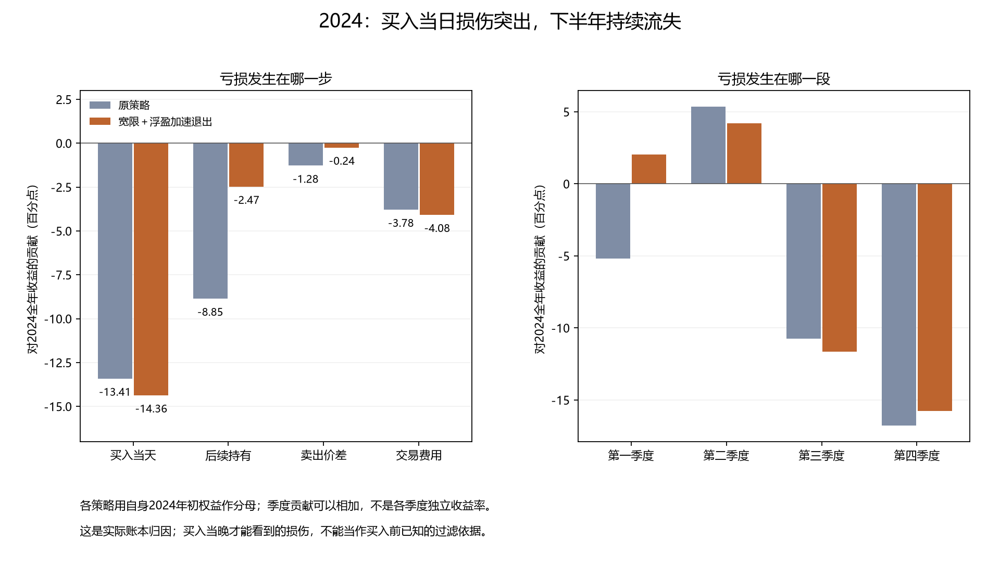

# 2024研究：入场损伤、退出职责与机会时钟

本轮2024研究目标已完成。**找到了一项有跨年对照支持的部分改进：按实际买入成本增加退出线，2024亏损由21.16%缩至12.37%，其他五个完整年份原有收益目标均保住；整套策略仍未全面达标。** 急涨时禁买可以让某条路径的2024转正，但会损伤其他年份，并且对后续交易排期敏感，不能直接视为识别了2024催化因素。

用人话说：上一轮较擅长“已有利润时如何处理”，2024很多损失却发生在“刚买入就受损、一直没赚到过”这一类持仓；此外，推迟某次买入，还会影响以后每轮参与的日期。具体分析应同时检查下单前的依据、买后亏损的处置和后续排期，而不能只找一条全年统一买卖口令。

## 2024究竟亏在哪里

上一轮固定组合的2024年初权益为349,766.513，年末为275,765.241，净亏74,001.272，年度收益−21.157335%。按同一实际账本、各自年初本金拆分：

| 损益环节 | 对2024全年收益的贡献 |
| --- | ---: |
| 买入当天，实际买价到收盘的变化 | −14.3647个百分点 |
| 此后继续持有期间的价格变化 | −2.4708个百分点 |
| 最后前收盘到实际卖出价的变化 | −0.2444个百分点 |
| 实际交易费用 | −4.0774个百分点 |

这支持优先研究入场时点和不利入场后的处置。买入当天的损伤是成交后才知道的，不能直接当作买入前的筛选条件；收盘发现亏损后再卖，也不能追回已经发生的损失。费用没有更改或机械加回作为“修复”。

一个持仓周期指一次实际买入到退出；跨年周期按各年实际损益分摊。全年有14个负年度贡献周期、8个正贡献周期。最大两笔亏损只占所有负贡献的32.17%，前五笔占64.64%；其他周期的盈利抵消了一部分损失，不能说删掉两笔就解释了全年。上半年贡献+6.2513个百分点，下半年−27.4086个百分点，最大回撤31.3439%的区间为5月7日至12月31日。损伤并非只来自一次十月追高。

2024年对全年有贡献且已实际退出的周期，卖单均在首次计划卖出交易日成交，没有卖出受阻。因此当前证据主要指向参与和退出决策，尚没有发现这些损失来自卖不出去的执行故障。年末仍有持仓，2025年1月2日的实际卖出费用不提前计入2024。

下文Z是把最近五日涨幅与更早的日常波动相比的相对加速值，固定门槛为2，不是获利概率或统计显著性。浮盈指按当晚价格估算、扣除双边费用后的未卖出盈亏。单笔收益按该次投入计算，全年贡献按年初本金计算，分母不同。两条代表路径分别是：

- **1月29日买入、2月1日卖出：** 完整周期净亏约11.51%，对2024贡献−12.17个百分点。计划买入的1月26日，相对加速指标Z约−0.037；买入当天约0.485，均未达到2。它不属于本轮“不追急涨”的原覆盖范围，而且整个周期观察到的扣费浮盈一直为负。
- **10月9日买入、10月18日卖出：** 完整周期净亏约10.42%，对2024贡献−9.58个百分点。尚未买入的10月8日，Z约7.56，已满足急涨状态；10月9日收盘持仓亏约8.24%，Z仍约3.66，但原“必须已有浮盈”的退出域不适用。这给出了入场前与持仓后两种不同的可检验动作依据。

2024是两条原代表账户在2020—2025中，唯一买入当日总盯市损益为负的年份。这是已发生账本的差异，并不是当时已经能识别的年份标签。[归因结论](accounting/diagnosis_findings.json)、[原账本核对](accounting/accounting_reconciliation_final.json)、[逐周期表](accounting/actual_2024_cycle_attribution.csv)保留金额、跨年仓、所有周期和必要反例。

## 五组对照各回答什么

所有新规则在各年份按相同状态运行，没有把2024、1月29日或10月9日写成策略条件。五组在新账户计算前固定，保留上一轮“买入当天破位宽限一次＋浮盈相对加速退出”的全部参数，分别改变以下职责：

1. **复现上一轮组合：** 新实现先完整复现EX043 run004，真实账户经济字段须精确一致。
2. **买入前过滤：** 原本已满足入场资格的D，若已有Z>2，就不发该次买单。以后每个符合资格的D重新判断，没有虚构买单或新预约；不等同于永久空仓或只取消一次。
3. **扩大退出域：** 持仓时Z>2就发出次日卖出意图，取消“当前必须有浮盈”的限制，其余条件不变。旧基线2020—2025实际持仓观察中，被浮盈门排除的状态只有3个D、2个持仓周期，不能称为广泛的新风险识别。
4. **前述两种职责组合：** 检查过滤入场后，新增退出还有多少作用，完整路径效果不能由两种单项差值相加。
5. **成本锚退出单臂：** 仅加在原组合上；当晚估算含双边费用的成本损失达到一份此前20日平均真实波幅，即发次日卖出意图。精确式为`entry_fill×1.001−Close_D×0.999 >= ATR20_prior_D`，波幅只用截至D−1的价格。它不要求先有利润，也不必等旧五日支撑破位。ATR逐日更新，波幅缩小也可能令条件跨界；它不是盘中成交指令或实际损失上限保证。

已有待卖和原到期卖出优先，新增风险退出可以覆盖买入日宽限，原预约、停牌、涨跌停、整手、资金和费用合同均保留。旧研究已经用过MA、ATR、浮盈及峰值信息；本轮检验的是动作职责和时点，不称作发现新指标。[固定根方案](design_decision.json)、[旧机制复盘](method/method_review.md)、[反方方法预审](official/method_adversarial_review.json)明确覆盖和限制。

## 跨年反证必须一起看

2024另一个Z>2的原入场是11月22日决策、11月25日成交，其完整原周期实际盈利。2025的同类状态还覆盖6月19日那笔在上一轮组合中已及时兑现的盈利机会。因此，不追相对急涨既可能避开原亏损，也可能错失原盈利，不能根据十月一笔交易的结果预告全年改善。

当前网页上的2024年报总结不能回填为当年已知信号。9月政策背景可以作为历史上下文，但不能倒用于9月18日更早的退出决策，也不能直接给出该股的买卖时机。[已知状态及披露时钟](official/known_state_and_timing_facts.json)保留公司原文、可用日和背景解释边界；这些新增账户没有加入政策或财报变量。

## 五组真实账户结果

| 规则 | 2024收益 | 2024最大回撤 | 2022收益 | 2025收益 | 六年收益达标 |
| --- | ---: | ---: | ---: | ---: | ---: |
| 上一轮固定组合 | -21.16% | 31.34% | +3.35% | +40.73% | 5/6 |
| 急涨禁买：每天重试 | +11.31% | 19.92% | -17.75% | +4.00% | 3/6 |
| 急涨退出不限浮盈 | -20.23% | 30.53% | +7.00% | +40.71% | 5/6 |
| 急涨禁买＋退出扩域 | +11.31% | 19.92% | -17.75% | +4.00% | 3/6 |
| 另加成本锚退出 | -12.37% | 27.75% | +3.36% | +40.72% | 5/6 |

所有收益使用该账户自身年初权益，来自同一条从10万元起步的连续资金路径，没有每年重置或删去事后亏损交易。全五组在2020—2025的年度回撤要求均6/6通过，原完整窗口频率也通过。急涨禁买两格虽然2024收益达标，2021、2022、2025收益不达标；未禁买的三格收益5/6通过，仍卡2024。因此没有符合全部原目标的新策略。

2021急涨禁买收益+69.52%，低于原+71.90%门；2025为+4.00%，低于原+40.187864%门；2022亏17.75%，而原要求严格为正。不能给2024单独启用禁买、其他年份关闭，这会把事后年份名写成策略。

两个“禁买”格的经济账本完全相同，五配置只有四种实际经济和财富路径。放宽浮盈域单独使用仅令2024从−21.16%改善到−20.23%；在已禁买的路径上没有新增经济作用。全部年度结果为：

| 规则 | 2020 | 2021 | 2022 | 2023 | 2024 | 2025 |
| --- | ---: | ---: | ---: | ---: | ---: | ---: |
| 上一轮固定组合 | +33.96% | +110.61% | +3.35% | +19.96% | -21.16% | +40.73% |
| 急涨禁买：每天重试 | +27.01% | +69.52% | -17.75% | +19.44% | +11.31% | +4.00% |
| 急涨退出不限浮盈 | +33.96% | +110.61% | +7.00% | +19.95% | -20.23% | +40.71% |
| 急涨禁买＋退出扩域 | +27.01% | +69.52% | -17.75% | +19.44% | +11.31% | +4.00% |
| 另加成本锚退出 | +35.59% | +116.70% | +3.36% | +17.29% | -12.37% | +40.72% |

[完整30行年度表](accounting/policy_yearly_summary.csv)、[五组总表](accounting/policy_summary.csv)、[五组独立审计](accounting/independent_ex044_audit_summary.json)保留每年基准、收益门、回撤门、各自年初权益和频率；负年度差值用于解释代价，没有另加“每年不得少赚”的门。

## 成本锚退出改善了什么

它最有价值的区别是：即使仍在过去五日最低收盘价之上，也可以因相对实际买入成本亏损过大而安排退出。2024有9个被成本条件选中的决策日，其中6个与原普通支撑退出重合，真正新增的只有3个周期：1月30日、7月15日、10月9日。全2020—2025共26次选中，其中20次重合、6次新增，不能把26次都当新增有效止损。

1月29日买入当晚尚未达到1ATR，1月30日旧支撑仍未破时才达到，次日提前卖出；十月则在买入当晚触发，次日真正卖出后，该周期仍亏约9.33%。它不能追回买入当天已发生的跌幅，也不保证只亏1ATR。该实际路径没有观察到严格的“价格没再跌、仅ATR缩小使条件首次触发”事件；方法上仍保留这种可能性，未改公式。

2023是明确代价：一次原本后来恢复盈利的持仓被提前以亏损退出；该年账户收益由19.96%降至17.29%，仍高于原要求。2022和2025没有新成本退出，小幅收益差来自先前资金和整手数量变化，不能说这两年各自又识别出了新风险。

剔除2025，成本规则截至2024年末的财富为312,130.034，上一轮组合为275,765.241；从共同初始10万元比较，改善并非只靠2025放大。纳入2025后分别为439,233.764与388,082.491，年末持仓按原估值口径计入，不等于全部已经卖出落袋。这是历史开发上的部分改进，尚无独立保留样本验证。

## 为什么另外做了两组机会时钟对照

五组独立复核发现：新“每天重试”的禁买路径在2025实际阻买次数为0，5月30日和6月19日却已经空仓。此前改变买入日期后，原预约和交易节拍已经改变。因此，旧组合曾有三次2025高Z拟买机会，不代表新路径也遇到并拦掉了它们；不能把2025损伤直接归为当年的禁买动作。

这是一项看到五组结果后提出的后续问题，另建EX045固定两个账户，不修改EX044证据、不伪称研究前已经预注册。新源码先精确复现EX044禁买格，再检验同一急涨门在阻买后“跳过本轮计划机会”：从拟下一成交日沿用原预约长度等待，届满再判断。不产生虚构持仓、成本、费用或收益，不根据未来那张买单能否成交选择是否等待；代价是本来可能未成交的机会也会被封窗。

| 拦住买入后的处理 | 2020 | 2021 | 2022 | 2023 | 2024 | 2025 |
| --- | ---: | ---: | ---: | ---: | ---: | ---: |
| 每天重新尝试 | +27.01% | +69.52% | -17.75% | +19.44% | +11.31% | +4.00% |
| 跳过本轮计划机会 | +31.53% | +102.21% | +7.19% | +19.96% | -13.46% | +34.27% |

只改变这一等待规则，2024收益从 **+11.3074%** 变为 **-13.4581%**，2025从 **+4.0043%** 变为 **+34.2681%**。跳过计划机会恢复了2021、2022的原收益达标，但2024、2025仍未通过：六年收益4/6通过，回撤6/6通过，原完整窗口交易频率4.786845通过。它没有同时保住2024转正和2025达标。

这说明该价格门的完整效果依赖如何安排后续机会；不能把一次单年转正全部解释成指标识别了高风险。该对照也不能把收益差线性分成指标贡献和时钟贡献，或宣称计划窗口完全恢复原策略的日期。

[时钟根方案](clock_followup_design.json)、[两组年度表](accounting/clock_policy_yearly_summary.csv)、[两组总表](accounting/clock_policy_summary.csv)、[两组独立审计](accounting/independent_clock_audit_summary.json)保留实际资金与逐年原门。后续时钟没有扫等待长度：它只沿用原下一E与H10预约的关系，阻买D索引i的预约为i+11，最早届满D重新决策、再下一E买入。

## 收口判断与下一步

**可以保留：** 成本锚退出的部分改进，和入场前后职责应区别处理的证据。**当前不支持：** 把“急涨一律不买”作为跨年通用规则，或根据2024转正就宣布识别了该年催化。2024主要损伤发生在实际入场后当天；仅靠收盘后止损仍有无法追回的部分，现有急涨门也没有给出跨年可通用的入场选择。

建议保留成本锚线索与固定原组合作比较基线，下一步优先研究下单前如何识别不利入场，明确区分信息判断和交易节拍。已有均线、支撑收复、阳线过滤等负面证据继续保留；不为2024降低ATR、移动Z阈值或单设年份开关。全目标尚未达成，本轮不推进阶段、不登记候选、不改变历史资格。

## 证据、资源和适用边界

本轮实际派发7次：EX044固定五组含复现对照，EX045自适应选定的两组含复现对照。账户执行全部成功，0账户失败、0未知、0重试；包含重复经济路径和源版本控制，不能当成7份独立验证。0新增行情供应商调用、0新模型拟合、0阈值扫描、0局部反事实收益标签。源实现合成与因果检查、实际账户会计和执行审计、最终报告反方复核用于本轮范围；没有仓库级全量回归或正式策略验收。

独立审计曾有一次未通过：2026技术尾部一笔限价记录为6.099999999999999、成交为6.10，旧助手直接用浮点数比较而判失败。经原准备资产、原公开下单计划和成交函数逐笔精确核验，262笔成交价都与原成交函数返回一致，属于审计断言过强，非账户违反原成交规则。保留[初次失败](accounting/clock_account_001_independent_failure.json)和[边界调查](accounting/clock_limit_boundary_investigation.json)，另建后继审计助手；没有放宽原成交要求、修改平台或重跑账户。

2020—2025全部已见，2024病例和旧结果影响了问题选择；其他年份是历史开发核验，不是新独立样本。每年以自身年初权益计算，整段以共同初始10万元比较；原逐年收益、回撤及完整窗口交易频率目标不变。2026只保留原完整2020-01-02至2026-10-15合同的技术核对及原频率字段，不用于新经济择优或调参。锁前导入环境和审计前缀边界的技术修正已留原件，未引发真实账户失败，交易公式没有据结果调整。

[五组最终公开证据](../../experiments/EX044_20261019/others/final_verification_ref.json)、[时钟实验入口](../../experiments/EX045_20261019/notes.md)、[原账户归因封装](accounting/original_accounts_diagnosis_delivery.json)、[五组独立解释](official/interpretation_results.json)、[反方解读](official/interpretation_adversarial_notes.json)。正式本地材料清单和研究族追加记录在publication.json中，旧实验和注册数量保持。
