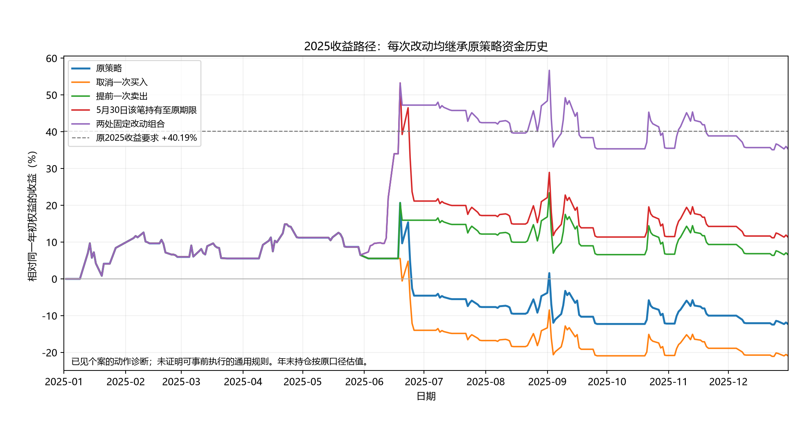

# S014：2025固定动作诊断

日期：2026-10-19。身份：RSCH。用户授权“自主决策，不限制诊断账户数量”，沿用当前研究分支。原目标、数据范围、费用和执行规则保持；不注册正式候选，不进入新阶段。

## 结论与范围

本轮把“公告之后次日涨跌怎样”推进到实际动作问题：如果只改变一次买入或退出，再让原策略继续运行，到2025年末究竟多了还是少了钱。不是把原账本中的亏损删掉，而是真实重算后续交易、费用、资金和期末持仓。

三项固定问题已完成真实账户与独立审计：**取消一次买入使结果恶化；买入后提前退出、以及修正此前那笔过早退出，各自有明显帮助；两处组合后2025收益可由−12.27%提高到+35.34%，回撤降至13.78%，但收益仍比原要求少4.85个百分点。**

2025这个案例表明，有必要分开研究“该继续持有”和“该及时退出”的条件。同一年也会出现不同的决策问题，统一收紧买入或统一提前退出可能产生相反后果。本轮算清了几处已知动作的后果，尚未建立能在当时自动识别这些情形的一般规则；原策略目标仍未达成。

## 第一波：同一公告事件段，两个动作的后果不同

| 独立路径 | 2025收益 | 2025最大回撤幅度 | 相对原策略的年度收益变化 |
| --- | ---: | ---: | ---: |
| 原策略／无干预复现 | −12.2746% | 27.4311% | 0 |
| 取消6月18日收盘发出的那一次买单，之后恢复原策略 | −20.9229% | 31.2732% | −8.6483个百分点 |
| 6月19日买入后，收盘发出下一交易日卖单，之后恢复原策略 | +6.5743% | 13.7861% | +18.8490个百分点 |
| 原2025要求 | 至少+40.1879% | 严格小于28.8759% | 原收益缺口52.4625个百分点 |

回撤指账户从此前高点最多跌了多少。取消一次买入的路径不仅收益更差，还失去原先通过的2025回撤要求。提前退出路径通过2025回撤要求，但收益仍差33.6136个百分点。原完整年份目标没有降低，也没有因局部改善宣布策略合格。[独立账本审计](accounting/independent_account_audit.json)

为什么跳过一次反而更差：它只是取消一张买单，不是持续避开整个风险阶段。策略下一晚又符合原买入条件，6月20日以更高价格重新买入，6月26日仍在原价格退出，结果扩大亏损。这个反证针对“跳过一次再恢复”的设计，不能推广为所有禁买规则均无效。

提前退出路径6月20日实际卖出，保留原再入场预约，直到原规则允许时才重新参与。相对原策略，年末权益增加52,543.150元。其中原6月19日持仓的实际处置现金增加57,171.771元，之后重新参与的差额为−4,628.621元，二者合计等于年末总差额。这是实际成交后的账目恒等分解，不代表两个独立因果来源。因此，“提前卖出能少回吐”在这个固定个案中有实际价值；后续重新参与并没有继续放大全部改善。

这些是原研究价格与数量合同下的账户金额，不是当前实盘报价。三条路径在2025年末都仍有持仓，期末按原规则估值，未假设全部变成现金或强制年末卖出。[原成交约束复核](accounting/independent_execution_constraints.json)

## 第二波：公告之前卖早了，另作独立诊断

原策略5月30日实际买入，同日收盘触发早退，6月3日卖出。三份相关公告都在此后，无法据此提前改变这次动作。

已有B／P方案在这个持仓周期获得较好结果，但它们的年初资金、持仓和全年其他动作也不同。直接用全年收益相减，无法确定这一次早退的贡献。

因此，新诊断从原完整资金历史出发，只对5月30日实际入场的这个持仓周期关闭“跌破此前支撑就提前卖”的权限，保留原第十个持仓交易日的期限及再入场预约；到期退出、卖出受阻和费用照原规则处理，实际退出后恢复原策略。没有修改6月19日动作，也没有在6月3日卖出后虚构补仓。

这一问题已在看到首批新动作结果前保留为独立缺口，具体实施方案见[第二波方法](early_cycle_method/method_plan.json)。它仍然是对已知失败个案的事后诊断，不是已经发现了事前可用的交易信号。

第二波结果：2025收益提高到**+11.3627%**，相对原策略改善23.6373个百分点；最大回撤为27.4586%，略高于原策略27.4311%，仍低于原基准28.8759%，符合原回撤要求。收益距原要求仍差28.8252个百分点。[第二波独立账本审计](accounting/independent_early_cycle_audit.json)

两条路径5月30日买入的研究数量、价格、费用与此前现金完全一致。原路径6月3日退出，新路径6月16日按原到期安排实际退出。新路径的年末权益比原路径多65,891.070元：原仓实际处置现金多79,344.576元，后续参与残差少13,453.506元。后续资本变化会影响6月19日买入规模，因此这两项改善不能被当作两个互不相关的收益来源。

同一笔已见持仓中，提前退出确实错过了后来上涨；这不代表“所有破位都应忽略”。本例在买入当天即触发支撑早退，该周期内实际被屏蔽的支撑退出触发仅出现在5月30日，持仓与后续决策随之沿新路径变化。期限卖单仍然保留，且6月16日实际退出后立即恢复原规则。

## 第三波：组合两处改动，直接核算而不相加

首波提前卖出和第二波延续原持仓分别改善了2025结果，但它们都从原资金历史独立出发。两者组合后，6月19日实际买入数量会随此前资金改变，不能把18.8490与23.6373个百分点直接相加。

按[结果前的条件组合方案](conditional_joint_diagnostic_plan.json)，在第二波单改动有改善、且6月19日仍有真实合资格持仓后，只追加一个固定组合：5月30日该笔保留原期限，6月19日收盘对实际当前持仓发出下一交易日卖单，保留其期限、预约和卖出受阻处理。固定日期、数据及年末终点不变，未选择其他有利日。

| 全年路径 | 2025收益 | 2025最大回撤幅度 | 2025收益／回撤原要求 |
| --- | ---: | ---: | --- |
| 原策略 | −12.2746% | 27.4311% | 收益未达标／回撤达标 |
| 仅修正5月底该笔过早退出 | +11.3627% | 27.4586% | 收益未达标／回撤达标 |
| 仅修正6月19日买入后的退出 | +6.5743% | 13.7861% | 收益未达标／回撤达标 |
| 两处固定改动组合 | **+35.3392%** | **13.7756%** | **收益仍未达标／回撤达标** |
| 原2025要求 | 至少+40.1879% | 严格小于28.8759% | 两项同时满足 |

组合路径年末权益377,270.052元，比原路径多132,727.811元；对应年度收益改善47.6138个百分点，剩余收益缺口4.8487个百分点。两项独立改动的年末财富差之和只有118,434.220元，组合额外增加14,293.591元，或5.1276个年度百分点。这是后续资本与交易参与交互的账目描述，不是两项独立因果效应；真实组合计算替代了错误的简单相加。[组合独立审计](accounting/independent_joint_account_audit.json)

组合在6月19日实际买入48,200研究单位，次日实际卖出；原单独提前卖出路径为37,900研究单位。前一处改动增加了后续可用资本，所以第二处动作的实际金额发生变化。组合相对仅H10路径额外改善66,836.741元，其中该6月原仓实际处置差72,709.218元，随后参与差−5,872.477元。组合年末仍持有62,900研究单位、现金3,644.052元，收益包含未平仓估值。

原2022、2024失败年份没有被2025动作修复。原完整年度审计仍为收益4／7、回撤7／7；其中2026只是原全窗技术尾部，本轮不据其选择动作或声称新增经济验证。没有新增有效组件、登记候选或全目标合格策略。

图的所有曲线统一使用原2025年初权益归一化；不是各自在第一次改动时重新放入相同本金。三波243个交易日的原策略和无干预净值逐值一致。[图数据完整性](plot_input_integrity.json)

## 能确认什么，不能确认什么

1. 不同问题需要不同的动作比较。买入后次日上涨，不能证明应该一直持有；取消某次买单，也不等于后面不会再买。
2. 6月18日空仓节点与6月19日持仓节点知道的公告不同。两项结果不能解释为在相同信息下纯粹改变仓位状态，更不能证明新增公告文字独自预测了下跌。
3. 三份相邻公告只构成一个2025事件段。多个文件、多个连续持仓日或几个改动账户，不会增加独立事件数。
4. 每个改动各自从原完整路径出发，统一比较2025年末财富。局部百分比使用各自决策日权益；年度收益变化统一除以原2025年初权益278,758.908元。两种分母不混用，不把不同路径效果直接相加。
5. 第二波若改变了原仓退出现金，就可能改变6月19日及以后买入规模。与第一波提前退出的局部效果不能直接相加；本轮未预设联合改动一定达标。
6. 原2020年至2026全窗只用于保留技术和控制合同；2026不用于挑选2025动作、经济终点或报告新的动作收益。所有数据均已见，不称为独立验证样本。

这里回答的是原交易规则改变后的账户后果，尚未证明某个唯一市场催化因素。公司披露经营未发生较大变化，不能单独证明上涨没有合理预期，也不能自动变成次日下跌预报。原公告的时点与信息边界见[已知信息复核](../20261019_2025_action_method_review/official/known_information_review.json)。

## 执行与核验

第一波无干预账户与原C0056全部原经济字段及原信号逐项一致，独立账本复核307,071项。新增成交约束复核直接读取原已认证数据资产，对全部三条成功路径的840张订单重套原成交规则，增加5,766项检查；成交价格和每日收盘价格差为0。新增账户收益不是简化账本或虚拟现金推算。

第一版无干预账户因新增诊断观测列为布尔类型，被运行接口拒绝。失败保留；修正仅把新增诊断列按接口要求转成数值，原交易逻辑不变。修正后55项合成检查通过，重新运行无干预校验成功后才执行处理路径。另有一次包目录命名准备失败，未派发账户。设计中诊断简称与实际绑定编号的不一致通过勘误披露，结果依据完整源码、参数、运行及证据哈希识别，未覆盖任何已登记候选。

原行情副本的重复留证操作被自动审批拦截，操作未执行；后续改用原PreparedDataRef进行公共只读读取，完成成交约束审核，不复制行情、不调用供应商，也不向外部发送数据。这未影响实际账户结果和独立审核。

第二波251,950项独立账本检查及3,844项原成交约束检查通过，真实无干预等价已先通过，处理路径原持仓资金前缀与期限／预约核对通过。第三波284,824项独立账本检查及3,844项原成交约束检查通过，组合6月19日前与仅H10路径一致，原预约和全部后续交易已核。每个新增源码均先完成真实无干预等价，再运行处理账户。

累计真实派发**8次：7次成功、1次技术失败**；一次包目录构建失败未派发账户，另列记录。新增供应商行情调用、模型拟合、正式候选登记、生产变更均为0。[最终资源及路径核验](accounting/resource_and_path_review.json)

此前研究和已发布证据均保持原样；本轮只追加研究材料及研究记录，不改变历史资格或验收结论。[授权](authorization.json)、[运行前决策规则](research_decisions_before_results.json)、[原证据完整性基线](baseline_integrity.json)

## 研究建议

本轮2025固定动作诊断目标已完成，原策略收益目标仍未达成。“仅取消这一次买单便能保护账户”已有明确反证；两种退出调整以及组合有实际改善，但均为已见日期的局部例外，不能直接转成交易规则。

下一步建议分别研究两类当时可以识别的条件：第一类是买入后出现破位，什么时候应继续持有、什么时候必须退出；第二类是上涨及风险提示后，什么时候应退出以减少回吐。检验应围绕实际完整持仓路径和后续参与，保留反例，并在其他已授权年份寻找可比情形。

本轮不继续追加历史日期例外来凑够剩余4.85个百分点。现阶段需要回答的是如何在决策当时区分上述情形；继续手工挑选事后有利日期无法回答这个问题。后续路线不改变原收益、回撤、频率要求，不据这次诊断自动推进阶段或更改历史候选资格。
