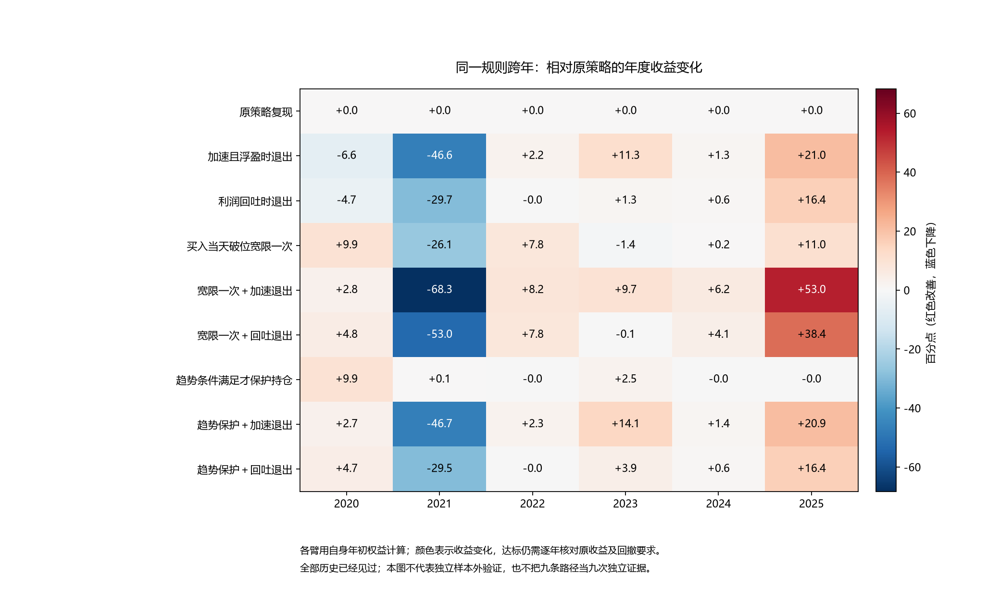

# 持有与退出的事前依据：跨年研究结论

本轮研究目标已完成：使用交易当晚可见的信息，固定九种持有与退出组合，跑完真实连续账户，并在2020—2025逐年核验。发现了具体的部分突破：**“买入当天破位宽限一次＋已有浮盈时的相对加速退出”让2022年、2025年达到原收益和回撤要求，但2024年仍未解决，整套策略尚未全面达标。**

这里的“事前”指每次决策只使用当晚及此前已知数据；九种规则是在本轮账户计算前固定。所有年份此前均已见过，2025案例也参与了问题选择，所以这些是历史开发证据，不能称为全新样本外验证或未来获利保证。

## 先用人话回答

**什么时候值得继续持有？** 本轮较有用的依据是“刚买进去，当天收盘跌破原支撑，先给一次确认机会”：只宽限买入当天的一次普通破位退出，下一交易日恢复原支撑规则。它支持有限的确认期，并不支持“既然买了就一直等上涨”。单独这样做，2022从亏损转正，但2025回撤反而恶化，必须交代代价。

**什么时候应该退出？** 已有扣除双边费用的浮盈，且最近五天的上涨相对此前日常波动明显加速时，次一可交易日卖出，是本轮较有用的风险处理线索。它表达“手里已有利润，走势突然加快，可以先兑现”，不能预测最高点，也不表示每次加速之后都会下跌。只加这个退出规则，2025虽转正，仍达不到原收益要求；与宽限一次结合，才在这批历史中同时改善参与上涨和保住利润。

**不能泛化成看涨就拿、看跌就卖。** 另一条“均线仍向上、破位不深就保护整个原持仓周期”的规则，在2025没有实际激活，无法解决5月底案例。利润已经回吐再卖的规则也有改善，但不及上述组合满足本轮原目标的年数。

## 实际结果

以下每年收益均用该账户自身年初权益计算，来自同一条自2020连续运行的资金路径；没有年初重置、单独挑交易或忽略后续买卖。

| 年份 | 原收益 | 组合收益 | 原最大回撤 | 组合最大回撤 | 组合收益／回撤达标 |
| --- | ---: | ---: | ---: | ---: | --- |
| 2020 | +31.13% | +33.96% | 24.39% | 16.97% | 通过／通过 |
| 2021 | +178.89% | +110.61% | 30.50% | 21.53% | 通过／通过 |
| 2022 | -4.84% | +3.35% | 13.77% | 13.19% | 通过／通过 |
| 2023 | +10.21% | +19.96% | 7.43% | 6.66% | 通过／通过 |
| 2024 | -27.32% | -21.16% | 37.89% | 31.34% | 未通过／通过 |
| 2025 | -12.27% | +40.73% | 27.43% | 15.07% | 通过／通过 |

2025原收益要求为 **+40.187864%**，组合实际 **+40.729299%**，仅高约 **0.54个百分点**；最大回撤 **15.073724%**，低于同期买入持有基准 **28.875876%**。因此2025按原要求通过，但收益余量较薄。2022同期基准为负，原要求是策略收益严格大于零，组合 **+3.347818%**，回撤也通过。

2024组合仍 **−21.157335%**；同期基准为负，原要求仍为正收益，因此未通过。这个缺口不能通过“已经少亏”来改写达标结果。2021组合虽然比原策略少赚约68.3个百分点，但 **+110.61%**仍高于原收益要求 **+71.90%**；这属于明确的机会成本，不是新增否决条件。

固定九种组合的完整收益表：

| 规则 | 2020 | 2021 | 2022 | 2023 | 2024 | 2025 | 收益达标年数 |
| --- | ---: | ---: | ---: | ---: | ---: | ---: | ---: |
| 原策略 | +31.13% | +178.89% | -4.84% | +10.21% | -27.32% | -12.27% | 3/6 |
| 只加速退出 | +24.54% | +132.25% | -2.59% | +21.54% | -25.98% | +8.68% | 3/6 |
| 只回吐退出 | +26.40% | +149.22% | -4.87% | +11.56% | -26.71% | +4.10% | 3/6 |
| 只宽限一次 | +41.02% | +152.76% | +2.93% | +8.77% | -27.17% | -1.31% | 4/6 |
| 宽限一次＋加速退出 | +33.96% | +110.61% | +3.35% | +19.96% | -21.16% | +40.73% | 5/6 |
| 宽限一次＋回吐退出 | +35.94% | +125.93% | +2.93% | +10.09% | -23.26% | +26.08% | 4/6 |
| 趋势条件保护 | +41.02% | +178.96% | -4.84% | +12.69% | -27.33% | -12.29% | 3/6 |
| 趋势保护＋加速退出 | +33.84% | +132.14% | -2.57% | +24.28% | -25.97% | +8.67% | 3/6 |
| 趋势保护＋回吐退出 | +35.87% | +149.38% | -4.84% | +14.07% | -26.73% | +4.12% | 3/6 |

完整54项逐年收益、回撤、基准、阈值及各年达标字段见[年度表](accounting/policy_yearly_summary.csv)。九条账户的全原窗口交易频率均为每60交易日 **5.042631**次闭合交易，高于原要求3次；完整2020—2025的同类诊断值为 **4.989691**次，单列而不替换原频率口径。组合在六个完整年份中收益通过5年、回撤通过6年；九条均没有满足全部年份原目标。

## 改善来自哪里，也付出了什么

2025只宽限一次：收益 **−1.31%**、回撤 **31.46%**，回撤不达标。只加速退出：收益 **+8.68%**、回撤 **10.10%**，收益不达标。二者组合：收益 **+40.73%**、回撤 **15.07%**。这说明“不要刚买就过早卖”和“已有利润时及时退出”各有职责；这批数据中两者结合的完整路径优于两种单改。差值不是可相加的独立因果贡献，也没有构造新的局部反事实标签。

2022转正的三个组合都包含买入日宽限；没有宽限的六个组合仍亏损。纯加速退出在2022本年没有新增触发，但其年收益仍与原策略不同，部分差异可来自上一年末已退出、跨年持仓和资金历史不同。因此不能把2022的年度差值都归为本年识别出了新的风险信号，详见[年度归因补充](accounting/research_findings.json)。

在实际组合路径上，2025-05-30是刚买入后破位的D：规则保留持仓，下一执行日是2025-06-03；2025-06-19是已有浮盈且相对加速的D：规则发出卖出，下一执行日2025-06-20。它们由统一状态规则产生，没有把这两个日期写进策略。后续机会、原H10截止、预约期、卖出受阻继续卖、交易费用和资金占用均保留。

该路径5月底持仓随后在6月3日恢复普通支撑规则，当时已不再破位，并于6月16日实际卖出；并非把“宽限一次”暗中改成全周期保护。实际买卖、费用口径和同条件消融见[独立解释复核](official/interpretation_results.json)。

但剔除2025再看截至2024的同一连续路径，组合终值 **275,765.241元**，略低于原策略 **278,758.908元**（初始均10万元）。因此不能说其他年份已证明它具备整体财富优势。纳入2025后，组合终值 **388,082.491元**，原策略 **244,542.241元**；两者年末均还有持仓，终值是当日持仓估值加现金，不是已经全部卖出落袋。组合的实际资金增加也高于原策略，2025改善并非只靠降低年初分母。

2024组合实际宽限3次、加速退出4次，年度收益有所改善仍亏损。已有证据只能说明这两类动作不足以解决该年的损失，尚不能确定损失究竟主要来自入场机会、持续弱势还是其他驱动。不能把“这个年份没修好”直接解释成催化因素已被识别。

## 规则到底用了哪些当时已知信息

- 宽限：仅实际买入成交当天，暂停一次普通支撑破位退出；已有待卖和到期强制卖出优先，不受保护。
- 趋势保护：实际买入日破位，收盘不低于此前20日均线、均线高于五天前、破位深度不超过此前20日平均真实波幅，才保护该原持仓周期。平均真实波幅（ATR）就是把每日正常波动换成价格尺度。
- 加速退出：实际持仓、非强制退出状态，D收盘估算扣双边0.1%费用后的浮盈大于零，且最近五日对数收益之和除以“更早20日收益标准差×√5”大于2。前后窗口不重叠；“2”不是显著性或获利概率。全部路径的SHOCK条件成立状态里，最小五日涨幅约2.95%；实际选中SHOCK卖出动作中的最小值约4.29%。条件成立和实际改变动作分别统计；它描述相对平时的加速，不能一概说暴涨。
- 回吐退出：截至D的真实持仓收盘最高价，扣费后获利尺度达到此前20日ATR的2倍，且从该最高收盘价回落至少1倍ATR。它可能在当前已无浮盈时触发；ATR缩小也可能使条件跨过阈值。九条重叠路径上的9行此类现象只对应一个2025-10-29事件，不能当作9次独立证据。

最高收盘价只从实际成交日起滚动记录，不拿成交价冒充收盘价，不取未来最高价，每次新持仓重新开始。全部计算沿用原运行时的复权价格尺度，成交约束和资金账本使用原执行规则；缺失或零波动不会被补成有效信号。原始观察群体为1455个决策日，其中668日实际持仓、639日可自主处置，不能只挑盈利或某个年份来定义总体。

## 研究判断与下一步

支持保留的是**“持有需要确认期，已有利润后的退出承担另一种职责”这一具体结构线索**。这并不引入新的信息源；均线、波幅、浮盈、峰值等在旧研究里已经出现，新检验的价值是把职责、实际持仓状态与后续完整资金路径明确连接起来。规则组合的历史改善值得保留，尚不足以成为可推广的统一买卖信号。

用户提出“不同年份需要区别看待”是有研究价值的：同一组规则解决了两年的原缺口，却没有解决2024。但按事后年份分别写规则会造成挑答案，应继续寻找当时可识别的状态差异。**建议下一步保留这组固定规则不调参，优先诊断2024剩余亏损发生在哪类实际持仓和入场机会，再判断需要入场筛选、亏损持仓处置还是其他信息。** 2025收益门余量较薄、2021机会成本明显，未来正式自检仍需研究；本轮没有宣布阶段推进、登记候选或修改历史资格。

## 证据与验证范围

身份RSCH，沿用研究分支；用户授权自主诊断且不限制诊断账户数。本轮固定九账户全部成功，0失败、0未知、0重试，0新增模型拟合、0阈值扫描、0新增行情供应商调用。锁前一次纯合成观察字段命名错误已保留，不属于真实账户失败。所有原目标、费用、T+1、限价、停牌和整手约束沿用；2026仅保留原完整执行合同的技术核对，不作为新经济验证或调参年份。

[实验入口](../../experiments/EX043_20261019/notes.md)；[固定方案](design_decision.json)；[执行前源码锁](../../experiments/EX043_20261019/protocols/execution_lock.json)；[公开账户索引](../../experiments/EX043_20261019/others/accounts_index.json)；[独立账本及逐年审计](accounting/independent_policy_audit_summary.json)；[状态与时点审计](official/method_observability_audit.json)；[总表](accounting/policy_summary.csv)；[实际动作表](accounting/policy_trigger_events.csv)。原账户复现与原经济字段精确一致，派生金额和比率采用事先声明的浮点算术容差；已核实际持仓状态、成交规则、费用、现金、数量和净值。九条经济路径确有区别，但不是九份独立验证；未做仓库级全量回归或正式策略验收。
