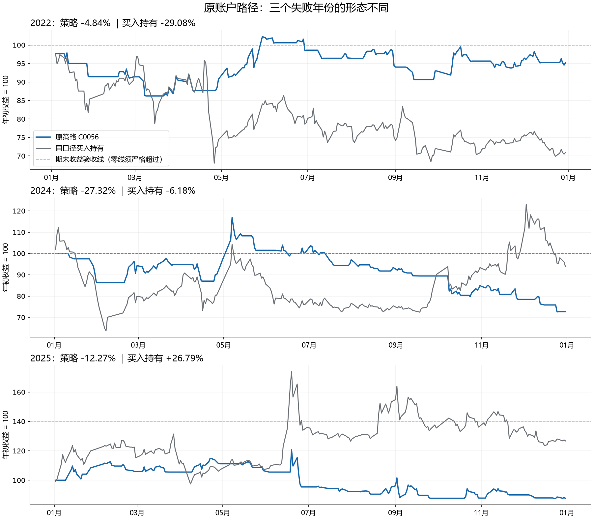

# S014：三个失败年份的驱动、事前可识别性与跨年对照

日期：2026-10-19。身份：RSCH。用户授权自主回答：三个失败年份分别有哪些主要驱动，交易当时能否识别，其他年份能否找到相似情形。沿用当前研究分支。原费用、执行、逐年目标及历史候选不变。

## 1. 用人话回答

**三个年份的短板确实不同，值得区别研究。现在可以定位主要损益路径、核对部分当时已公开的信息；仍不能把每年的涨跌归结为一个已经识别的催化因素，更没有证明一套按年份切换的交易规则有效。**

| 年份 | 主要问题定位 | 当时可识别的信息与当前边界 |
| --- | --- | --- |
| 2022 | 盈亏反复抵消，价格贡献−0.90个百分点，再叠加−3.94个百分点费用，净收益−4.84%；相对买入持有−29.08%已有防守，但没有转为盈利 | 行情状态可观察，控制权拟变更和终止定增也有公开日期；它们未被识别为全年亏损的唯一原因，不能只按“熊市”或“费用”处理 |
| 2024 | 下半年策略贡献−27.52个百分点，而同期基准贡献+17.75个百分点；买入损伤、持有行业弱势、错过反弹及后段再入场回吐并存 | 9月政策信息在当时公开，但不能直接推出该股该买多少或持有多久；过去20日强弱状态也没能稳定区分入场风险 |
| 2025 | 六月贡献−11.05个百分点，接近全年−12.27%的亏损规模；提前退出后错过一段上涨，后来重新买入又遇到回吐 | 6月17日起的异常波动／风险提示在保守时钟下可用于后续决策；部分公告还称近期公司甲醇销售价没有较大变化。但公告后的买入日与继续持有日表现不同，不能统一当成禁买／卖出信号 |

年度或半年度贡献均以该年年初权益为分母，不能把其中一个时段称为独立策略收益。2022的收益目标是严格大于零；2024同样要求盈利；2025要求至少+40.19%。代表方案C0056的年度回撤已7/7满足，接下来的改进还须保住这一表现。

**新的突破口是把催化背景、原持仓时钟和具体动作连起来。** 2024与2025有不同公开背景，也有类似的“先离场、错过上涨、再参与时承受回吐”路径。相同信息对入场和持有可能有不同含义。当前证据支持进一步提出有针对性的动作问题，尚不支持直接采用新策略。

## 2. 证据和方法

本轮复用EX023正式C0056完整账户及同一结果内的可执行买入持有基准，覆盖原1642个交易日。结果身份为`423a1ccf05574d17eb4fa3d5984de02dc869c7387cbe66bf4f502b54c7510ef6`。不替换为理论收盘价基准，不删旧交易重新拼收益。

三个层次分别处理：

1. **账本定位：**逐日、逐月、全7年核对买入日、持有日、卖出日和费用，按原自然年分母汇总。原账户价格与数量为锚定的`HFQ_RESEARCH`／`RESEARCH_UNIT`投影，按同一账本单位计算货币，不把研究数量乘原始股价。
2. **事前状态：**严格用前一股票交易日D的信息解释下一执行日E的原账本变化。市场／行业过去20日分为共同上涨、共同不涨、分化，再乘个股上涨／不涨，共6类；预热不足保留未知。股票20日是简单收益，指数20日是对数收益，只比较零边界符号。
3. **公告状态：**在已完整的2020—2025官方目录中，按固定标题规则保留全部14份股票交易异常波动／风险提示。公告日之后首个股票交易日收盘才保守视为可用，之后10个D交易日内记为公告已知状态；2026目录有缺口，不用于该效果对照。

D的姿态分为计划买、计划卖、继续持有、继续空仓，并核对280张原订单。实际成交阶段仅用于会计归因；例如6月17日买入失败后的`action=SELL`是目标归零重置，不是假设下一日要卖。142次原买入计划含4次未成交，均未按结果删除。

[固定设计](design.json)、[独立方法预审](pre_review.json)、[主分析锁](main_lock.json)、[公告分析锁](warning_lock.json)均在各自新分组结果前通过本地公共API固化。没有扫描窗口、阈值、年份规则或模型。全历史早已使用，本次其他年份和过去年份对照属于开发研究，不是新的独立验证。

图中每年年初权益归一为100；虚线表示期末收益验收要求，不能当作年内动态买卖线。[原日面板](state_driver_daily_panel.csv)、[原账户月度盘点](accounting/monthly_existing_accounting.csv)

## 3. 三个年份具体发生了什么

### 2022：防住了一部分下跌，却没有留下足够盈利

原账户净收益−4.8368%，买入持有−29.0760%。一月对年度权益贡献约−8.57个百分点，五月约+11.35个百分点，存在明显抵消。全年价格部分贡献−0.9013个百分点，费用−3.9355个百分点；这解释账面结果，不等于降低费率或减少某些交易就能改善真实账户。

在实际无成交持有日，将原损益按同期市场、行业相对市场、个股相对行业的收益作精确加法拆分，三项分别约+6.78、−2.68、−6.59个百分点，合计原持有项−2.49。即使全年的市场环境偏弱，策略所选持有日的市场坐标仍为正，不能把原损失直接全归为市场下跌。

公司2022半年报披露上半年归母利润同比+29.67%；次年年报描述甲醇价格多次起落、需求与成本压力，并报告全年归母利润同比+2.95%。这些事实也不支持简单的“经营崩坏导致全年策略失败”叙事。半年报到8月才可用，年报次年才可用。

10月15日公司同时公告控股股东拟变更及终止玻纤相关定增等计划，保守可用于10月17日收盘决策、10月18日执行。两件事同日发生，无法拆为独立冲击，更无法解释1月已经发生的损失。它们提示财务数据之外存在公司事件，尚未量化其可交易效果。

**判断：2022更像盈利余量不足、阶段盈亏抵消和原交易路径成本共同形成的缺口。尚未找到可事前选择掉亏损的单一催化依据。**

### 2024：年度短板集中于下半年，不能只解释为年初熊市

上半年策略相对年初权益贡献约+0.19个百分点，下半年−27.52个百分点；同一下半年买入持有贡献+17.75个百分点。下半年买入和其他持有日贡献分别约−12.84、−12.72个百分点，不能只处理买入后的止损。

一个已在EX033见过、不能冒充独立新发现的案例是：9月13日三个方案同日买入；C0056在9月18日按支撑破坏退出，固定H10及浮盈退出方案继续持有至10月8日。9月19日至10月8日C0056保持空仓，之后10月9日三者同日重新买入，又一起承受后续下跌。这既包含提前退出的机会损失，也包含共同再入场风险。[同入场价格与费用核对](accounting/same_entry_price_fee_comparisons.json)

9月24日国新办发布会公布降准降息及支持股票市场的新工具，是可核实的公开政策背景；它发生于上述空仓期间。但不能据此认定该股上涨的全部原因，或推导事先可以准确买在起点、卖在10月高点。[央行官方实录](https://www.pbc.gov.cn/en/3688110/3688172/5188125/2025112114573374594/index.html)、[上下文与日期说明](policy_context.json)

持有日会计拆分约为市场−1.90、行业相对市场−8.98、个股相对行业+2.03个百分点。该坐标显示持有期间行业弱势的重要性；但全年入场损失另有−13.41个百分点，且拆分不是行业变化的因果效应。公司年报后来披露2024甲醇毛利率改善，不能倒填为当年已知信号，也不能把经营改善等同于股价和交易时点正确。

**判断：2024需要同时关注入场质量、行业环境与行情转折期的参与衔接，单纯“所有弱市都不买”解释不了全部问题。**

### 2025：六月的提前离场与后段再参与，是最清楚的路径短板

六月对全年权益贡献−11.0486个百分点，其中买入日+15.2275、其他持有日−23.2491。全年持有日会计坐标约为市场+17.27、行业相对市场+10.76、个股相对行业−57.73个百分点，合计−29.70。原策略持有期间个股相对行业的损伤突出；不能解释成市场和行业同期都在拖累。

原序列核对如下：

- 5月30日三个方案同日买入；C0056于6月3日卖出，该周期净收益约−2.93%；B／P持有到6月16日，约+23.58%。说明原提前退出确实遗漏了一段随后上涨，但不证明当晚已能预知。
- 6月17日三个方案的限价买单均未成交；6月19日三者均按原规则买入。因此后段入场不能归咎于C0056独有的预约，也不能声称取消预约一定赚钱。
- 6月19日C0056买入日贡献约+15.13个年度百分点，随后持有回吐；6月26日退出，该周期净收益约−10.56%。B／P后续也亏损，单纯放弃提前退出不是完整解法。

6月17日公告按原保守时钟已可用于6月18日收盘决策、6月19日执行，早于该次实际买入。6月18日更详细的风险提示称近期公司甲醇销售价没有较大变化，保守要到6月19日收盘决策才可用。这个细节区分了两种问题：**较早公告可能用于入场选择，较晚公告只能用于后续持有决策；不能把两份信息都提前用。**

这削弱“公司近期销售价猛涨足以解释当时股价”的简单解释，但未识别真实买卖主体、市场预期或唯一上涨催化。2025半年报和次年年报的行业解释都是相应时段之后披露；2026批准的风电项目也不能倒写为2025催化。

**判断：2025最值得追问的是急涨背景下入场、持有、退出与原H10时钟的配合。账本定位很强，催化的因果识别及新动作收益仍未建立。**

上述官方事实、页码、原文与可用日统一见[原文事实表](official/official_driver_facts.json)。公司陈述、账本事实和本报告判断分别保存。

## 4. 事前能识别状态，是否就能知道该采取什么动作？

**目前不能。** 六种状态都按D日可知信息固定，但同状态在其他年份有明显相反结果。

| 固定事前状态及D姿态 | 目标年原结果 | 跨年反例／过去参照 |
| --- | --- | --- |
| 市场行业共同上涨、个股上涨；计划买入 | 2024共8日，次日账户平均−2.4614%，年度贡献−17.26个百分点 | 其余年份31日平均+0.5226%；只用此前年份22日也为+0.2095% |
| 市场行业共同上涨、个股上涨；继续持有 | 2025共46日，次日账户平均−0.4672%，年度贡献−22.93个百分点 | 此前年份166日平均+0.3328%；2024同格年度贡献+19.24个百分点，2026贡献亦为正 |
| 市场行业共同不涨、个股不涨；继续持有 | 2024共26日，年度贡献−15.08个百分点 | 2022同格40日贡献+17.74个百分点，2025同格12日贡献+8.93个百分点 |

这里平均的是原账户下一日收益，贡献使用原年度权益分母；不能把同格正负差直接称为新规则收益。跨年参照还没有平衡全部持有年龄、浮盈、事件背景和时间相关性。

这说明“状态出现得更多”和“同一状态下赚钱能力改变”必须分开看。能在当晚读到涨跌状态，不代表它已经准确告诉我们2024该少买、2025该早卖。不能再按目标年份更改方向来补齐回测。

[全部196格及392项跨年参照](state_driver_analysis.json)、[主统计独立复核](state_driver_independent_review.json)：1642日、82个月、原单位、订单、四项账本及持有日三项坐标均重建一致，83,759项检查通过。

## 5. 一个新的具体信息对照：公告已经披露后，入场与持有有何不同？

2020—2025共30个完整日期叶片、450条原公司公告中，固定标题规则检出14份文件，按时间重叠合为6段公告期。2026目录不完整，未用于此效果对照。初期历史窗口不足单列未知。[完整性与原引用](official/catalogue_coverage.json)、[14份库存与时钟](official/events_2020_2025.json)

只比较原次日财富变化，不模拟新动作。主要结果如下：

| D日姿态 | 已知公告状态 | 非公告状态 | 同六种价格状态对照后的组差 |
| --- | --- | --- | --- |
| 计划买入 | 7日，原次日平均+5.8694% | 118日，+0.1500% | 约+5.9122个百分点 |
| 继续持有 | 42日，原次日平均−0.6140% | 504日，+0.2030% | 约−0.5859个百分点 |

共同格按固定原始最小组数加权，没有控制所有年份组成、持有年龄或浮盈，也没有把未成交买单删掉。少数极端交易日与原持仓选择可能驱动结果。

这反驳“公告后入场日通常立即受损”的简单叙述：已知公告后的原买入日往往仍有较大上涨，2025那一次尤其明显。但它不能判断禁买后的完整账户是否更优：6月19日入场日为正、整周期为负，正好说明必须比较完整动作。对“公告后持有风险值得研究”，有有限线索：2021、2024、2025的公告后原继续持有日平均为负；但2022的9个同类日平均+0.6749%，并不支持统一卖出。该年唯一异常波动公告是在下跌后发出，公告本来就不都是同一种风险背景。

逐段删除还显示明显集中性：删去2021年9—10月公告段后，固定共同格持有组差转为约+0.2257个百分点；删2022段会失去一个原共同组，结果保持null；删2025六月段后差异缩小但仍为负。不能把42个连续持有日当成42次独立催化，更不能只挑对结论有利的删除。2024年两次匹配公告在5月和12月，本固定W并未覆盖9—10月那段主要参与问题，因此不能承诺用公告路线同时修复2024。

**判断：找到“同一公开信息对入场与持有可能有不同用途”的有限线索，尚未建立可跨年稳定采用的公告交易组件。** 公告前后的原收益关联，不能直接回答卖出、持有现金及之后再参与的完整动作价值。[固定结果](warning_state_results.json)、[逐日成员](warning_state_rows.csv)、[独立复核](warning_independent_review.json)。公告独立审计重新核验30份原目录、30份请求、14个事件、6个时间段与各次整段删除，共90,993项检查通过。

原文反方检查还否定了一种容易讲顺的故事：2021与2025多份公告都说主营未重大变化；2021年2月的公告也说甲醇市场价回落、近期无上涨趋势。不能预设“2021盈利靠经营改善，2025亏损靠炒作”。而市场价、公司实际销售价和所有基本面事件也不能混为一谈。[逐文质性审查](official/warning_content_review.json)

## 6. 对原研究判断的更新与下一步

对用户问题的回答是：

- **主要驱动是否不同：**损益路径和可核的公开背景确实不同；2022更接近盈利余量不足，2024入场和行业／转折参与并存，2025急涨前后持仓路径特别突出。公司事件与政策是竞争解释和背景，尚无唯一因果催化识别。
- **当时能否识别：**部分价格状态、公告和原持仓时钟可以；年报事后总结不可以提前用。已知信息还不足以稳定决定动作。
- **其他年份能否验证：**已经找到相似交易路径与公告情形，也找到强烈反例。简单价格状态不能稳定外推；公告与持有的线索有集中性和2022反例，因此未证明稳定交易优势。

建议后续只优先评审一个明确的动作问题：**急涨并已有公开异常波动／风险提示时，原策略已持仓的继续持有价值，是否不同于尚未入场的参与价值？在正确计入卖后再参与的前提下，原H10与支撑提前退出各遗漏什么？** 区分公告记载的上涨／下跌背景应以事前事实定义，不能按事后盈利改标签；当前仅列为后续机制评审，不追加第二套公告窗口或新账户。

这个问题相对旧EX033的新增处，是公开事件时钟与真实全部决策姿态，不限于100个已配对的首次支撑破坏；相对旧EX034/35，锚点要明确是C0056的H10与预约，不能把C0011的E9动作值直接搬来。旧P/D退出、单纯延长期限和原反证全部保留。后续若只是将原状态重新命名，或没有足够可比事件，应停止追加，不为维持研究而拟合。

2022不硬并入同一急涨修复规则，保留为另一个盈利余量问题；2024的政策转折参与衔接也单独保留，目前有公开背景和账本，尚未形成可跨年复用的政策事件分类。优先评审2025公告相关动作，不等于已有办法一并修复另外两年。也不因此调低费用、减少频率要求或改变年度目标。后续机制有价值仍须评审，再决定阶段二具体检验及获批后的阶段三账户。

## 7. 完成状态与验证边界

本轮获准问题的研究已完成，包含原账户定位、固定事前六状态／跨年对照、完整官方公告时钟及唯一固定公告状态对照、原文反方核对。新增模型拟合、参数搜索、行情调用、反事实账户标签、完整或局部账户、候选、组件定义均为0；新增获支持交易组件0，新增合格候选0。官方材料同源读取24次成功，另核对央行公开历史说明，不能把这些读取说成零资料调用。

正式本地证据见publication.json；原39个实验、28项组件定义、66个策略候选、另69个EX035诊断账户、COMPONENTS/22和原研究状态均保留。横向诊断不等于自动进入下一阶段，不恢复历史耗尽的搜索额度。源码聚焦检查、17项主合成检查、14项公告合成检查及独立数值／报告审查用于本轮范围；没有运行仓库级全量回归，也没有重新验收策略经济目标。

**S014原策略目标仍未达成。本轮成果是更准确的问题定位和有限的新信息用途线索，不是三年已经修复。**
