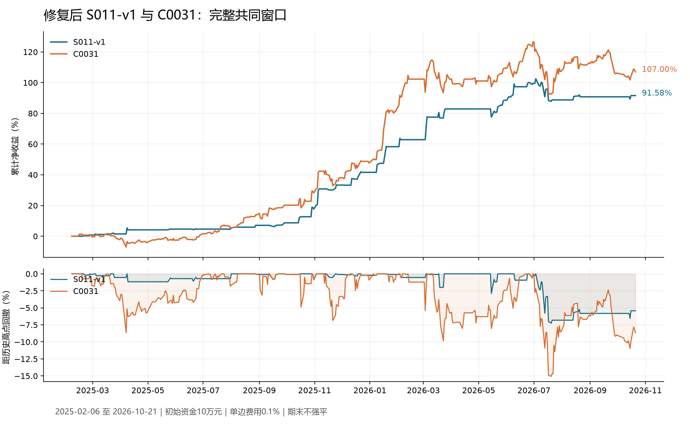

# 修复后 S011-v1 与 C0031：完整共同窗口对照

Status: COMPLETED

RSCH，2026-10-22。已按用户授权重新执行两份独立 TDR 回测，原策略和既有证据保持不变。

**结论：C0031 收益更高、回撤更大，仍未满足“收益和回撤均优于 S011-v1”的必要条件，本轮不推进 C0031 的冻结及 PTE 准入。**

## 口径与身份

共同窗口为 **2025-02-06 至 2026-10-21，415 个交易日**。修复恢复了 S011 原设计首个执行日；本次是两份策略保持原样时的最长共同窗口，不是完整2025自然年。S015 原开发池从2025-01-02起的约定和历史证据仍保留，不在S011合法起点前虚构空仓记录。

两账户均从10万元、零持仓开始；159326.SZ，单边实际成交额费用0.1%，HFQ_RESEARCH研究价格与份额单位、100份整手、DAILY_RANGE_V3价格范围成交，不按成交量约束。保留各自限价与退出规则，期末不强制平仓。收益含期末持仓浮动盈亏，扣除实际已发生费用，不扣尚未发生的未来卖出费用。C0031期末持有140,100研究份额，S011期末空仓。

- S011-v1：本地修复后发布，release_hash `5da4a999f28aa699ef60641bc26d34f66e124dda8236063aeeea9b18afa9e89e`。
- S015-C0031：登记内容 `6a6e536c6c2f017c43d238633267c05f1f2b9d647aa22d52506d9e8e0a81d580`，实现与参数未变。
- 两账户执行数据全字段一致，指纹 `52d8dadf23685e6cd6f2f37d846e4001eca200187c1ee301dbee28d045a31529`；逐笔实际费用与0.1%一致，起止日和初始账户相同。策略所需输入不同是既有策略定义的差异。
- 本轮沿用当前获批分支，仅做固定策略比较，不调参、不新增候选、不写生产。全部历史已见，独立回测指独立账户运行，不代表新的独立样本外验证。

## 完整账户结果

| 指标 | 修复后 S011-v1 | C0031 |
| --- | ---: | ---: |
| 累计净收益 | 91.58% | 107.00% |
| 最大回撤幅度 | 7.25% | 15.07% |
| 252交易日复合年化收益 | 48.41% | 55.55% |
| 期末权益 | 191,580.29元 | 206,999.16元 |
| Calmar（年化收益/最大回撤） | 6.68 | 3.69 |
| 夏普比率 | 2.73 | 2.07 |
| 闭合交易数 | 41 | 100 |
| 胜率 | 73.17% | 64.00% |
| 盈亏比 | 2.86 | 1.24 |
| 实际累计费用 | 12,036.21元 | 31,104.34元 |
| 滚动60日闭合交易中位数 | 6 | 15 |
| 60日窗口至少3笔覆盖率 | 92.13%（328/356） | 100%（356/356） |

C0031多赚 **15,418.87元**，累计收益高 **15.42个百分点**；最大回撤却大 **7.83个百分点**，约为S011的 **2.08倍**。收益条件通过、回撤条件失败，二者必须同时满足的总体结果为FAIL。较高的最终净值不能抵消用户单独规定的回撤要求。

## 回撤发生在哪里

S011最大回撤从2026-07-03的202,573.67元降至07-20的187,889.79元，为7.25%；C0031从2026-06-30的226,645.00元降至同一天07-20的192,480.92元，为15.07%。如峰值连续多日相等，起点取谷底前最后一个等高日。两者截至10-21均未恢复对应峰值。

这表明两者在2026年7月同一阶段遭遇损失，而C0031承受的净值跌幅更大。此处是账户路径事实，不把差异直接归因于某个单一信号，也不将两者解释为有互补价值。

## 年度与滚动诊断

| 连续账户切片 | S011收益 | C0031收益 | S011区间回撤 | C0031区间回撤 |
| --- | ---: | ---: | ---: | ---: |
| 2025（2025-02-06至2025-12-31） | 41.59% | 47.71% | 1.17% | 8.64% |
| 2026（2026-01-05至2026-10-21） | 35.30% | 40.13% | 7.25% | 15.07% |

年度收益从切片前一交易日权益起算，继承资金与持仓，不重新投入10万元；区间回撤包含切片初始权益，主结论始终使用415日账户完整高点。2025、2026都是实际覆盖区间，首尾不完整年份不年化后混合。本次两个年度切片都表现为C0031多收益、多回撤。

252交易日滚动窗口、步长21日，共8个完整窗口：C0031在8/8个窗口收益更高，也在8/8个窗口回撤更大。最末窗口为2025-09-08至2026-09-21；这些重叠窗口用于说明路径，不是8次独立验证，不新增年度或窗口必须胜出的硬门。

## 与上次408日比较的变化

上次共同窗口从02-17开始，本次恢复02-06起点，多7个交易日。S011新增日期全部空仓，因此累计收益仍为91.58%、最大回撤仍为7.25%；期限增加导致年化指标变化。

C0031累计收益从104.36%变为107.00%，增加2.64个百分点。其首次买入由02-17、1.092元提前到02-14、1.078元；其余成交日期和价格相同，02-17以后目标仓位序列相同，初次资金差异影响后续复投和整手取整。闭合交易数仍为100。这里是固定策略窗口恢复后的账户路径变化，不是调参提升，也不是S011修复改变了C0031源码。

## 验证、限制与下一步

两策略与CLI内置基准技术审计均PASS。额外从账本独立复算收益、含初始资金的连续最大回撤、逐笔费用和滚动交易频率；另一次独立只读复核确认每日权益恒等式及按成交重建期末权益一致。两个账户并行运行，各自原生线程1，回测计算与保存耗时分别约3.58秒和3.94秒。

滚动60日交易中位数≥6笔、至少90%窗口有≥3笔及绝对最大回撤≤25%的单项均满足。**其他既定默认要求没有放宽，也没有宣称本轮全部复验通过。** CLI内置BuyHold与原研究1%限价BuyHold不同，不能据其结果宣称正式基准经济门通过。由于新增必要条件已失败，本轮不追加32点扰动或费用压力，不把旧窗口通过结论转作本窗口全面验收。

研究建议：保留S011作为当前比较基线，C0031保持未获本轮准入的状态。若继续研究，优先提出能降低反弹失败期间亏损、并检验其收益代价的有边界方案；方案评审后再决定新实验。本轮没有冻结、部署、账户切换或PTE生产操作。

证据：[完整数值与原文件哈希](others/assessment.json)、[事前协议](protocols/comparison.json)、[来源归档引用](others/account_archives.json)、[独立复核](others/independent_review.json)。

独立回测：[S011报告](../../../../outputs/1022_14_S011-v1/report.md) · [S011交互图表](../../../../outputs/1022_14_S011-v1/chart.html) · [C0031报告](../../../../outputs/1022_15_S015-C0031/report.md) · [C0031交互图表](../../../../outputs/1022_15_S015-C0031/chart.html)。
