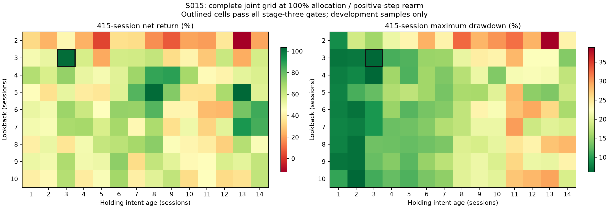

# S015 EX065：阶段三联合参数重新寻优

Status: COMPLETED

完成128次固定联合网格/对照及96次自适应TPE提议，共207个实际配置、414个正式窗口账户、2个串行技术账户。5个评价配置通过阶段三中心目标，排除旧配置复算后新增达标配置为0。阶段四尚未执行，完整新资格为0。

## 目标、方法与证据

沿用原434/415日已见窗口、10万元独立空仓账户、0.1%单边费用、开仓周期现金比例、1%限买和市价卖出。经济与频率门槛逐项保持，不加权抵消。新MANDATE/5改变后续局部自检适用性，不降低阶段三目标。
先完成lookback2..10与hold1..14的126个联合配置（100%投入、正步重新许可），加3/3即时许可的95%和100%对照；随后采用Optuna4.9.0多变量约束TPE，对真实lookback、hold、allocation与rearm_mode分批提出96次建议。每批8次，全部回填后再生成下一批；重复配置使用本轮相同参数的证据，不重复账户。
allocation搜索0.6..1.0、步长0.025；其他参数固定，max_hold30在固定退出中不生效，未作为搜索维度。先用完整中心复算验证与旧C6105相同经济路径；串并行五张账表逐项一致。全部正式账户另做现金、费用、资金预算、闭合交易和指标算术核验。
约束用于采样引导，最终采用独立精确硬门判断，包括434日经济/双频率及415日净收益严格大于91.5802915%、回撤严格小于7.2486637491%。全部trial提议及反馈先后保留，不把固定网格称作自适应搜索。

## 通过配置与对照

| 身份 | 观察/持有 | 投入 | 再许可 | 434收益/回撤 | 415收益/回撤 |
|---|---|---|---|---|---|
| C6105 | 3/3 | 1.000 | positive_step | 105.3160%/6.1441% | 102.1707%/6.1470% |
| C6500 | 3/3 | 1.000 | positive_step | 105.3160%/6.1441% | 102.1707%/6.1470% |
| C6626 | 3/3 | 0.950 | immediate | 96.0652%/7.1041% | 94.9048%/7.1039% |
| C6653 | 3/3 | 0.950 | positive_step | 98.2728%/5.8481% | 95.3766%/5.8464% |
| C6680 | 3/3 | 0.975 | positive_step | 101.7493%/5.9956% | 98.7475%/5.9990% |
| C6692 | 3/3 | 0.925 | positive_step | 94.8215%/5.6966% | 92.0392%/5.6964% |

未达标的新增四目标前沿：

| 身份 | 观察/持有 | 434收益/回撤 | 415收益/回撤 | 未满足的中心条件 |
|---|---|---|---|---|
| C6549 | 5/8 | 104.7771%/16.2553% | 102.3546%/16.2538% | frequency_median, 415回撤 |
| C6554 | 5/13 | 103.7204%/14.0531% | 103.5565%/14.0518% | frequency_median, frequency_coverage, 415回撤 |

## 停止与局限

联合过线时间组合为[(3, 3)]；同时在四目标上支配原C6105的本轮过线配置为[]。边界改善触发项为[]。完整逐配置表见[search_grid.csv](others/search_grid.csv)，联合网格见[joint_grid_415_return.csv](others/joint_grid_415_return.csv)。
本轮完成预定联合覆盖和96次自适应提议。停止依据仅限该收益机制、固定退出结构与声明参数范围内的收益/风险/频率证据；不宣称全局最优、所有结构已优化或独立验证通过。若边界改善触发非空，必须先完成预留扩边再正式交付。
新增前沿只改善415日收益，434日收益反而低于C6105，且回撤及交易频率不达标；不能称为整体改善。达标区域仍集中于3/3日，尚未获得宽泛时间参数区间内的稳健支持。新规则允许局部自检不扰动超限整数参数，不意味着这一已知选择风险消失，也不据此追加否决门槛。
原CANDIDATES/6的全部16个阶段三过线中心继续保留；同内容重复评价，以及相同源码、相同生效参数且账户结果完全一致、仅失活字段不同的技术复算，均保留旧候选而不重复登记。新复算账户保持自身身份，不冒充旧候选账户证据。原EX064及ASSESSMENT/3失败事实保留，新参数适用性规则不自动改变其历史资格。
434/415高度重叠且反复用于选择。全部旧结构/标签/组件搜索历史和末期依赖、三日尺度敏感性等负面证据继续有效。本轮增加的配置数不是独立信息数，也不能证明可精确识别入场亏损。
后续阶段四须纳入EX065的新增选择历史，区分提议次数、实际配置、历史内容重复及收益路径重复；不能直接沿用旧176列家族统计而遗漏本轮，也不能把重复提议当成独立试验。选择偏差诊断仍为报告项，不新增经济否决条件。
下一步建议按MANDATE/5对新交接集合执行阶段四自检；当前尚未获准本轮阶段四，不选型、不冻结、不操作PTE或生产。
