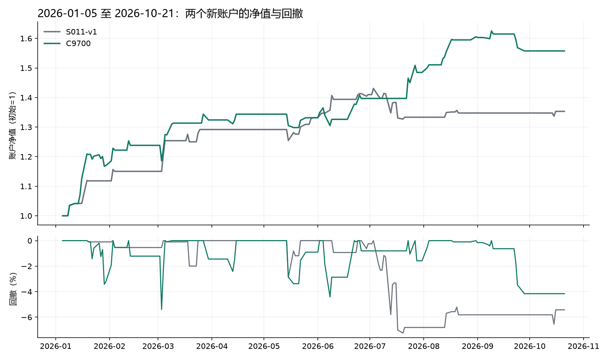

# S011-v1与C9700的2026指定窗口独立回测

Status: COMPLETE

**用户要求的两份独立回测及绩效对比已完成。** 在2026-01-05至2026-10-21的191个交易日内，C9700净收益55.7534%，高于S011-v1的35.3217%；最大回撤幅度5.4012%，低于7.2454%。以相同10万元起始资金计，C9700多赚20431.73元，同时最大回撤小1.8442个百分点。

这是相同新账户起点下的实际策略对比，支持C9700在本指定窗口内收益、回撤同时更优；不表示每个月都占优，也不将这个已见窗口当作新的独立验证样本或替换既有全周期研究条件。本轮没有冻结或部署。

## 回测口径

- [事前协议](protocols/comparison.json)固定用户原文、窗口、身份及账户条件。S011-v1发布身份`5da4a999f28aa699ef60641bc26d34f66e124dda8236063aeeea9b18afa9e89e`；C9700内容身份`3f92791519e1f9422fef11bb5c9177db4d9d83e628ea5f5cba0ec684b9530d5f`。
- 同一159326.SZ、同一191交易日、同一执行行情及市场规则，初始资金100000元、初始持仓0，单边费用0.1%、100份交易单位，HFQ_RESEARCH价格口径、DAILY_RANGE_V3日范围成交模型。
- 通过独立回测入口分别生成新的完整账户，不截取旧账户权益曲线。保留各策略规范信号预热；首个执行日使用2025-12-31信号，不继承旧账户资金或持仓。两者首次成交均为2026-01-09。
- 不修改策略设计来制造可比性：S011买入限价参数0.3%、资金模式full_available_cash；C9700为1%、signal_cash_fraction/entry_cycle。不同参数和资金规则本就是所比较策略的一部分，公共费用、行情、初始条件及执行模型保持一致。
- 没有期末强制平仓；两者本次最后一天实际均空仓。费用已从账户净收益中扣除。

## 主要结果

| 指标 | S011-v1 | C9700 |
| --- | ---: | ---: |
| 区间净收益 | 35.3217% | **55.7534%** |
| 最终权益 | 135321.65元 | **155753.38元** |
| 最大回撤幅度 | 7.2454% | **5.4012%** |
| 年化收益换算 | 49.0467% | 79.4306% |
| 夏普比率 | 2.4276 | 3.0204 |
| 卡玛比率 | 6.7693 | 14.7062 |
| 闭合交易周期 | 20 | 24 |
| 盈利周期 / 闭合周期 | 13/20（65.00%） | 20/24（83.33%） |
| 平均盈利率 / 平均亏损率绝对值 | 2.5120 | 1.1684 |
| 累计成交费用 | 5144.55元 | 6476.92元 |
| 收盘持仓交易日 | 27/191（14.14%） | 41/191（21.47%） |
| 期末持仓 | 0 | 0 |

年化仅按252交易日换算，不是未来收益预测；夏普用日净收益均值与波动率衡量，未额外减无风险收益；卡玛为年化收益除以最大回撤。胜率及盈亏比只针对已闭合周期，盈亏比不是总盈利除以总亏损。收盘持仓天数不代表精确日内暴露时间。

C9700取得优势的同时，交易更频繁、费用多1332.37元、持仓天数更多，单次平均盈利相对亏损的比例更低；本区间更高的胜率弥补了较低的盈亏比。这是账户表现的描述，不证明该取舍会在未来持续。

S011-v1最大回撤从2026-07-03峰值至07-20谷底，截至10-21尚未回到该峰值。C9700最大回撤从02-12至03-03，03-05修复；其9月之后另有未修复回撤，不能把最大回撤已修复解读为期末处于净值新高。

## 分月对照

下表是本次新账户的连续月度切片，月初继承前月资金与持仓，不逐月重置；1月从01-05开始，10月只到10-21。

| 月份 | S011-v1 | C9700 |
| --- | ---: | ---: |
| 2026-01 | 11.82% | 17.02% |
| 2026-02 | 2.87% | 5.81% |
| 2026-03 | 12.31% | 6.94% |
| 2026-04 | 0.00% | 1.48% |
| 2026-05 | 3.08% | -0.90% |
| 2026-06 | 5.88% | 4.90% |
| 2026-07 | -5.42% | 6.30% |
| 2026-08 | 1.06% | 8.12% |
| 2026-09 | 0.00% | -2.99% |
| 2026-10 | 0.41% | 0.00% |

C9700在5个月更高、另5个月更低。两条净值在6月底接近，7—8月明显拉开；9月C9700又回吐部分收益。因此应将本次结论限定为整个指定窗口的收益与回撤同时占优，而非逐月稳定压倒S011。

## 证据与范围

[完整数值与文件哈希](others/assessment.json)、[独立复核](others/independent_review.json)保存核对结果。两份完整回测的账户和基准审计均PASS；窗口、共同执行行情指纹、现金起点、费用及交易统计另行核对。原策略源码、注册记录和发布身份运行前后不变。

- [S011-v1原始完整报告](../../../../outputs/1025_02_S011-v1/report.md)，[交互净值图](../../../../outputs/1025_02_S011-v1/chart.html)。
- [C9700原始完整报告](../../../../outputs/1025_01_S015-C9700/report.md)，[交互净值图](../../../../outputs/1025_01_S015-C9700/chart.html)。

完整回测自带BuyHold和MA基准，仅作背景，不等同研究约定的LimitBuyHold基准验收。这里没有重算参数邻域、PBO或DSR，也没有改变原资格、策略参数、冻结计划或研究目标。数据与模型此前均经过开发选择，重新计算账户并不能产生独立样本外证据。

建议将这一比较作为C9700冻结决策的补充证据；此前[精确冻结计划](../EX082_20261025/others/freeze_plan.json)仍待用户单独批准。本次任务不含冻结、部署或生产操作。两个完整回测文件包将通过公开材料接口归档；Git保存协议、源码、结果摘要及报告，正式资产仍须独立保留。
