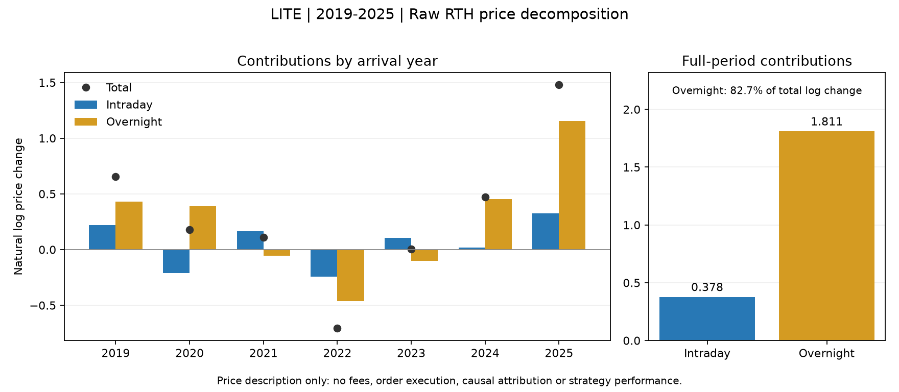

# EX011_20261029 阶段二实验报告

本实验完成2个固定配置、4个完整账户路径（各配置及其基准）和3项公共账户诊断。
其中0个新配置同时满足已确认的完整区间经济与双频率五项目标。
技术完成、目标数值与研究采用判断分别记录；本报告不自动推进阶段、登记候选或赋予冻结/PTE资格。

## 固定设计与比较条件

[事前设计](protocols/design.md)、[授权](protocols/authorization.md)、[固定参数](protocols/configurations.json)、[候选输入契约](protocols/candidate_contracts.json)及[合成预检](others/precheck.json)保留原始内容。
开发评价为2019-01-02至2025-12-31，预热始于2018-11-01；LITE单标的、只做多、30分钟常规交易时段，初始资金100,000美元，每侧费用0.1%，固定买入限价溢价1%。经营和行业认识用于提出假设，不直接作为事件交易条件。
原C0013只读复用EX003正式证据。主标的四项输入的完整元数据和内容哈希、执行条件及费用均核对一致；辅助输入允许使用不同联合准备清单，但不得改换主标的来源。所有嵌入基准已核对相同经济路径。

## 完整账户结果

|配置|净年化|30分钟回撤|日末回撤|闭合周期|60日闭合数中位数|≥3笔窗口占比|完整窗口数|费用USD|持仓柱占比|持仓日末占比|
|---|---:|---:|---:|---:|---:|---:|---:|---:|---:|---:|
|C0013|26.22%|58.77%|57.30%|68|2.0|45.86%|1701|18193.61|56.92%|57.05%|
|C0036|-12.86%|67.21%|66.41%|555|19.0|100.00%|1701|60171.85|18.38%|0.00%|
|C0037|-5.79%|37.43%|36.35%|177|5.0|97.24%|1701|26998.53|5.95%|0.00%|
|同条件买入持有|36.32%|67.34%|66.18%|0|0.0|0.00%|1701|97.17|100.00%|100.00%|

表格为显示取整；完整精度见[分析结果](others/analysis.json)。持仓比例按正持仓的柱/日末观察点计算，不是经过时间占比。回撤使用包含初始资金的连续账户高点；日末回撤单独展示，目标采用30分钟BAR_CLOSE回撤。

## 五项目标逐项核对

|新配置|净年化目标|相对回撤目标|绝对回撤≤25%|60日中位数≥6笔|≥3笔完整窗口覆盖≥90%|全部满足|
|---|---|---|---|---|---|---|
|C0036|否|否|否|是|是|否|
|C0037|否|是|否|否|是|否|

基准净年化为正时，净年化目标为其1.5倍，否则要求策略净年化为正；相对回撤目标为不超过基准回撤的80%。频率按实际退出日计入完整滚动60交易日窗口，未闭合持仓不计闭合次数。

## 固定对照的账户差值

|主体 / 对照|净年化差（百分点）|30分钟回撤差（百分点）|闭合周期差|费用差USD|公共诊断|
|---|---:|---:|---:|---:|---|
|C0036 / C0013|-39.07|+8.44|+487|+41978.24|[COMPUTED](../../assets/evidence/EX011_20261029/b1af69f5230e5bfd334807cc56786818418f162fe44562dc8b8eb69da660e473.json)|
|C0037 / C0013|-32.01|-21.34|+109|+8804.91|[COMPUTED](../../assets/evidence/EX011_20261029/dca3ee0103ef70fb5050b91135bfe0f766ee56ad5a116ea4889be71fbc48e17a.json)|
|C0037 / C0036|+7.06|-29.78|-378|-33173.32|[COMPUTED](../../assets/evidence/EX011_20261029/751395b29a06d9842427c4746efa008b43f47c1371876d05ad74fb819be27585.json)|

差值仅为主体减对照的原账户事实；正负号不是统一评分，也不证明行为因果。具体组件用途、原型保留与下一轮问题由批次统一研究判断补充。

## 连续账户逐年收益

|配置|2019|2020|2021|2022|2023|2024|2025|
|---|---:|---:|---:|---:|---:|---:|---:|
|C0013|70.25%|3.72%|-7.95%|-28.22%|7.20%|11.21%|265.45%|
|C0036|-18.40%|-20.29%|-21.06%|-23.60%|-1.90%|16.07%|-14.36%|
|C0037|-9.29%|-9.98%|-8.35%|-8.63%|-1.50%|6.64%|-8.23%|
|同条件买入持有|89.40%|19.26%|11.43%|-50.13%|0.47%|58.85%|334.44%|

逐年收益继承上年末资金与持仓，第一年使用初始资金；不逐年重置本金或平均年度收益率。

## 独立描述：价格变化发生在日内还是隔夜

这项描述性证据形成于本实验正式账户结果返回之前；使用原账户同一份LITE价格与独立会话网格，没有改动已冻结的开盘突破规则、费用或参数。[价格分解结果](others/session_price_description.json)和[描述脚本](src/describe_sessions.py)保留输入哈希。
日内为每个会话首根Open至末根Close的自然对数价格变化，隔夜为前一会话末Close至本会话首Open；全期从2019首个交易日Open开始，排除首日隔夜，跨年隔夜归入到达的新年。表内单位是自然对数，不使用百分数收益或年度收益率平均；各年贡献相加还原全期首Open至末Close的变化。

|区间|日内对数变化|隔夜对数变化|合计对数变化|日内正/负/平|隔夜正/负/平|完整观察会话|未知日内/隔夜|
|---|---:|---:|---:|---|---|---:|---|
|2019|+0.220273|+0.432587|+0.652860|134/117/1|144/100/7|252/252|0/0|
|2020|-0.209681|+0.388212|+0.178531|122/131/0|151/98/4|253/253|0/0|
|2021|+0.163344|-0.053846|+0.109498|125/126/1|145/106/1|252/252|0/0|
|2022|-0.244702|-0.462058|-0.706759|117/134/0|106/141/4|251/251|0/0|
|2023|+0.107387|-0.102606|+0.004781|125/124/1|120/121/9|250/250|0/0|
|2024|+0.018359|+0.452574|+0.470933|131/120/1|133/110/9|252/252|0/0|
|2025|+0.323037|+1.156426|+1.479464|142/108/0|146/99/5|250/250|0/0|
|全期|+0.378016|+1.811290|+2.189307|896/860/4|945/775/39|1760/1760|0/0|

全期隔夜部分占总对数价格变化的82.73%（约83%）；共1760个会话，1760个观察完整，1760个首尾价格已知。其中4个会话含5根既定执行阻断柱，观察到价格不代表当时允许成交。
该占比仅说明这条历史价格路径的净变化在什么时段发生，并非可交易收益、利润分配或因果解释；RAW价格变化也不是含分红的股东总回报。没有构造免手续费的日内或隔夜策略，没有假定能够按开盘、收盘成交。它为日终清仓原型与持续持有基准的暴露差异提供背景，不能单独解释具体原型落后多少，更不能据此否定日内择时机会。

## 实际退出用途

|配置|实际退出类别|闭合周期|账本净损益USD|实际双侧费用USD|
|---|---|---:|---:|---:|
|C0036|日终强制退出|455|22521.47|49777.78|
|C0036|止损触发|100|-84270.88|10394.07|
|C0036|隔夜残留退出|0|0.00|0.00|
|C0036|未知|0|0.00|0.00|
|C0037|日终强制退出|150|3888.49|22868.42|
|C0037|止损触发|27|-37970.15|4130.11|
|C0037|隔夜残留退出|0|0.00|0.00|
|C0037|未知|0|0.00|0.00|

[退出用途描述](others/exit_purpose_description.json)按真实订单、决策、成交和闭合周期关联。日终分支优先于止损计算，分类不证明同一时点不会触发止损；分组具有事后条件化，不能将某类正收益解释为延长持仓会盈利，也不能将费用加回构造零成本策略。

## 事后描述：原开盘突破交易的入场大盘背景

本节形成于C0036与C0043正式账户发布之后。将C0036已经实际执行的555个周期，按买入决策时刻精确关联[EX014/C0043原始账户](../../assets/evidence/EX014_20261029/684227dd886347c972c1b2993bbf3d1a075f82e27a35ffa098b504648e26b0e8.json)中的SPY固定20日条件。已核对来源、主数据、经济窗口与相同买入持有路径；SPY条件事实不依赖C0043自身是否持仓。

|入场SPY条件|原周期数|原账本净损益USD|实际双侧费用USD|原周期收益中位数|止损退出周期/占比|
|---|---:|---:|---:|---:|---|
|TRUE|364|-38130.77|39657.76|-0.22%|59 / 16.21%|
|FALSE|191|-23618.64|20514.10|-0.27%|41 / 21.47%|
|UNKNOWN|0|0.00|0.00|无样本|0 / 无样本|

[完整分组描述](others/entry_market_context_description.json)保留全部年份、收益分布、退出用途交叉表、未知项及逐项加总核对；[描述脚本](src/describe_entry_context.py)可复核原始关联。TRUE表示已完成SPY日Close高于其最近20个完整日Close均值，UNKNOWN不并入FALSE或忽略。
这些是原策略已选择交易的事后条件分组，受原有持仓、资金路径和交易机会选择影响；两组总体净损益与收益中位数均为负，分年差异也不稳定。不得删除FALSE组推算新过滤策略收益，不得将费用加回、将周期收益分布视为组合收益，或将差异解释为大盘条件的因果效果。它只为后续区分跨日持仓与仅入场过滤提出有限问题，不预判两者组合有效，不新增实验。

## 原始证据与限制

[可复核分析](others/analysis.json)保留精确账户、公共诊断和方法来源引用。
- [C0036原始账户](../../assets/evidence/EX011_20261029/d25c7a3a12237fdc046f223e705311bd0afbea13f7ac9491d8153f6c4fa58145.json)
- [C0037原始账户](../../assets/evidence/EX011_20261029/8ac829abf8eefa8083adf2fdd0f3b91fc1f80ee4ff9cfd4fcb13aacbd08c2846.json)
- [C0013原始账户](../../assets/evidence/EX003_20261028/1496c8667bd1f8ad4cc26e7ee4beb0080d02cb42d8380d49c5d2de1fb53048af.json)

本实验使用反复观察过的开发池；重叠窗口与30分钟观察点不能视作独立样本。未读取2026保留行情，未进行独立验证或稳健性自检。买入持有基准相同不意味着不同机制具有独立统计证据。
本次仅发布本实验报告。COMPONENTS/PROTOTYPES类型化面板由主流程汇总精确引用及研究判断后单独、串行发布。
