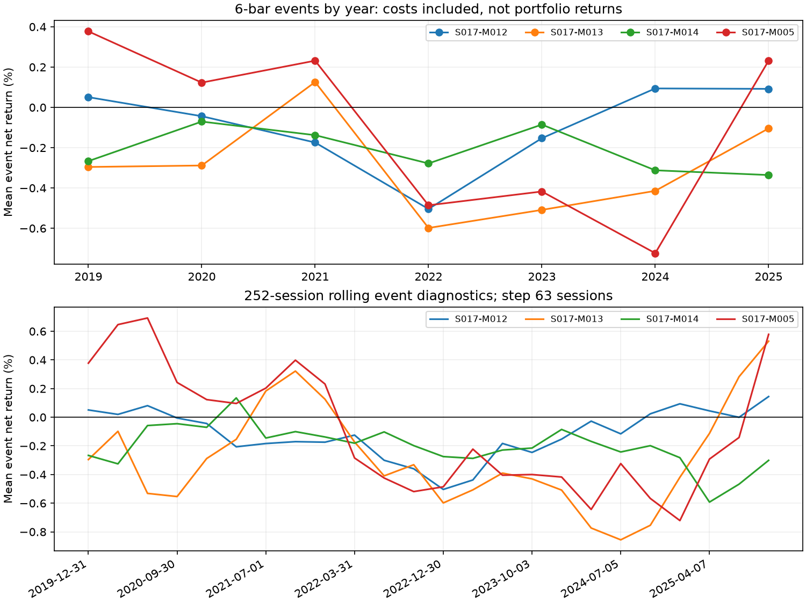

# EX028：短周期入场竞争及时间延续检验

Status: COMPLETED

## 结论

本轮完成，未发现足以进入新完整账户的入场表达。三种新机制的主6柱去重扣费均值均为负；仅用此前252日选择、接下来63日观察也未取得正的事件净收益。因此本轮未新建完整账户，不将事件统计解释为策略年化、回撤或交易频率达标。

**七年合并确实会掩盖时间差异，但“缩短开发池即可找到有效策略”没有获得支持。** S017-M012在最近252日转正，2019、2024、2025年度读数也为正；2021—2023为负，呈交替变化，不能简单解释成早期规律单向衰退。事前固定的过去一年选择也没能把这种差异变成正的后续净收益。

S017-M012增加了观察机会，但优势主要被成本消耗；S017-M013仍偏稀疏，S017-M014较常出现却缺乏扣费优势。旧S017-M005在短6柱也为负，其原65柱账户线索不能直接搬到短周期。

## 定义与合同

|编号|入场规则|
|---|---|
|S017-M012|完成收盘高于此前6柱最高价。|
|S017-M013|截至t−3的6柱涨幅至少等于ATR13[t−4]，随后两柱收盘回落，当前收盘收复前柱高点。|
|S017-M014|当前最低价跌破此前6柱低点，但收盘回到该低点上方且为阳线。|
|S017-M005|旧放量窄幅阴线后收复入场，定义不变，仅作历史描述参照。|

精确等号、父集合及公式见[事前协议](protocols/design.md)；编号只标身份。LITE RTH30分钟，2018-11/12预热、2019—2025开发；单边0.1%，固定1%买入限价溢价。下一段按既定合同成交，完成持有N柱后下一段退出。普通机会对照排除该编号全部信号，按同月、同美东计划入场时刻匹配，与旧含目标自身的对照口径不同。

## 主6柱：频率与入场结果

|编号|原始信号|完整去重标签|扣费均值|普通机会增量|
|---|---:|---:|---:|---:|
|S017-M012|2775|1188|-0.090%|+0.030%|
|S017-M013|254|240|-0.334%|-0.266%|
|S017-M014|1139|847|-0.203%|-0.077%|
|S017-M005|324|267|-0.133%|-0.038%|

信号数量不是账户成交笔数；去重只减少同段重复计算，不使样本完全独立。6柱约3小时交易柱时间，可以跨日。S017-M012在本合同下，主6柱去重成交价毛收益均值约+0.110%，扣费后−0.090%；它有一定价格推进，却没有覆盖约0.2%的往返费用。此为同一成交模型的毛净分解，不是零成本账户。

3柱下四项去重净均值都为负。13柱下只有S017-M012均值约+0.017%，但相对普通机会增量约−0.038个百分点；辅助期限不能事后取代主6柱，也不据此补选账户。全部原始、去重、父集合、亏损尾部及完成率见[数值结果](others/census.json)。

## 时间变化

以下均为各时间段重新按预定规则选取的去重事件均值，不是连续账户年度收益；各段边界剔除尚未成熟标签，不能机械加权还原全池结果。

|年份|S017-M012|S017-M013|S017-M014|S017-M005|
|---|---:|---:|---:|---:|
|2019|+0.051%|-0.296%|-0.267%|+0.377%|
|2020|-0.044%|-0.288%|-0.070%|+0.123%|
|2021|-0.174%|+0.126%|-0.138%|+0.232%|
|2022|-0.504%|-0.598%|-0.278%|-0.486%|
|2023|-0.153%|-0.509%|-0.085%|-0.417%|
|2024|+0.094%|-0.414%|-0.312%|-0.723%|
|2025|+0.092%|-0.104%|-0.336%|+0.232%|

最近252日为2024-12-30—2025-12-31。S017-M012此前均值−0.118%，最近+0.074%，但最近相对普通机会仅+0.017个百分点。旧S017-M005最近自身+0.232%，相对普通机会仍−0.179个百分点，说明行情本身也提供了收益，不能仅看自身转正。

预定行情分组中，S017-M012在前收盘低于前65柱均价时的两种波动组均值分别约+0.084%、+0.167%，高于均价时两组约−0.333%、−0.123%。这更像值得辨别的条件差异，尚不是“突破后延续”已经成立。同条件内部也有跨年正负变化，例如低均价低波动组2024为正、2025为负，不能把近期改善简单归因于组别占比。分组内各自去重，成员不同于全池去重子集，组数及均值不能拼成收益归因。未把这些事后读数加入交易条件。

## 只看过去的选择能否延续

252交易日训练、63日测试，共24折，其中12折空选。训练只用测试开始前已经退出、当时可知的主6柱标签；训练净均值及匹配增量均为正才可选择，合格中按增量选一项。测试末未成熟或未成交事件留为缺失，不用未来收益补齐。

累计预选327个去重事件，其中320个结果成熟，7个未成交或未成熟；平均扣费净收益-0.138%，盈利比例46.56%。有控制支持319个，增量+0.026%。略好于普通机会，仍然是亏损机会。

|编号|被选且成熟事件|净均值|有支持事件|匹配增量|
|---|---:|---:|---:|---:|
|S017-M012|243|-0.035%|242|+0.142%|
|S017-M013|43|-0.393%|43|-0.439%|
|S017-M014|34|-0.547%|34|-0.214%|

所有三项顺序测试自身均为负，因此即使取消全池净均值条件，也没有正的顺序事件依据。这一结论不是由“必须七年普适”的门槛单独造成。此路径没有模拟现金、仓位和切换账户，不能报告为动态策略绩效；已见开发池中的因果顺序不等于独立验证。

## 不确定性、技术核验及范围

- 20日移动块1000次重新估计控制；S017-M012、S017-M013、S017-M014主期限去重增量仅326、840、583次有定义，缺少匹配支持的抽样不补值。有定义抽样的增量条件区间均跨零，不能宣称精确或显著优势；不继续追加细格拆解。
- 独立核验[结果](others/result_validation.json)：45580条旧3/13标签逐点一致、68370次真实信号标量/向量比较，费用、成员、匹配、成熟边界、每折选择及未来扰动通过。合成检查覆盖严格边界、失败买入、实际成交计时和退出受阻。
- 初次标签任务因旧脚本从文件位置识别实验而停止，未产出收益结果。保留原冻结census.py，census_v2.py仅改为从原位置装载同字节已认证来源；信号、费用及协议不变。[修订事实](others/label_loader_revision.json)。独立核验适配含旧参照的接口为verify_v2.py，原冻结verify.py保留，均不改变收益计算。
- 本轮0个新正式账户，0个账户年化/回撤结论，0候选登记，0参数搜索。预定最多四账户为上限，不是必须产出数量；原五项目标仍有效，不能借事件胜率替代。
- 公司行动NONE和已知中断沿用既定数据边界，不宣称独立认证全部停牌或含分红总回报。未访问2026封存行情或策略绩效，未改平台/A股实现，未进入阶段三、冻结或生产。

## 研究决定与下一步

完成本轮并停止三种无条件短周期表达的发展，不继续修改持有期或删年份促成正收益。S017-M012保留一个有限线索：近期局部恢复和低于均价时的收复可能需要与追涨分开理解；这只是下一问题的依据，不是已验证交易过滤。

建议下一次若获新额度，先评审“价格尚低于近期均价时，短区间突破是否属于有价值的修复”，并与同条件普通机会、原S017-M012及仅条件本身比较；同时用先前数据形成选择、随后观察，避免只截最近好年份。原S017-M005的条件拆解与两种止损补丁不重启。

20轮额度已发起20轮：完成19、失败1，剩余0轮。本轮技术重试与工程核验不另占额度。不追加实验、不自动进入阶段三；阶段二额度内工作完成，尚无推荐推进的新完整原型，等待用户决定后续研究范围。

证据入口：[事前设计](protocols/design.md)、[授权](protocols/authorization.md)、[冻结来源](others/pre_run_evidence.json)、[标签与时间结果](others/census.json)、[完整事件](others/events.json.gz)、[账户选择](others/selection.json)、[账户未运行状态](others/account_run_status.json)。
