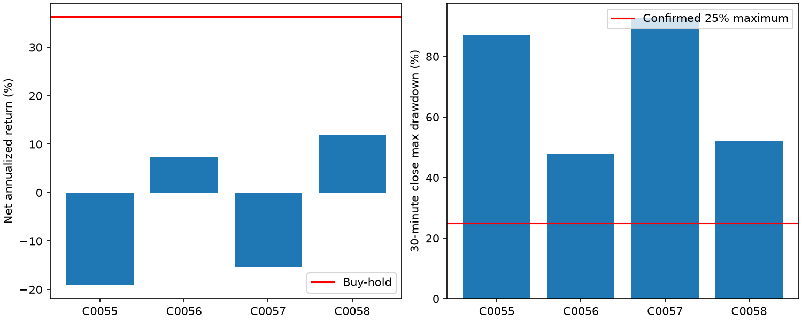

# EX029：低于近期均价的突破修复定向验证

Status: COMPLETED

## 结论

S017-M017确有优于原突破及仅低均价背景的完整账户用途，但尚不足以构成达标策略：6柱净年化7.37%、回撤47.93%，13柱11.83%/52.14%。频率已满足，收益和绝对风险仍明显失败，不推荐进入阶段三。

条件不是单纯减少交易：同6柱下，M012年化−19.15%、M018−15.41%，M017转正为+7.37%，说明等待突破在当前开发池有实际用途；这不等于独立验证或未来有效。
低于均价并不保证抛压结束。M017/6柱在2021、2022分别亏21.05%、25.85%；最深回撤谷在2023年2月，M017/13柱谷在2024年5月，两者直到2025年11月才恢复旧峰。问题是持续损伤及恢复缓慢，不能简单靠删年份消除。
延持13柱提高年化，但并非各年一致增益，且回撤扩大；公共路径显示后续入场也改变。暂不继续调退出，先辨别反弹发生在整体仍抬升的回落中，还是持续走弱中。

## 机制、授权及合同

用户先同意定向续研，随后明确“不用受额度约束，可以继续开展实验”。旧20轮发起20、完成19、失败1的历史保持；本轮另记为解除轮数限制后的第1轮。无阶段三、2026封存行情、平台修改或生产授权。

|编号|完整定义|
|---|---|
|S017-M012|当前完成收盘高于此前6柱最高价，原突破对照，定义不变。|
|S017-M017|M012，且突破前一柱Close严格低于其截至当时65柱均价。|
|S017-M018|仅满足上述低于均价条件，每个完成柱均可触发，不等待突破。|
|S017-M015 / S017-M016|实际买入起，分别完成6 / 13根30分钟柱后持续要求退出，直到真实卖出。|

低于均价不证明此前持续下跌、见底或估值便宜；当前突破柱不进入背景均价。窗口允许跨日，不强制日内平仓。只有M017新增背景过滤，未加量能、波动、大盘或日线条件。

2018-11/12预热、2019—2025开发，LITE只做多不加杠杆、初始10万美元、全可用资金整数股、固定1%买入限价溢价、每侧0.1%、下一段执行。买持同合同，期末不强平；卖出资金即时可用沿用原研究假设。

## 入场普查

复用EX028已认证3/6/13柱标签，共68370条，重新计算本轮信号与背景。主期限仍6柱。M017的主要对照为同月、同美东计划入场时刻、同低均价背景的非M017机会；M012、M018对照排除自身，不将相反背景的差额当作突破贡献。

|编号|原始信号|6柱完整去重事件|平均净收益|匹配增量|支持事件|
|---|---:|---:|---:|---:|---:|
|S017-M012|2775|1188|-0.09%|0.03%|1188|
|S017-M017|910|508|0.13%|0.25%|503|
|S017-M018|10211|1493|-0.05%|0.30%|1493|

这些是固定单股事件收益，不能报告为策略年化或账户成交频率。各机制分别选取去重成员，因此均值差不能直接当作同一组交易的过滤贡献。

252日训练、63日测试共24折，仅选择M017启用或空选；8折空选。训练只用当时已完成退出的标签、同背景对照；测试跨折连续去重。301个预选事件，296个成熟，平均净收益0.13%，有支持294个、增量0.17%。这不是动态账户或独立验证。

M017最近252日去重均值约+0.521%、此前约+0.079%；年度2021/2022均值仍为负，不能只选近期好年份。20日移动块1000次中，M017主期限全部增量抽样因至少部分目标失去匹配支持而无定义，不能给出可靠区间或宣称统计显著。此限制不因点估计为正消失，不继续加细格拆解。

## 正式完整账户

|账户及机制|净年化|30分钟最大回撤|闭合交易|60日闭合中位数|至少3笔窗口覆盖|全部目标|
|---|---:|---:|---:|---:|---:|---|
|C0055 S017-M012＋S017-M015|-19.15%|86.99%|1259|43.0|100.00%|否|
|C0056 S017-M017＋S017-M015|7.37%|47.93%|523|18.0|100.00%|否|
|C0057 S017-M018＋S017-M015|-15.41%|92.95%|1688|59.0|100.00%|否|
|C0058 S017-M017＋S017-M016|11.83%|52.14%|436|15.0|100.00%|否|
|同合同买入持有|36.32%|67.34%|0|—|—|基准|

原目标保持：正买持下净年化至少1.5倍，本窗口约54.48%；30分钟回撤同时不超过基准80%及25%；完整滚动60交易日闭合中位数至少6，至少90%窗口不少于3笔。各项必须同时满足。

过滤和持有时间同时改变后续资金、实际入场序列及忽略信号。此处比较完整策略用途，不把账户差额全部归因于某几笔删掉的交易；单股标签的去重间隔也与真实账户受阻退出、未成交和重入时序存在差别。

|年份|M012＋6柱|M017＋6柱|M018＋6柱|M017＋13柱|
|---|---:|---:|---:|---:|
|2019|3.39%|9.83%|-15.73%|37.68%|
|2020|-19.73%|41.69%|16.64%|35.22%|
|2021|-29.86%|-21.05%|-36.09%|-29.72%|
|2022|-58.05%|-25.85%|-53.71%|-20.25%|
|2023|-24.87%|9.00%|-26.70%|8.26%|
|2024|15.47%|24.70%|-28.93%|18.21%|
|2025|6.95%|32.68%|105.20%|63.52%|

年度为连续账户年末净值变化，年初不重置本金，不按平仓年损益替代；252交易日、步长21日切片继承原账户资金和持仓，详[账户分析](others/account_analysis.json)。

## 核验与限制

- 旧实现四配置合成七表串行/两个spawn一致、未来后缀和实际成交计时通过；新版与旧版四配置合成完整七表及关键状态一致，全开发68370次入场信号零差异，两侧合成原表均保留。此模式不是全七年V2/V3双账本比较。
- 68370条旧标签逐点复现，68370次信号标量/向量比较、背景严格等号、24折成熟训练/选择与未来扰动通过。
- 四份正式评价和配对基准已发布；3项公共完整账户诊断覆盖全部新账户，身份、共同数据/合同、完整买持路径与损益对账通过；独立账户数字核验通过。技术PASS不代表经济达标。
- 初次统计加载因旧证据路径键分隔符中断，study_v2仅规范键；初次候选装载缺少既有numpy/pandas版本声明，accounts_v2与account_candidate只补全已安装版本，不安装依赖、不改策略或平台。旧兼容回放耗时过长，核实进程后取消，未发布正式账户；随后按[V3接入约定](protocols/v3_adoption.md)完成上述等价核验，使用V3正式回放并认证，身份为C0055至C0058。没有依据旧账户成绩改变规则或引擎；旧实现及技术事实保留。
- 开发池反复观察、背景由EX028事后分组启发；新顺序检验不恢复独立性。2026封存价格与绩效未使用，已知中断及公司行动NONE仍不等于完整停牌和含分红总回报认证。
- 未执行参数邻域、费用压力和阶段四稳健性验收；未登记候选、推进阶段三、冻结、PTE、合并或推送。

## 下一步

沿用用户解除轮数限制的授权，下一轮固定6柱退出，竞争性检验M017在近期均价仍抬升、或近期低点不再下移两种可见背景中的用途；复用本轮M017原完整账户为控制，不搜索日期/止损，不使用2026封存样本。若无明确整体改善，收口本条件修复路线，不继续堆过滤。

证据：[事前设计](protocols/design.md)、[授权](protocols/authorization.md)、[冻结来源](others/pre_run_evidence.json)、[事件结果](others/census.json)、[独立事件核验](others/result_validation.json)、[账户清单](others/accounts_v3.json)、[账户分析](others/account_analysis.json)、[独立账户核验](others/account_result_validation.json)。
