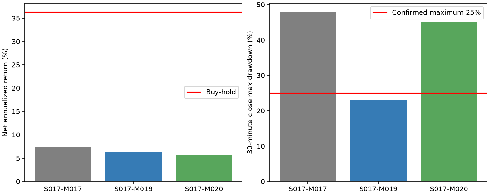

# EX030：均价方向与低点结构的竞争验证

Status: COMPLETED

## 结论与研究决定

两种背景没有形成同时改善既定目标的新完整原型。M019有清晰风险选择与单笔质量用途，年化6.20%、回撤23.10%，但七年仅110笔、60日闭合中位4且覆盖75.54%；M020年化5.58%、回撤45.09%，只有局部风险改善。保留M019为风险研究对照，不推荐进入阶段三或用更稀疏的交易替代30分钟研究目标。

M019首次将本路线绝对回撤降至25%以内，不能说条件完全无用；但它同时失去双频率目标，收益距54.48%仍巨大。风险与频率代价必须一起看，不能称整体达标。
M020保留合格频率，却仍有45.09%回撤，年化低于父控制。没有证据支持把两种过滤继续叠加或组合就会解决问题。
两个新表达全历史主期限自身净均值为正，但只用过去一年选择后事件均值转负，且净均值区间均跨零。原样静态历史有用线索与可稳定选择的优势必须区分。

## 固定机制与合同

|编号|完整规则|
|---|---|
|S017-M017|当前Close突破此前6柱最高价，且前Close低于截至前柱的65柱均价；复用原机制。|
|S017-M019|M017，且SMA65[t-1]>SMA65[t-14]；前置均价仍在上移，严格大于。|
|S017-M020|M017，且min Low[t-6..t-1]>=min Low[t-12..t-7]；近期低点不再下移，等号属于。|

两新机制分别验证，不叠加。全部固定S017-M015：实际买入后完成6根30分钟柱退出，到期受阻则继续要求退出，失败买入不启动周期。当前柱不进入背景窗口；均价方向和低点结构只是价格行为代理，不证明真实卖压或见底。

沿用2018-11/12预热、2019—2025开发、初始10万美元、只做多不加杠杆、全可用资金整数股、每侧0.1%、固定1%买入限价溢价、下一段执行、期末不强平。卖出即时可用沿用原研究假设，买持同合同。未改变原收益、双回撤和双频率要求。

## 入场结果与时间延续

复用EX029已认证3/6/13柱执行标签，重新计算背景和信号；M017逐点复现910次。主6柱，辅助3、13不替代主结果。先选成员再检查成交与成熟，下一去重信号i严格大于上次i+N+1。

|机制|原始信号|6柱完整去重事件|平均净收益|同背景增量|支持事件|自身净均值区间95%|
|---|---:|---:|---:|---:|---:|---|
|S017-M017|910|508|0.13%|0.25%|503|[-0.08%, 0.38%]|
|S017-M019|149|108|0.45%|0.50%|94|[-0.17%, 1.07%]|
|S017-M020|482|276|0.19%|0.18%|251|[-0.17%, 0.55%]|

普通控制同月、同美东计划入场时刻、同各自前置背景并排除该机制信号。M019、M020的支持范围不同，不能把它们的增量点估计直接排名当因果。区间仅针对自身净均值，20日移动块1000次，全部有定义但跨零；匹配增量不构造区间，避免重复此前细格缺少控制导致无定义的问题。未把区间设为新增硬门，选择偏差仍存在。

只用此前252日成熟标签，在两个新机制中按事前规则选择，随后63日观察：共24折、11折空选；73个预选事件、70个成熟，平均净收益-0.28%；有控制支持65个、增量-0.23%。原始历史均值改善没有自动成为可持续的选择能力。此为事件检验，不是动态账户，不是独立验证。

## 完整账户

复用EX029的C0056原M017/6柱账户，不重放、不改写；两新账户C0059、C0060均为公开V3。不同特征图和source保留各自身份，共同市场输入、资金、费用、执行合同与完整买持路径核对一致。

|机制及身份|净年化|30分钟最大回撤|闭合交易|60日闭合中位数|至少3笔窗口覆盖|持仓柱占比|五项达标|
|---|---:|---:|---:|---:|---:|---:|---|
|S017-M017 / C0056|7.37%|47.93%|523|18.0|100.00%|13.77%|否|
|S017-M019 / C0059|6.20%|23.10%|110|4.0|75.54%|2.90%|否|
|S017-M020 / C0060|5.58%|45.09%|281|10.0|100.00%|7.40%|否|
|同合同买入持有|36.32%|67.34%|0|—|—|100%|基准|

原目标：净年化至少正买持1.5倍，本窗口约54.48%；回撤同时不超过基准80%及25%；60交易日闭合中位至少6，至少90%完整窗口不少于3笔。不得以风险改善抵扣收益或频率失败，也不以通过目标的数量排序。

|年份|M017原控制|M019均价方向|M020低点结构|
|---|---:|---:|---:|
|2019|9.83%|9.28%|15.85%|
|2020|41.69%|18.79%|31.94%|
|2021|-21.05%|-13.01%|-24.81%|
|2022|-25.85%|-8.18%|-14.11%|
|2023|9.00%|4.87%|-2.00%|
|2024|24.70%|-2.18%|15.32%|
|2025|32.68%|43.08%|31.00%|

年度继承连续账户，不重置本金或把平仓年损益当年度收益。M019最大回撤由2020-12峰至2024-06谷形成，直到2025-11才恢复峰值；幅度达标不等于没有漫长损伤期。该事实只诊断，不新增时间硬门。

M019实际单笔净收益均值约+0.4385%、盈利比例58.18%，优于父M017的+0.1235%和51.05%；但持仓柱仅2.90%，七年110笔，比原M005固定65柱的145笔还少，重新引入用户指出的机会稀疏问题。前5盈利笔贡献正收益42.29%，样本选择和集中性不能忽视。

公共路径中，M019与父控制同入场108次、父独有415、新独有2；M020同入场222、父独有301、新独有59。因此不能从父账本删除若干损失就证明过滤因果，也不能将回撤下降全部归因于一个条件。资金和后续入场路径已改变。

## 核验、资源和边界

- 两新机制公共V3合成均实际10次买入、10次闭合；严格均价、等号低点、失败买入、卖出受阻延至第7柱及未来后缀完整七表不变通过。
- 独立核验68370条复用标签和68370项信号/背景、净均值抽样区间、24折成熟训练/顺序选择及未来扰动通过。正式运行信号与普查全点一致。
- 两份新正式评价和共享基准已发布，复用父账户1份；两项公共诊断覆盖新/旧账户、共同合同、完整基准路径及金额对账，独立账户数字核验PASS。
- 本轮直接采用V3，无旧兼容回放。两个新候选＋共享基准计算约18.1秒，端到端准备/认证/发布约69.2秒；回放本体与完整接口耗时分别说明。没有修改平台或A股实现。
- 全部仍在反复使用的开发池；不将顺序回放称独立验证，2026封存行情及绩效未使用。原已知中断、公司行动NONE与RAW仍不等于完整停牌史或独立认证含分红总回报。
- 没有参数搜索、费用压力、邻域或其他阶段四验收、候选登记、阶段三、冻结、PTE、生产、合并或推送。技术PASS不能代替研究达标。

## 收口及下一步

按事前停止约定，收口低均价突破继续加过滤的路线，保留M017正收益入场线索和M019风险对照，不再以日期、阈值或止损小改动追加实验；不推进阶段三。下一步建议先重新评审收益来源与持有职责：短暂修复能否承担当前高收益及频率目标，或者需要有独立依据的持续持有机制。新方案须区别此前已停止的趋势表达，不能因额度不限重复旧路线；现目标和授权边界保持不变。

用户已解除轮数限制；本次停止是因为当前竞争结果和取舍，不是额度用完。不改变旧20轮历史；本次续研新增EX029、EX030两轮、6个新正式策略账户、2个会话内共享买持、5项公共诊断。旧V2被取消技术尝试单列，不把它们算成额外独立配置或经济结果。

证据：[协议](protocols/design.md)、[授权](protocols/authorization.md)、[冻结来源](others/pre_run_evidence.json)、[入场与时间结果](others/census.json)、[独立事件核验](others/result_validation.json)、[正式账户](others/accounts.json)、[账户分析](others/account_analysis.json)、[独立账户核验](others/account_result_validation.json)。
