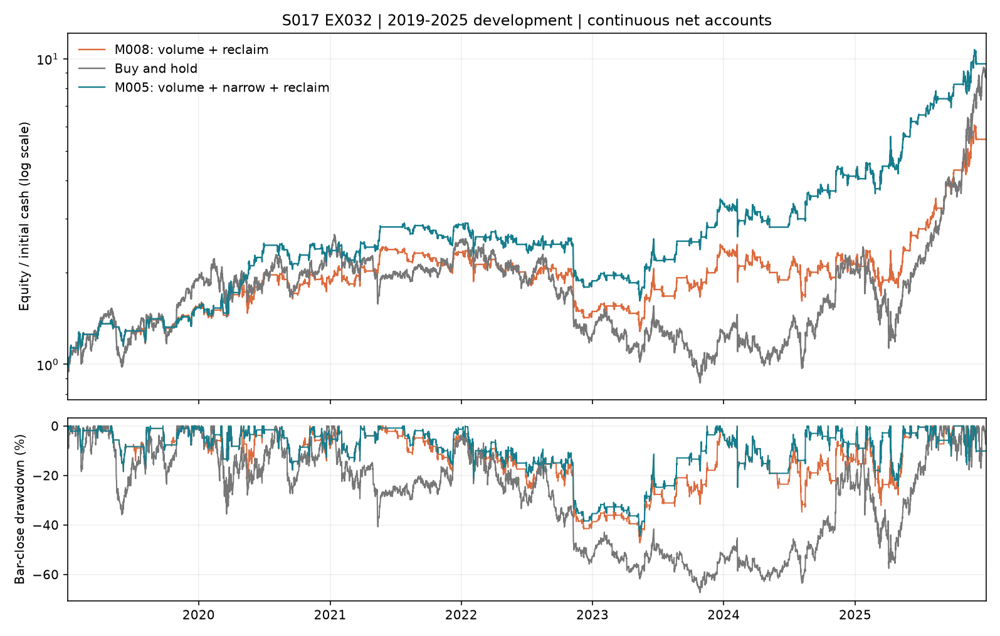

# EX032：M008数天修复简化规则的完整账户对照

Status: COMPLETED

本轮研究目标已完成；策略目标未达成。**删除窄幅限制确实增加交易并满足双频率，但净年化下降、回撤扩大，停止继续发展本次M008＋65柱简化表达。** 不继续调阈值、叠加背景或搜索其他持有期，不推荐阶段三。

实验于2026-10-30建立，2026-10-31完成。用户在研究决策评审后明确DEV完成、可继续；本轮只新增1个经济配置。平台已升级至V4，为使用当前公共诊断，另做1个M005技术控制复算，2候选共享1个买持。没有重跑全部旧账户。

## 完整账户结论

|账户|净年化|30分钟最大回撤|闭合交易|60日闭合中位数|至少3笔窗口覆盖|持仓柱占比|
|---|---:|---:|---:|---:|---:|---:|
|M008＋65柱 / C0061|27.50%|47.26%|164|6|99.71%|46.78%|
|M005＋65柱 / C0062（V4控制）|38.31%|44.47%|145|5|95.12%|41.36%|
|同合同买入持有|36.32%|67.34%|0|—|—|100.00%|

相对M005，闭合增加19笔，中位数5→6、覆盖95.12%→99.71%；但年化降低10.82个百分点，最大回撤扩大2.79个百分点。M008自身年化也低于买持8.82个百分点。频率改善不能抵扣收益或风险失败。

原五项目标全部保留：年化至少正买持1.5倍，本窗口约54.48%；30分钟回撤同时不超过买持80%及25%；60交易日闭合中位至少6，至少90%完整窗口不少于3笔。M008仅相对回撤、两项频率通过；M005控制仅相对回撤和频率覆盖通过。不得按通过项目数量排序。

## 唯一假设与完整规则

研究问题是：放量阴线被随后完成柱收复后，是否存在数天修复机会；要求阴线波幅较窄是否排除了仍有价值的机会？此前M008有399次信号、163个完整65柱去重事件、1.3651%扣费均值，已有单次完整账户的研究依据；其自身均值低于M005、背景调整增量不清楚、2022/2024事件均值为负，是事前保留的反证。没有把事件均值当策略年化或独立验证，也没有要求每个条件先分别显著。

M008：前一已完成柱Close<Open；其Volume不低于此前20个不同实际交易日同美东起始时刻成交量中位数的1.5倍；当前已完成Close严格高于前柱High。M005只多一个限制：前柱TR不高于截至更早一柱的ATR13。TR考虑本柱高低及相对前收盘跳空，ATR13是13柱TR的简单均值。高成交量和收复只是价格行为表达，不证明真实买卖动机。

两者实际成交后完成65根30分钟柱持续要求退出，到期受阻则锁存到真实清仓。持仓中不加仓、不重置时钟；失败买单不启动持仓周期。65柱沿用既有数天观察尺度，没有搜索期限、止损或阈值。全资金整数股、只做多不加杠杆、USD100000、每侧0.1%、固定1%买入限价上限、下一段执行、严格触价、零额外滑点、资金即时可用研究假设及期末不强平保持。

## 从信号到实际资金

|账户|原始信号|持仓时忽略|空仓信号|实际买入|闭合|平均单笔净收益|盈利比例|期末权益USD|实际费用USD|
|---|---:|---:|---:|---:|---:|---:|---:|---:|---:|
|M008|399|235|164|164|164|1.3071%|49.39%|545505.30|65731.90|
|M005|324|178|146|145|145|1.8372%|53.79%|963356.91|84960.69|

两候选期末均空仓，闭合损益与权益变化对账。M008原信号多75次，实际只多19笔；持仓占用也增加。不能把所有新增信号当新增可交易利润。费用总额下降不能解释为交易效率提高，因为本金积累、订单数量和完整资金路径同时变化。

M008有1次已知中断导致卖单受阻，随后持续退出；M005另有1次买单未触价。受阻执行按原已知中断合同处理，不跳过信号或按未来收益补选。

公共路径诊断按入场交易日匹配：同日入场127组、M005独有18组、M008独有37组。这不是精确时点的随机配对；资金及后续入场路径已改变，不能把M008理解成在M005旧账本上简单增加19笔，更不能删几笔损失合成反事实收益。

## 时间路径及最强反证

|连续账户年度收益|M008|M005控制|买入持有|
|---|---:|---:|---:|
|2019|54.41%|53.09%|89.40%|
|2020|19.11%|51.21%|19.26%|
|2021|26.46%|23.69%|11.43%|
|2022|−35.93%|−34.46%|−50.13%|
|2023|59.60%|78.43%|0.47%|
|2024|−10.33%|23.33%|58.85%|
|2025|155.78%|133.27%|334.44%|

年度从同一连续账户的年末权益计算，不重置本金，不按平仓年合计替代。年份只定位表现，不构成年度开关。M008在2019、2021、2025收益更高，是反对“所有额外机会都差”的证据；但其他年份与资金积累代价使完整账户退化。不能因2025更好而删去早期历史。

M008最大回撤由2021-06峰到2023-05谷形成，2023-12恢复旧峰；M005由2022-01峰到同一2023-05谷，2023-11恢复。前5盈利笔占各自正损益约26.50%/28.21%，不据此新增集中性硬门。

本轮支持的判断是：**在这套完整规则和已见开发池中，删除窄幅条件的整体代价超过机会增密的收益。** 这不证明窄幅条件的独立因果作用、不证明所有M008机会都差，也不把本次失败扩展为所有放量修复无效。

## 当前V4控制和数据边界

DEV完成后的基线是`master / 82636b0ce`。本轮遵守当前默认master开发约定，仅增加S017研究材料，不修改平台或A股实现，不新开分支、不合并/tag/推送。

旧V2/V3研究读取认证已退役。旧C0048未改写；新C0062用独立V4身份复算同一经济配置。两者候选及嵌入买持的账户点、日末账户、决策、订单、成交、交易、权益事件七表**预先声明的完整经济投影均无差异**。比较排除簿记ID、版本说明和解释schema，不冒称全部字节相同或旧证据重新获得V4资格。具体字段和固定精度见[控制核对](others/control_equivalence.json)。

原行情、日历及公司行动内容哈希不变；V4所需新约束字段通过公开ProviderBinding，以新来源版本显式表达原研究执行假设：价格限制不模拟、买入即可卖、整数步长、资金即时可用。SettlementAt是即时研究时点，不称真实券商结算事实；原约束资产未改。原NONE行动来源不升级为独立完备历史证明，RAW不宣称含分红总回报。

只用2018-11/12原预热及2019—2025开发，23298根含预热，22790个决策点、1760个交易日。全部OBSERVED，5根已知阻断按原规则处理。无新供应商下载、无2026行情或策略绩效访问、无其他批次；此前已见2026公开经营信息的边界继续保留。旧原件与新资产共同保存，仅Git不足以恢复完整证据。

## 验证、资源及决定

- 公共SRT/TXE合成预检通过：严格收复、量能/窄幅等号、失败买入、65柱计时、受阻锁存及未来后缀扰动的前缀七表经济一致。没有非空公司行动验收或全仓回归声明。
- 两候选正式决策逐点复现EX025的22790个时点，M005/M008分别324/399次信号，零差异。
- 公共V4评价/证据发布、同合同共享基准、旧控制经济投影核对通过；1组公共配对诊断COMPUTED，金额残差小于1e-6美元。独立数字核验及正式报告发布结果见下方引用。
- 2个spawn工作进程、每进程原生线程1；共享1个输入快照及1个买持。会话约141.6秒，含数据准备等端到端约143.1秒；计算阶段墙钟约40.1秒、认证约65.0秒；两个候选回放分别约16.2/15.8秒。各阶段并行/统计口径不同，不直接相加或外推任意策略速度。

**决定：停止M008＋65柱删除窄幅表达的后续调参及组合。** M005仍是数天修复的历史研究参照，原收益、绝对回撤及频率中位数差距未解决；本轮不将它自动送阶段三，也不重启条件拆解、止损等待或短周期过滤。下一项研究必须提出与已检验规则有实质区别、能改变决定的完整机制，不能以未试配置或更多交易本身作为依据。

本轮已按事前规则给出明确负面收口，不追加账户。下一步建议先形成新的完整机制及最小反证设计，当前未执行；阶段推进、目标修改、冻结、PTE及生产均未授权。

证据：[事前设计](protocols/design.md) · [合成预检](others/precheck.json) · [数据身份](others/data_preparation.json) · [正式账户](others/accounts.json) · [信号复现](others/signal_validation.json) · [账户分析及诊断引用](others/analysis.json) · [独立核验](others/result_validation.json) · [发布回执](others/publication.json)
