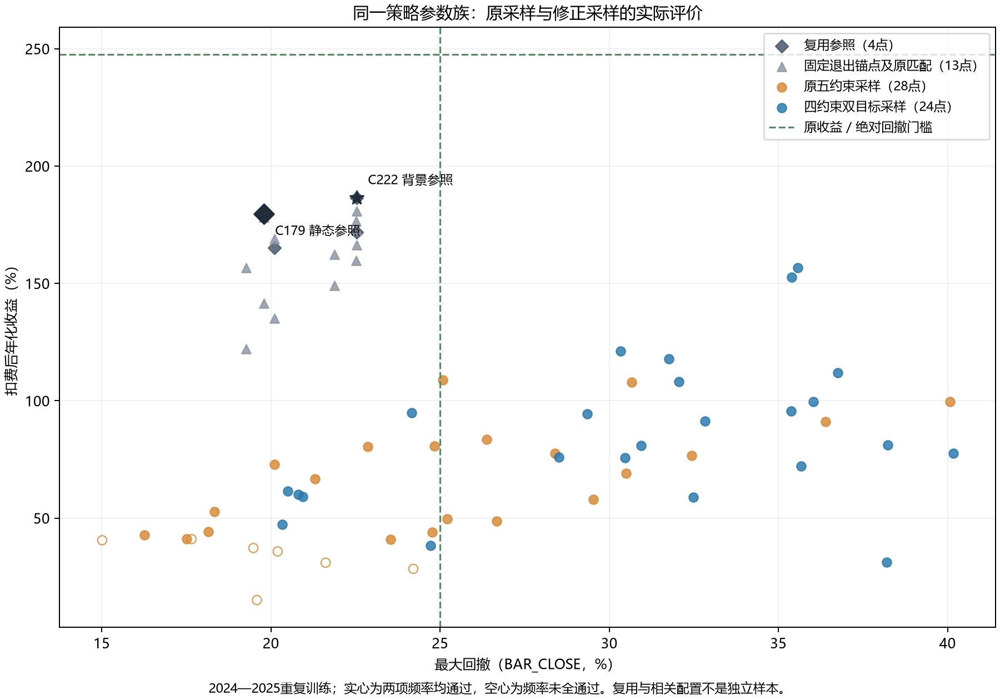

# 风险与频率可行性引导：同模型采样修订

本组已完成，0项同时达标，策略目标未达；四项采样引导真实生效，尚未带来金融改善。

## 尝试了什么

本组逐字保留原金融策略和参数域，只将采样可行性改为原风险与频率四项。收益继续作为最大化目标，回撤仍是第二个最小化目标；最终策略必须满足原五门AND，收益门没有放宽。旧完整观察只导入已认证结果，没有重算或把family证据冒充逐点完整账户。

单Study在已有观察基础上提出有限新组合，最后固定代表作匹配；所有点同源、同执行，旧负证与选择史保留。[精确协议](protocols/design.md)区分了采样引导、金融验收和历史身份。

## 学到了什么

历史导入、实际四项系统约束及首批参数都与独立复现逐点一致，说明引导修订已经落到真实调用链。新增完整账户仍未超过C222，且没有任何点达到原收益门；修订采样元数据成功不等于策略成功。

多目标采样仍要在收益与更低回撤之间分配观察权重，而用户的金融条件是在回撤门内合格，不要求继续追求更低回撤。后续可检验以收入为单一采样目标、用原风险与频率作约束是否更贴近任务；这不是账户或原结果作废，也不能仅凭密度权重宣称会提高收益。

## 下一步是什么

本组最终没有达标点，已满足预先批准EX059的条件：同金融模型、同域与样本下，将采样改为单收入目标，并用联合观测分量保留参数共同出现的信息。原四项采样约束和五门金融验收均不变，旧两项经济观测仍保留。

这同时改变采样目标与参数分量组织，不能给它们作单因素金融归因。联合分量不是学习完整协方差，也未被证明更局部或更有效；独立未评分前检甚至保留了相反的距离/rank证据。新程序须经实际API与新首批expected前检，再在有限预算内以真实账户检验，不筛掉不喜欢的draw、不从诊断伪造收益。没有自动阶段四或封存测试。

## 依据是什么

全部历史逐项保持参数、actor、原经济值、序列和五门资格；所有新点的日末与BAR_CLOSE权益、实际闭合时间窗口由独立程序重算。必要完整原账金额与新状态路径也已审核，原hash绑定后没有重复SE或回放。

实际首批在evaluate前匹配冻结B参数，使用expected作技术断言而非强制入队。真实FrozenTrial系统约束四项与原五项向量同时公开，不能把采样可行的点当作金融达标。重复训练、多轮选择和有限覆盖的反证仍然存在。

## 附录A：原门、关键代表与预算

原收益门247.633956%；BAR_CLOSE DD同时不高于42.810252%及25%；60日闭合中位至少6、至少90%窗口有3笔。2024—2025训练、必要2023预热、2026封存；100000新空仓/0或1只多、每侧.1%费、固定1%买限价与下一段执行保持。

|身份|性质|净年化%|DD%|闭合|中位|覆盖%|
|---|---|---:|---:|---:|---:|---:|
|C0222|历史参照、全体收益及其余四门池最高|186.3551|22.5401|94|12|100|
|C0264|实际新首批B第一点|58.8659|32.4927|106|13|100|
|C0275|最高收益新点|156.7381|35.5698|124|14|100|
|C0287|新点中其余四门全过的最高收益|94.8602|24.1561|77|9|100|

69成功唯一观察=45旧点0compute+24新model TPE；69 COMPLETE/0FAIL/0重复，matched六比较全为已有点，0新匹配，不为用满预算补random。真实24候选compute+2共享BH=26，必要原账RESUME也是0新compute。各原门通过数为收益0、相对DD69、绝对DD40、中位62、覆盖63；四项sampling-feasible33，但金融joint仍0。

全部69点期末均空仓；11必要完整V4为8条旧公ref精确复用与3条新ref，不是旧4条，也不是为69点再开账户。新C264/C275/C287费用分别24884.64/45554.76/23017.11，期末净增均为已平利润。完整年度/成本/闭合明细见全部族记录，不能把更低费用或更低DD独立当作目标达成。

## 附录B：采样边界与后继反证

原45观察金融值与原五门完全不变，只有采样约束从五项改四项，使27点能够给模型提供可行观察权重。正式首批4参数逐点匹配冻结B，且全COMPLETE系统约束均为实际四项；这是技术接线证明，不是收益证明。

条件EX059独立0账户诊断保留了不利结果：在同69观察下，联合首四draw相对旧代表的归一化距离比独立单目标版本更大，已知较好g中心profile密度rank也未改善。选择联合模型的依据是金融参数存在交互、分量保留共同观测，而不是已经证明效率或邻域优势。这些诊断不作新硬门，不重抽提议；实际收益须由新有界程序判定。

## 附录C：公共证据

[全族与共同calendar](others/search_publication.json)、[完整必要原账](others/accounts.json)、[代表结果](others/analysis.json)、[匹配去重](others/matched_ablation_plan.json)、[首批实际接线guard](others/first_batch_sampling_guard.json)、[原序列/金额/raw独立审计](others/independent_validation_publication.json)、[0compute恢复](others/selected_resume_stats.json)、[冻结协议与源](others/pre_run.json)。

## 附录D：全参数记录的采样比较图

图展示两组新点及复用参照，空心表示未过原频率条件；不加jitter，不把同训练/同参数复用当独立样本。原目标线与0joint保留。图、生成源、输入公族及可视QA，以及后继未评分机制诊断均见[公共留证](others/sampling_comparison_publication.json)。图形展示不增加金融试验或验证资格。
