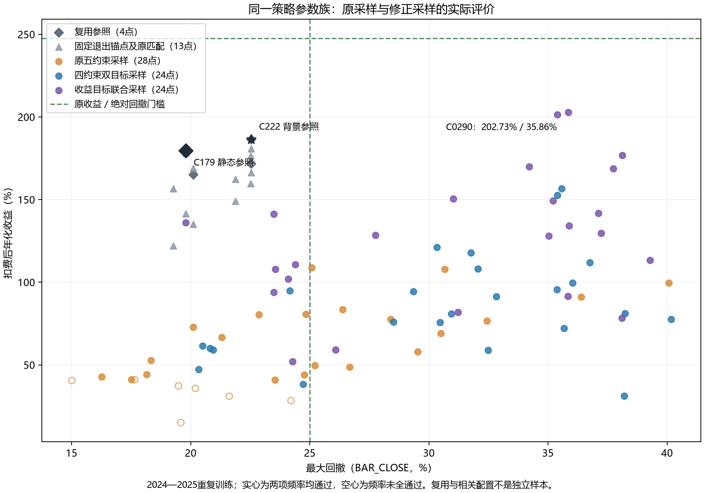

# 单收入目标与联合参数分量：最后一组有界优化

本组已完成，0项同时达标，策略目标未达；停止继续扩充这一价格参数族。

## 尝试了什么

本组在EX058最终0joint后启动，逐字保留金融策略、参数域、均价背景与执行。采样同时改为单收入目标和联合观测分量，风险/频率仍是采样约束，最终仍须原五门AND。历史两项经济观测没有删除，新Study只把年化作为一个objective；DD继续作为原硬门和结果指标。

联合分量保留同一历史参数组合共同出现的信息，不等于学习完整协方差或必然更局部。未评分诊断的不利距离/rank也保留，没有据此重抽或换设置。只做预先批准的有限模型提议和去重匹配，没有增加金融源码、指标或持有时间规则。

## 学到了什么

出现了更高的未达标收入点，但同时违反绝对回撤门；在原风险与频率条件内，仍没有超过C222。较低风险的新点又明显牺牲收益，因而不能把单收入目标、联合采样或某项退出称作已经解决问题。

采样调用链按设计运行，旧经济结果与资格保持，未发现独立采样fallback或账户错误。本组失败不能由此归为某一个参数、入口薄弱或某一种行情原因，也不能把有限预算当作整个金融族不可能的证明。需要停止无依据增加同类常数，转向能提供不同辨识的交易信息。

## 下一步是什么

保留C222作为未达标的风险/频率强参照，保留更高收入但回撤失败的点及全部负证，不采用它们、不进入阶段四。后继若继续，先提出并锁定不同成交活动的信息问题，例如缩量回落及收复时参与恢复，做固定多期普查，再比较完整政策；不能从某个延续期的正均值直接设置时间退出。

新的量价信息也只是待检验假设，不证明卖压耗尽或主动买盘。本报告不借新路线掩盖本参数族的目标缺口，不放宽收益或风险门，2026测试继续封存。

## 依据是什么

旧观察的参数、actor、完整经济、原序列与资格逐项保持，新单objective值、四项实际系统约束和五门独立验收同时留证。真实首批与新的单目标联合expected逐参数一致，五维relative空间与0fallback均通过，不是把expected强行enqueue。

全族原序列独立重算收益、BAR_CLOSE DD和真实闭合窗口，必要完整原账金额与新状态重建也通过。全部初始、匹配及历史一起筛joint，没有只取Study前沿。多轮同训练选择、经济相同或相近参数点和旧负证均不构成独立市场验证。

## 附录A：原目标与关键完整账户

收益门247.633956%；BAR_CLOSE DD同时不高于42.810252%及25%；60日闭合中位至少6、至少90%窗口有3笔。2024—2025训练、必要2023预热、2026封存；100000新空仓、0/1全资金只多、每侧.1%费用、固定1%买限价/原tick/严格Low及下一段执行保持。

|身份|性质|净年化%|DD%|闭合|中位|覆盖%|
|---|---|---:|---:|---:|---:|---:|
|C0222|原历史、其余四门过池最高收入|186.3551|22.5401|94|12|100|
|C0288|实际单目标联合首点|78.3653|38.1018|104|12|100|
|C0289|新点其余四门过池最高收入|141.2218|23.4947|58|7|98.8713|
|C0290|全体最高收入、未达标|202.7259|35.8591|113|13|100|

C290仍低收益门约44.91个百分点且DD高于25%门约10.86个百分点，不能称接近通过。其主DD段2024-02-07至06-04，已接受且此前净浮盈持有区间（含due）的会计净变化约−26642.88，主DD净损约−43128.87；这只是该实际持仓路径的分组描述，不是可避损金额或初始入口薄弱的充分证据。

新C288/C289/C290手续费分别30698.97/24609.55/53345.45，均期末0股。全部93观察期末均空仓，未用末仓浮盈解释收入。年度、已平损益及详细贡献保留在全族和原账，不能用同theta控制缺失的差额归单个g因果。

## 附录B：实际预算与完整资格

69历史0compute+24新model TPE=93 COMPLETE，0失败/重复/联合达标；matched六比较全为已有点，0新匹配，不用完剩余额度也不补random。真实24候选compute+2共享BH=26，必要原账RESUME也是0新compute。

各原门通过数0/93/47/86/87（收益/相对DD/绝对DD/中位/覆盖），四项sampling-feasible40而金融joint仍0。14必要完整V4为11旧公ref精确复用与3新ref；raw逐状态重建3新路径，历史只明确继承11已审路径，不夸成69旧点全部重新raw审计。

## 附录C：公共证据

[全族与共同calendar](others/search_publication.json)、[必要完整原账](others/accounts.json)、[代表结果](others/analysis.json)、[匹配与复用](others/matched_ablation_plan.json)、[actual single/joint首批guard](others/first_batch_sampling_guard.json)、[独立全序列/金额/raw审计](others/independent_validation_publication.json)、[0compute恢复](others/selected_resume_stats.json)、[冻结源/协议](others/pre_run.json)。

[图、生成源、provenance与可视QA](others/sampling_comparison_publication.json)保留三个公族输入和93唯一参数记录。方法按顺序承接不同数量历史，变化也非单因素，不以图形认定某算法造成金融收益优势；所有图中代表仍须原五门AND。
