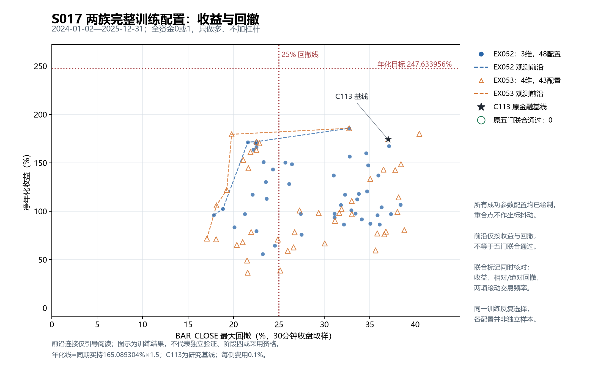

# 阶段三：金融决策改造与参数优化结果

## 尝试了什么

以C113普通阴线收复后的延续为收益对象，把入场推进幅度、初始结构失效和已确认突破后的容忍度改成连续金融决策函数。第一族共同研究收复幅度与两类失效位置；第二族进一步让已完成的新推进部分进入保护。没有固定持有期限，没有把26柱重新当作金融逻辑。

初始失效线为S0+a(R−S0)，接受后基础线为L+b(H−L)。后继加入g·max(0,P−H)，其中P只来自最后已接受配对之后的完成收盘价，未接受候选不能修改H。g保护新增价格推进，不保证本周期扣费盈利。所有试点由同一公开账户实现和真实Optuna Study管理，原五门同时验收。

## 学到了什么

改造已经完成，也改善了风险与收益之间的可选前沿，但没有产生满足全部原目标的策略。强风险代表的收益提高伴随更多手续费，改善不是省费；最大收益代表仍未达到收益门。关键代表期末均已正常平仓，结论没有借助未兑现末仓或末日强平。

新增推进保护把主要回撤转向尚未获得接受确认的初始结构阶段。这支持停止继续收紧接受后的退出参数，不能由此认定初始损失本可避免。旧最大收益路径中跨夜至次日首个完成点的损失也包含开盘后变化，不能全部称作无法避开的跳空。具体分解见附录及独立审计。

## 下一步是什么

结束这两族的扩充，交付空达标候选集。下一步建议回到入场信息与额外收益来源的辨别，由用户审阅决定新的研究方向；不自动进入阶段四，不读取封存测试，不把四门通过的研究代表当作可采用策略。

## 依据是什么

两族保留全部成功与负面记录、逐日净值、参数、源码、约束及真实选择历史。精确零点嵌入与旧源控制的完整经济投影通过，独立审计复核全部试点统计，并对必要公开原账和金融状态进行重建。相同训练上的自适应选择、跨族零点复现和技术控制均不构成独立验证；结论也不是全局最优或参数空间穷尽证明。

## 附录A：原目标与代表结果

训练为2024—2025，必要2023指标预热；2026测试封存。新账户100000、0/1全资金只多、每侧0.1%费用、1%买限价溢价、下一段执行，全部保持。收益门247.633956%，相对DD门42.810252%，绝对DD门25%，60日闭合中位至少6且至少90%窗口有3笔。

|代表|净年化%|BAR_CLOSE DD%|闭合|60日中位|覆盖%|验收|
|---|---:|---:|---:|---:|---:|---|
|C113 原金融原型|174.2582|37.0176|150|18|100|收益与绝对DD失败|
|C136 全体最大收益|185.6853|32.7371|145|17|100|收益与绝对DD失败|
|C147 第一族其余四门通过代表|171.9000|22.5409|94|12|100|收益失败|
|C169 第二族正g最大收益|179.9579|40.4638|见完整记录|见完整记录|100|收益与绝对DD失败|
|C179 第二族其余四门通过代表|179.4939|19.7969|118|14|100|收益失败|

C179净增674822.13全部已平，期末持仓0，费用48303.02；相对C147财富增加41371.67、费用增加8340.76。C179主DD移至2024年7—8月，初始结构状态贡献约74.83%，已接受且此前净浮盈状态含due续段约14.15%；这是实际持有区间的会计归因，不是删除分组可避损反事实。旧C136主DD的跨夜至次日首完成点损失19450.08，其中Close→Open14058.72、首30分钟5391.36，分别占主DD37.43%与14.35%。

## 附录B：完整预算、选择史与证据

EX052为40初始+8匹配=48唯一族内记录；初始实际12固定锚+1正常startup随机+27模型TPE。EX053为36初始+7新匹配=43；8项匹配中一项复用已有g0，初始15锚后21模型TPE。两族alpha扩边均未触发，不为用完预留额度强行扩边；自然端点不盲目扩展。第一族18项、第二族17项通过绝对DD，但全部91项都失败收益门，全部通过相对DD与双频率，联合达标0。

共91族内唯一记录，含4项新源零参复现；另有4旧源exact控制。实际95候选compute+8共享买持compute=103，技术失败0。它们不是91个独立样本，也不是8个独立基准。保留旧七年/长持有负证、阶段二选择史和边界勘误；旧36+12提案仍WITHDRAWN。

[机器统计与完整引用](STAGE3_FINANCIAL_OPTIMIZATION_REVIEW_20261031.json)；[第一族报告](../experiments/EX052_20261031/report.md)；[第二族全记录](../experiments/EX053_20261031/others/search_publication.json)；[第二族完整原账](../experiments/EX053_20261031/others/accounts.json)；[第二族独立审计](../experiments/EX053_20261031/others/independent_validation_publication.json)；[图来源与QA](../experiments/EX053_20261031/others/figure_publication.json)。
