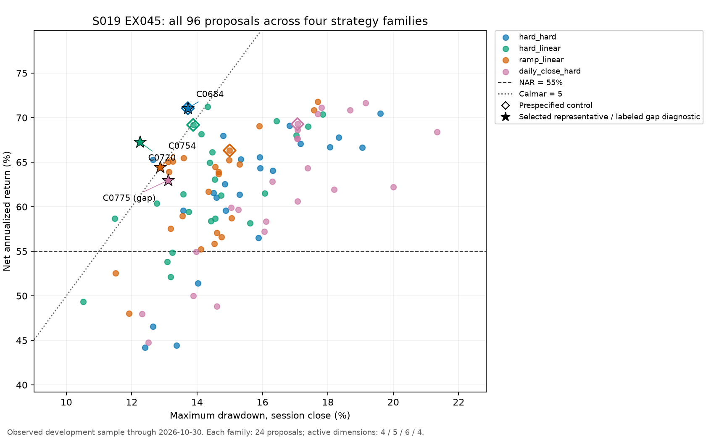

# EX045 四家族有限适配对照

96 个提议全部保留；代表和各族控制按公共账户读取。新增账户 0。

|家族|六门达标/24|代表|选择状态|NAR|MDD|Calmar|
|---|---:|---|---|---:|---:|---:|
|hard_hard|2|C0684|SIX_GATE_REPRESENTATIVE|71.0588%|13.7170%|5.18035|
|hard_linear|2|C0720|SIX_GATE_REPRESENTATIVE|67.2761%|12.2465%|5.49351|
|ramp_linear|1|C0754|SIX_GATE_REPRESENTATIVE|64.4138%|12.8647%|5.00701|
|daily_close_hard|0|C0775|CALMAR_GAP_DIAGNOSTIC|62.9706%|13.1161%|4.80102|

各族完整分布、六门失败组合、边界位置和费用/闭合周期数见 JSON；代表账户另含实际成交数、年度收益、MDD 起止、最大亏损周期及成对仓位差。
每族首个控制计入 24 提议；四族连续参数维度分别为 4/5/6/4。家族代表比较同时披露参数差，属于本轮有限适配结果。
代表相对控制及跨族代表差异按完整配置的改善与代价解释；结构作用结合 EX043/EX044 及后续 R4 同参数配对。各族独立种子、参数维度和覆盖难度已披露，某族零达标记为本轮 24 次提议内未发现达标配置。
若后续阶段四仍对每个有效轴采用 −5%/中心/+5% 全笛卡尔邻域，四族名义邻点数分别为 80/242/728/80，实际点集按合法性与精确去重确定。已搜索的参与宽度、退出宽度继续作为有效轴；后续成本仅用于说明研究投入，原六门与 NAR 选择保持。
R4 第二锚点采用 ramp_linear 的原六门代表；该族无全门点时采用其余五门合格集合内最高 Calmar 的缺口诊断点；集合为空交回主线程。

R4 可加入 hard_linear 原六门合格中最高 NAR 为第三锚点，用同参数三种退出×三档 ATR 检查达标配置的机制取舍，最终点集在 R4 冻结前确定。

分析源码 SHA256：`9ea1aaa981887a590858266df688432579aca9b1488ba542f5669da2ccfc371c`

完整输出：`others/family_comparison.json`。

