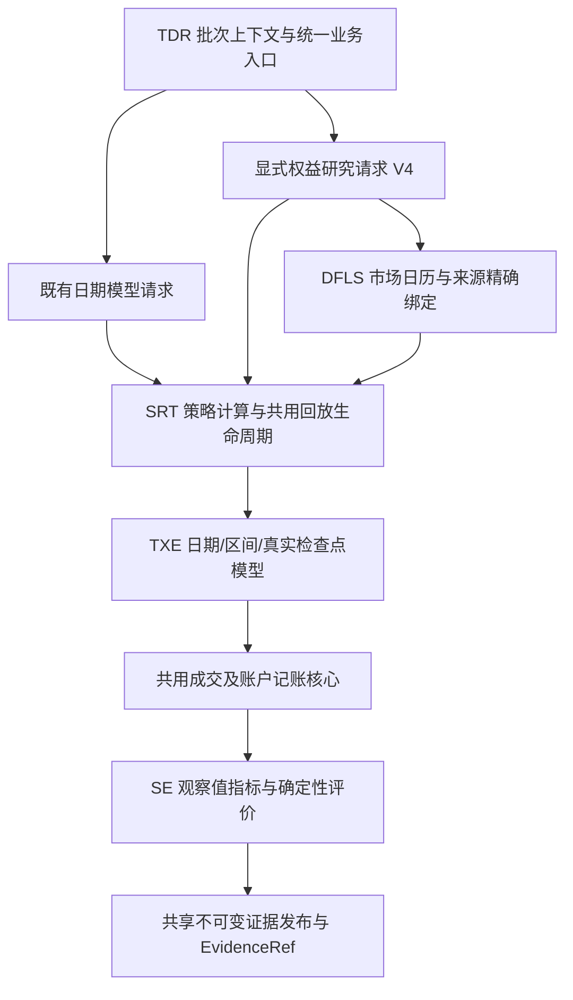

# TDR 研究工具使用说明

TDR 为研究员提供批次上下文、研究概览、账户评价与诊断、回测、实验报告、结果留证、候选登记及五阶段交付。
本文是这些公共工具的统一使用入口，说明调用契约、支持范围、示例及结果处理；研究方法与判断责任由RSCH指南规定。
阶段二、三的探索与搜索由 RSCH 自主组织；TDR计算并保存声明结果，不在普通读取、登记或发布时独立证明结果正确。
研究目标、授权、候选选择和冻结批准见 [RSCH 契约](../../research/RSCH_AGENT.md)。
用户 CLI 提供 `backtest run`；Python API 与 CLI 的结果保存行为分别说明如下。

A股、美股的新账户研究统一使用显式会话内的V4接口，详细类型与完整示例见[第10节](#us-equity-research)。
旧普通评价、发布和候选登记链已删除；历史材料仅用于明确的读取、诊断及技术检查，不能恢复为新研究计算入口。
研究判断分别参阅[通用指南](../../research/RSCH_AGENT.md)、[A股补充](../../research/guides/CN_RESEARCH.md)和
[美股补充](../../research/guides/US_RESEARCH.md)；本文维护平台契约，不代替研究政策。

## 1. 公共契约与能力导航

| 任务 | 公共入口 | 输出与职责 |
| --- | --- | --- |
| 业务操作 | [application](application/__init__.py) | 批次、证据、候选、交付、决定、检验、冻结及发布包升级入口 |
| 研究类型 | [research_tools](research_tools/__init__.py) | 上下文、评价请求／结果和强类型交付内容 |
| 立项与意图 | `create_research_batch`、`update_research_intent` | 研究族、立项凭据及 `ResearchBatchRef` |
| 批次能力与实验分配 | `create_research_context`、`create_experiment` | `ResearchContext`、`ExperimentRef` |
| 账户评价 | `research.evaluation.prepare/evaluate_many` | 绑定输入、计算各窗口／成本场景及逐项结果 |
| 完整回测 | `run_backtest` | 既有契约返回`BacktestEvaluation`；V4权益研究使用显式会话的`prepare/evaluate_many`，见第10节 |
| 结果留证 | `publish_evidence`、`publish_evidence_many` | 单项 `EvidenceRef`；批量逐项 `PublicationOutcome` |
| 候选登记与读取 | `register_candidate`、`load_candidate` | 保存候选载荷、源码快照及支撑证据，读取已登记实体 |
| 五阶段交付 | `assemble_delivery`、`validate_delivery` | 结论、选定证据快照和不可变修订 |
| 研究概览 | `get_research_overview(repository, batch)` | `ResearchOverview`，提供研究导航、轻量元数据状态及核验范围 |
| 账户诊断 | `diagnose_accounts(repository, AccountDiagnosisRequest)` | `AccountDiagnosisResult`，正式账户损益、路径差异及覆盖 |
| 实验检查 | `validate_experiment(repository, ExperimentValidationRequest)` | `ExperimentValidation`，实验结构或报告发布一致性 |
| 自检与比较 | `build_assessment_evidence`；SE `assess_candidates/compare_candidates` | 数值事实适配、自检和比较 |
| 技术检验与冻结 | `inspect_candidate`、`record_research_decision`、`freeze_candidate`、`get_freeze_result` | 真实用户决定、技术检验、批准与事务状态 |
| 同版本发布包升级 | `prepare_frozen_runtime_upgrade`、`apply_frozen_runtime_upgrade` | 精确新旧身份、审计材料、归档及提交；独立于研究检验 |
| 目录与模板 | `validate_catalog/list_catalog/show_catalog`、`validate_templates/list_templates/show_template/instantiate_template` | FSC/STC 公开内容与绑定校验 |
| 运行发布 | `list_installed_strategies`、`strategy_info`、`deploy_strategy`、`validate_release_package` | 发布查询和单独获准的部署操作 |

项目复用因子计算由 [FSC](../../packages/factor_signal_catalog/README.md) 提供，策略编写使用
[SRT](../../packages/strategy_runtime/README.md) 公共契约。第三方研究库由研究员组织，见
[RSCH 的使用原则](../../research/RSCH_AGENT.md#62-研究工具使用原则)。

| 对象 | 当前版本 |
| --- | --- |
| 历史`account_evaluation`证据／请求身份 | 8／7、7／6仅支持显式历史读取和检查，不再新发布 |
| 新账户`equity_research`证据 | 4；A股、美股共用，旧格式不自动转换，见[权益证据边界](#us-equity-evidence) |
| 已发布账户评价／回测 manifest | 5／5 |
| 实验报告快照 | 1 |
| 研究交付定义、文档和回执 | MANDATE默认12，COMPONENTS/CANDIDATES为8，PROTOTYPES为10；ASSESSMENT支持12—15对应请求契约 |
| INSPECTION交付定义、文档和回执 | 9 |
| 选型对象／冻结计划／技术检验报告 | 2／2／2 |
| SM 候选登记／候选内容身份 | 3／2 |
| SM 冻结版本／SRT 发布记录 | 5／5 |
| SRT 运行定义／运行绑定 | 3／2 |
| SRT 新解释观察／回测图投影 | `strategy_observation.v4`／`tdr_backtest_chart.v2` |
| 同版本升级计划／回执 | 2；既有schema 1升级归档只读 |
| SE 评价标准 | `opc-v3` |

版本按对象独立管理。新写入使用当前契约；历史只读支持以各入口明确范围为准，不自动迁移或改签原件。

## 2. 输入、状态与生命周期

- `RepositoryContext.discover` 定位仓库路径；`create_research_context` 打开已登记批次并配置 DFLS。
- 研究批次、实验和交付采用强类型请求；其他服务是否接收文件路径以各自公开签名为准。
- 单次评价和回测返回计算结果，数据准备可能更新 DFLS 资产，计算缓存位于 `.tmp/`。它们不自动登记候选或保存阶段报告。
- 显式发布的证据、候选快照及阶段修订不可覆盖；同一内容可复用，冲突明确失败。
- 实验 `src/`、`protocols/`、`others/` 和根目录 `notes.md` 可修改，技术修正或重复计算可沿用同一实验。运行结果、搜索数据库及检查点按需要保存于批次 `assets/runs/<实验>/<运行>/`。
- 正式结论的修正通过新交付修订表达。影响判断的有效负面结果、反证和修正说明仍须随结论保存。
- 数据身份、日期或数值不符时明确失败；研究成功、技术通过与用户批准分别判断。

## 3. 批次上下文、实验与数据

### 批次与实验分配

新立项使用 `create_research_batch(repository, ResearchBatchRequest, *, actor, reason)`，返回
`ResearchBatchRef`；调用前取得用户立项授权。更新意图使用
`update_research_intent(repository, batch, ResearchIntentUpdate, *, actor, reason)`。
重复启动同族的研究轮次需要显式且符合该策略ID的立项凭据，既有名称及范围须一致。

下面的连续示例在仓库根目录使用已获准并已登记的 `S900`。实际策略、日期、资源与费率按研究合同填写。

```python
from datetime import date
from pathlib import Path
from czsc_trader.application import (
    RepositoryContext, create_research_context, create_experiment, ExperimentRequest,
)
from czsc_trader.research_tools import ResearchBatchRef, ExecutionResources

repository = RepositoryContext.discover(Path.cwd())
research = create_research_context(
    repository, ResearchBatchRef("S900"),
    resources=ExecutionResources(max_workers=2, native_threads_per_worker=1, random_seed=42),
)
experiment = create_experiment(
    research, ExperimentRequest("收益机会检验", "该机制能否改善账户收益？", date(2026, 10, 7)),
)
experiment_root = experiment.resolve(repository.root)
source = experiment_root / "src"
```

`create_experiment` 在 `research/S900/experiments/EXxxx_YYYYMMDD/` 分配身份，创建 `experiment.json`、根目录初始 `notes.md`、进行中的`report.md`及`src/`、`protocols/`、`others/`。单个实验材料内聚于该目录，正式资产仍由批次`assets/`管理。实验报告独立发布，不要求阶段交付；操作见[实验报告发布](#实验报告独立发布与修订)。
编号在批次内跨日期递增，分配时参考本批次旧目录的现有编号；三位编号耗尽时拒绝。源码、实验方案和其他材料分别保存于对应目录，运行资料由研究程序按需要组织。

上下文的 `data`、`runtime` 和 `evaluation` 共用 `research/<批次>/assets/data/`。DFLS 的只读 `binding`
返回 `DataSpaceBinding(base_dir, space, space_id)`，可核对实际空间；批次上下文拒绝混用另一批次的数据能力。
默认供应商配置使用仓库 `.env`；需要明确的供应商绑定时向 `create_research_context` 提供 `ProviderConfig`。

```python
from dataflows import DataRequest, Dataset, PreparePolicy

requests = (
    DataRequest(dataset=Dataset.ETF_OHLCV, symbol="588080.SH", frequency="daily",
                start="2026-09-14", end="2026-09-15", required_cutoff="2026-09-15"),
)
prepared = research.data.prepare(requests, policy=PreparePolicy.REUSE)
if not prepared.ready:
    raise RuntimeError(tuple((item.status, item.error) for item in prepared.items))
market = research.data.fetch(requests[0], prepared=prepared.reference)
if not market.ready:
    raise RuntimeError(market.error)
```

一次 prepare 对完整请求集合完成校验、适用补丁及质量验收，再形成准备引用。fetch 读取已准备资产，
核对空间、准备身份与实现修订，不对子窗口重新执行质量验收。详情与门槛见 [DFLS 手册](../../packages/dataflows/README.md)。
独立取数与多个账户可复用相同批次空间；完整评价所需行情、分钟执行数据和策略预热由平台按实际依赖准备。

### 研究概览

`get_research_overview(repository, batch) -> ResearchOverview`接受已发现的仓库上下文和批次引用。
研究概览、账户诊断及实验检查均为只读入口，不创建数据准备环境，不访问供应商、PTE生产库或其他研究批次，不重新执行策略。

```python
from czsc_trader.application import get_research_overview
from czsc_trader.research_tools import ResearchBatchRef

overview = get_research_overview(repository, ResearchBatchRef("S900"))
```

`ResearchOverview`使用`schema_version=2`，返回以下轻量元数据：

| 字段 | 范围与含义 |
| --- | --- |
| `batch`、`registered_state` | 批次身份与登记状态；不代表用户批准或运行资格 |
| `task_sources` | `research/registrations/<批次>/family.json`与`research/<批次>/HANDOFF.md`来源引用；交接文件不存在时标记`present=False`，不解析授权、推算预算或解释交接内容 |
| `deliveries` | 每阶段最高修订的`stage`、`revision`、`reference`、`report_path`、`metadata_state`及`source`；元数据可读状态为`READABLE`或`UNSUPPORTED` |
| `experiments` | 实验编号、报告发布状态、发布引用、声明结果及元数据来源 |
| `snapshot` | `METADATA_ONLY`范围内实际读取的文件、目录及其哈希和查询时间；不覆盖关联证据正文 |
| `limitations` | 本次范围的限制及不支持的回执格式；不代表全批次没有其他问题 |

概览读取批次登记和实验的`experiment.json`、`report.md`、`report_ref.json`以及指针指向的报告快照。报告状态为`MISSING`、`DRAFT`、`PUBLISHED`、`UNPUBLISHED_CHANGES`：`PUBLISHED`表示当前报告与本次读取并认证的报告快照一致，不表示关联证据已全部核验，也不等同于研究结论通过。历史实验缺少根报告如实显示，不自动搬迁或补写。概览不递归读取报告快照的`evidence`或`previous`引用。

阶段交付在公开目录与资产目录中按数字修订号选最高修订，仅读取该修订的两份`receipt.json`并检查字节、引用身份及文件清单的声明哈希，不展开文件清单、不读取`delivery.json`或关联证据，也不读取交付业务状态和前驱内容。最高修订回执格式不支持时返回`UNSUPPORTED`、`reference=None`及限制，不能静默用旧修订冒充最新交付。`READABLE`只说明本次回执元数据检查通过；交付完整性、业务声明和数值结果须在选定具体交付后检查。

对实际读取范围保留类型、身份、路径安全及结束前一致性复核；发现读取范围内文件或目录发生变化时报`CONCURRENT_CHANGE`，不自动重试。必要元数据缺失、损坏或身份不一致明确失败。未读取的账户正文、交付正文及关联证据不纳入本次认证；使用具体成果时调用`validate_experiment`或`validate_delivery`进行对应范围核验。概览不扫描账户目录，不重算SE，不验证运行资格，也不判断研究是否充分。

这是返回契约变更：`component_tests`、`prototype_panels`、`candidates`、`handoffs`、`searches`和`counts`已移除，无轻量/完整双模式或旧返回结构兼容分支。完整组件、原型、候选及搜索材料通过具体交付引用按需读取。历史概览JSON、实验源码和证据保留原样；旧概览不能按新的`ResearchOverview`结构反序列化，读取旧字段的历史实验脚本不能直接重跑，维护中的调用方须使用新契约。

研究接手、重大转向或阶段收尾可使用概览定位成果；单个实验收尾使用报告发布与`validate_experiment`结果，无须每次刷新整个批次。登记状态、最高修订和历史PASS都不能代替当前用户授权。

### 实验结构与报告检查

创建实验后可用`STRUCTURE`检查结构；以下示例用于完成第5节的独立报告发布后，检查当前报告与正式引用的一致性。

```python
from czsc_trader.application import validate_experiment
from czsc_trader.research_tools import ExperimentValidationRequest, ExperimentValidationScope

check = validate_experiment(repository, ExperimentValidationRequest(
    experiment, ExperimentValidationScope.REPORT_PUBLICATION,
))
```

`STRUCTURE`检查身份、根报告及目录；`REPORT_PUBLICATION`还要求当前报告引用、快照、正文及关联证据一致。`ExperimentArtifactRef(owner, path, sha256)`中`path`相对其所属实验，禁止绝对路径、逃逸、符号链接或junction；共享材料可以属于同批次另一实验。只检查声明的必要材料，不要求完整过程封存，也不能发现未声明材料的语义归属。

返回`ExperimentValidation(status, scope, issues, report)`；`PASS`只表示结构或发布契约成立，不表示研究有效、实验成功、报告充分或阶段获批。

## 4. 策略评价与回测

### 账户评价与执行会话

A股、美股统一使用`EquityStrategyCandidate`、`EquityEvaluationRequest`和V4执行规格。
调用顺序是显式打开会话、准备请求、批量计算、按需投影或发布；单个账户也使用单元素元组。

```python
from czsc_trader.research_tools import ResearchExecutionSession, EvaluationEvidenceWrite
from czsc_trader.application import publish_evidence

with ResearchExecutionSession(research, experiment=experiment) as execution:
    prepared = research.evaluation.prepare(request, execution=execution)
    outcome, = research.evaluation.evaluate_many((prepared,), execution=execution)
    if outcome.status.value != "SUCCEEDED":
        raise RuntimeError(outcome.error)
    result = outcome.result
    account_evidence = publish_evidence(research,
        EvaluationEvidenceWrite(experiment, "account", prepared, result), execution=execution)
```

`prepare`只接受V4请求；`evaluate_many`只接受当前会话持有的`PreparedAccountEvaluation`。
已删除`evaluation.evaluate`、旧`EvaluationRequest/Result/Run`公共导出、旧账户准备和发布分支，
不提供自动转换、兼容别名或失败后的旧引擎兜底。原始请求不能跳过准备直接提交计算。
历史数据模型由显式技术检查内部读取，不作为新的研究接口。旧research_backtest模块及其vectorbt计算后独立账本复算链已删除；历史S001/S002脚本如需重做研究，须迁移至V4，而不是重新启用旧入口。

会话按输入与配置身份共享准备后的行情、特征及精确买持基准；首个账户显式建立基准后可复用。
请求身份、会话归属、执行规格及结果对象对应关系属于调用契约；默认计算不独立审计账本、重算既有指标或认证上游研究结论。
`EvaluationOutcome`逐项返回`SUCCEEDED/FAILED/CANCELLED/UNKNOWN`，成功结果与错误互斥。
进程失败不自动切换串行或重试，调用方按实际状态处理。计算不会自动登记候选或更新实验报告。

### 资源与显式恢复

通过`ExecutionResources(max_workers=..., native_threads_per_worker=...)`限制公共执行资源。
工作进程使用公共执行器；不要在批量评价外再嵌套进程池。准备、共享基准、账户计算和发布采用同一会话生命周期。
Optuna负责参数提议和搜索轨迹，tsfresh负责适用的特征提取，expr_codegen负责表达式生成；
pandas、NumPy等负责批量数据处理。研究员选择方法并控制计算规模，TDR执行明确请求。

通过`ResearchExecutionSession(..., checkpoint=ExecutionCheckpointRequest(run_id, CheckpointMode.CREATE或RESUME))`显式创建或恢复检查点。V4检查点保存结果、输入和账户依赖的不可变字节，恢复核对请求及对象身份，
不重新执行策略、提取账户事实或复算指标。缺失或损坏明确失败，不读取磁盘pickle、不退回旧格式恢复。
恢复和发布不会认证历史报告、候选资格或研究结论。完整会话参数与共享输入示例见[第10节](#us-equity-research)。

### 显式基准与费用

V4使用`EquityBuyHold`及对应`ResearchBenchmark`，基准身份包含市场执行规格、窗口、输入、资金及费用。
不同市场的交易日历、数量单位、公司行动和可交易规则由显式事实及执行规格决定，不能因共享API而混用。
费用、场景及计量层级由RSCH声明；平台不从场景名称推算费用，不自动增加成本压力场景。

### 完整回测

```python
from czsc_trader.application import BacktestRequest, run_backtest

backtest = run_backtest(
    research, frozen_version,
    BacktestRequest("588080.SH", "etf", date(2026, 9, 14), date(2026, 9, 15),
                    initial_cash=1_000_000, lot_size=100),
)
print(backtest.manifest["audit"]["status"], backtest.metrics)
```

`run_backtest(research, strategy, request) -> BacktestEvaluation` 仅接受已认证的冻结`StrategyVersion`，
返回账户、基准、指标与审计，不自动保存 CSV、报告或图表。`lot_size` 必填正整数，并须与策略执行合同一致。
该冻结回测是显式技术检查，输入价格、时间、成交及费用通过SRT/TXE计算，包含SE账户审计；完整回测包含BuyHold、MA5/MA20基准。普通候选回测旁路已删除，候选研究须使用V4会话。
回测 manifest 为 schema 5，研究指标语义版本为 `candidate-srt-txe-v4-explicit-benchmark`。

基准估值与图表投影使用独立的数值容器，避免在 pandas 派生操作中反复深复制行情的质量元数据。
原始输入及其元数据保留用于认证；同次基准计算的 BuyHold 和 MA 共用已构造的估值表，
数值结果保持隔离，不修改调用方行情。复用仅发生在本次内存调用中，不新增磁盘缓存或跨调用认证缓存，
输入身份、当前字节及数值校验继续执行。端到端性能验证需同时计入报告生成和实际写盘，
不得将纯计算时间直接当成完整交付耗时。

普通`FROZEN_RULE`目标仓位策略采用`DAILY_RANGE_V3`日范围成交模型，含普通限价单；该路径不请求分钟成交数据，
也不按成交量约束成交数量。当前声明`11:30_CLOSE`检查点的日内执行策略请求5分钟DFLS不复权产品；
仅声明`OPEN`检查点不增加分钟需求。
数据已准备不表示某个账户执行路径实际消费了该频率。具体成交与时点精度见[TXE](../../packages/trading_execution_engine/README.md)。
SRT独立规划策略预热，完整回测的MA5/MA20基准另需20个先前交易日。
缺少必需频率、日期或截止日时失败，不静默缩窗。

多档位策略须显式声明`FROZEN_RULE`资金模式`target_equity_fraction`、作用范围`decision`及
`allocation_fraction=1`。TDR评价保留小数目标，由SRT按实际账户权益计算份额、TXE执行及记账；
原`entry_cycle`资金模式仍仅接受0/1目标。计算规则见[SRT执行计划](../../packages/strategy_runtime/README.md#执行计划)。
公开账户归因诊断的全仓/现金、单周期单次买入等限制不因新增仓位能力而扩大。

用户CLI已删除`--candidate-id`；候选研究使用V4会话。CLI从仓库根目录执行，`--strategy-version`必填，仅接受已登记冻结版本；对应研究族须已登记。CLI 明确创建实验并保存报告证据，
JSON 输出的 `artifacts` 给出内容寻址文件路径，报告内图表链接保持可用。

```powershell
.\.venv\Scripts\czsc-trader.exe backtest run `
  --strategy S900 --strategy-version v1 `
  --symbol 588080.SH --asset etf `
  --start 2026-09-14 --end 2026-09-15 --init-cash 1000000 --lot-size 100
```

### 账户损益与路径诊断

`diagnose_accounts(repository, request) -> AccountDiagnosisResult`要求强类型`AccountDiagnosisRequest`，引用正式证据及精确评价身份。
本接口仅处理存量`account_evaluation` schema 7/8，不接受新V4结果；不构成旧研究计算入口。
`AccountRunRef(evidence, identity)`精确选择保存的评价；该历史诊断是显式的深入检查，会核验保存账本。
`alternative`可指定同批次另一历史账户；市场、资金、费用及执行上下文不一致时返回不可比。
V4账户事实通过显式投影供SE分析，不自动转换为历史诊断格式。

窗口是原连续账户的切片，继承此前资金和持仓，不重置本金。首版支持单标的、只做多、全仓/现金、单周期一次买入和至多一次卖出的账本；加减仓、多次成交、日内往返等不支持，不降级为简化收益计算。

在原账户一致的价格及数量单位下，每日互斥分解为：

| 分项 | 金额 |
| --- | --- |
| 入场日 | 买入数量 ×（当日估值价 − 买价） |
| 其他持有日 | 持仓数量 ×（当日估值价 − 前一估值价） |
| 退出日 | 卖出数量 ×（卖价 − 前一估值价） |
| 费用 | 当日实际成交费用的负值 |

分项合计核对实际权益变化，费用不重复扣除。返回逐日、逐年明细及完整切片残差；年度贡献使用本账户该诊断年度期初权益，单位为比例。部分年度标识是诊断窗口边界说明，不改变原研究年度目标。跨年周期不把全部利润记入入场年。SE协议固定为`single-long-full-position-v1`，精度固定，调用方不能放宽容差。

返回状态为`COMPUTED`、`INCOMPARABLE`、`UNSUPPORTED`、`INVALID_EVIDENCE`，失败保留原因。结果包含原证据、评价身份、决策/订单/成交/周期标识。两账户返回共同或仅一方入场周期及逐日资金路径差异，不把差额解释为独立因果贡献，也不据此计算取消交易的反事实。

可选`DecisionPopulationRef(evidence, population_id)`引用研究员显式提供的人群。材料JSON必须是以下精确结构：

```json
{"schema_version":1,"population_id":"entry-population","evaluation_id":"<64位评价身份哈希>","memberships":[{"decision_id":"<原决策身份>","member":true}]}
```

`member`仅允许`true`、`false`、`null`；未列决策保持未知，未知/重复决策和跨账户身份拒绝。平台按真实订单、成交与持仓记录计算覆盖，不寻找分类条件，不认证研究员的金融解释或真实历史可得性。

`coverage_summary`按评价、人群及买入意图/成交/持有决策类别汇总总数、组内、组外及未知数。比例分母为该类别总数；分母为零或存在未知成员时`member_fraction=None`，不把未知改为组外。

结果的`to_dict()`可交给现有材料证据发布入口保存；诊断调用本身不写证据、不新增账户。

## 5. 显式发布和读取证据

### 账户与材料证据

`EvaluationEvidenceWrite(experiment, name, prepared, result)`只接受当前会话持有的V4准备句柄和结果。
`publish_evidence(..., execution=execution)`保存现成字节及其依赖，生成`equity_research` schema 4引用；
`publish_evidence_many(..., execution=execution)`按输入顺序返回逐项`PublicationOutcome`，共享依赖每批处理一次。
旧`account_evaluation` schema 7/8不再支持新计算、发布或发布检查点恢复，历史原件不改写。

发布前检查请求类型、已分配实验、批次及会话归属。账户发布不独立审计账本、不重新计算指标、不再次执行策略。
材料和报告不要求执行会话。不可变内容冲突拒绝覆盖；已完成项不因其他项失败被撤销。
`PublicationStatus.PUBLISHED`携带引用；失败、取消或状态未知携带错误。不能确认实际提交状态时返回`UNKNOWN`，不自动重试。

```python
from czsc_trader.research_tools import MaterialEvidenceWrite
note = publish_evidence(research, MaterialEvidenceWrite(
    experiment, "mechanism-conclusion", "研究结论".encode("utf-8"), "text/markdown", "md"))
verified_path = note.resolve(repository.root)
```

`EvidenceRef`保存实验、业务名、哈希、格式及schema；`path`相对交付包，`repository_path`相对仓库。
`resolve(repository.root)`是显式校验内容后返回路径的操作，会读取和计算哈希；只保存引用关系时不调用它。
V4结果头和依赖对象保存在`research/<批次>/assets/evidence/<实验>/`，按内容身份不可变保存。
`EvaluationEvidenceRef`只声明选定评价ID；阶段三交付要求与V4头部ID、候选及实验身份一致。

### 实验报告独立发布与修订

先将实际结论写入实验根`report.md`并选择结果声明。下例假定报告已完成，使用前例正式账户证据作为来源；发布接口不判断研究结论或报告内容是否充分。

```python
from hashlib import sha256
from czsc_trader.application import publish_evidence
from czsc_trader.research_tools import ExperimentOutcome, ExperimentReportWrite

report_bytes = (experiment.resolve(repository.root) / "report.md").read_bytes()
report_ref = publish_evidence(research, ExperimentReportWrite(
    experiment=experiment,
    expected_report_sha256=sha256(report_bytes).hexdigest(),
    outcome=ExperimentOutcome.COMPLETED,
    evidence=(account_evidence,),
    previous=None,
))
```

`outcome`由RSCH声明：`COMPLETED/FAILED/CANCELLED/INCOMPLETE`。没有阶段交付也能发布，阶段报告与实验报告不要求相同。

报告发布只检查本次正文、实验归属、前版指针和原子提交，不认证关联材料或前版报告内容；显式`validate_experiment(REPORT_PUBLICATION)`检查直接证据。
通过`publish_evidence`提交`ExperimentReportWrite`，返回报告快照的`EvidenceRef`。快照为`experiment_report` schema 1，保存UTF-8原文、字节哈希、声明结果、来源及前版，不转换换行；根`report_ref.json`指向当前正式快照。前版冲突或正文哈希变化拒绝，同一请求可幂等确认。发布不会改写根报告。

引用提交前失败可能留下不可变但未被当前引用指向的快照，不删除或冒称提交完成。`ReportPublicationError`及批量`PublicationError`提供`phase/reference/pointer_committed`；发生异常且指针已提交或提交结果不确定时批量状态为`UNKNOWN`，明确未提交为`FAILED`，取消按实际状态表达。正常提交仍返回`PUBLISHED`。不自动重试。`publish_evidence_many`逐项报告，参数预检失败仍在任何写入前拒绝整批。

根报告以后可继续编辑；已发布快照仍不变，正文不同于当前快照即为未发布修改，修订时传入准确的`previous`。原始阶段交付、候选及旧实验报告不迁移、不重签。

## 6. 候选登记与自检

候选键为策略ID和`C`加四位数字。实现、参数或执行规则变化时使用新身份；评价不会自动登记。
新登记只接受`EquityStrategyCandidate` V4，覆盖A股、美股；旧`StrategyCandidate`登记入口已删除。

```python
from czsc_trader.application import CandidateRegistrationRequest, register_candidate, load_candidate
registration = register_candidate(repository, CandidateRegistrationRequest(
    candidate=candidate, experiment=experiment, evidence=(account_evidence,), dependencies=()))
loaded = load_candidate(repository, candidate.key)
```

登记保存载荷和源码快照，核对直接结果头的候选、批次及实现身份；不展开行情、策略账户或买持账户，
不独立审计账本或重算指标。`evidence`可为空；V4登记所带账户引用须为V4格式。
同键同内容幂等，冲突拒绝。登记只表示声明与实现已保存，不表示策略达标或获得交付资格。

`load_candidate`明确返回可执行V4候选，进行一次源码、环境依赖和导入契约检查；不认证历史研究账户。
普通交付通过登记元数据检查交接身份，不调用可执行加载。历史候选加载仅供内部显式技术检查与冻结使用。
源码留存于`assets/candidates/<候选>/`；原实验源码变化不会影响已登记快照。
SM普通登记检查自身载荷和源码，来源附件保留为声明；显式完整读取仍可核验附件。

`build_assessment_evidence(prepared, result, execution=execution)`将V4已有账户事实投影为SE输入，
不复算指标。派生关系使用`CandidateDerivation/EvaluationLineage`声明，不覆盖原登记。
SE自检、比较及研究标准判断由RSCH显式组织，参见[SE手册](../../packages/strategy_evaluator/README.md)。

### 参数扰动评价

SE生成`ParameterNeighborhoodDesign`或接受`DeclaredParameterPointSet`，RSCH确定检验范围并按具名点准备实际策略载荷；TDR绑定本次请求、点ID与结果。新局部设计使用v2协议及`BoundedLocalStep(RelativeChangeLimit(...) | AbsoluteChangeLimit(...))`，按合法域和最小步长判断幅度上限，仅展开适用变化，其他参数保持中心值。全部变化不适用时保存零点设计及适用性依据，不制造邻域账户。类型、点集与分位数口径见[SE参数扰动](../../packages/strategy_evaluator/README.md)。

默认五项独立检验时，参数计划中的中心和全部子候选只声明同一基准窗口、标准费用；
中心费用压力另建独立请求，不与子点交叉。完整非参数契约包含整个窗口及费用列表，
不得用双费用中心请求搭配单费用子请求，也不得改写已有证据的请求身份来复用。
中心标准账本同时支撑时间稳定性、收益集中性及收益区间；完整身份核对通过的既有结果可复用。
没有可复用证据时，每中心需要N+2个策略账户场景：N个邻域点、中心标准与中心压力；整项不适用时只需中心标准与中心压力，研究族补证另计。

可用 `MaterialEvidenceWrite` 发布坐标映射及可行性约束材料；其原始字节哈希应分别等于
`ParameterNeighborhoodSpace.mapping_sha256`、`feasibility_sha256`。中心和实际声明子候选通过
`research.evaluation.prepare(..., execution=execution)`准备后，在同一活动会话内构造计划；下例展示事前发布的一种组织方式：

```python
from czsc_trader.research_tools import ParameterEvaluationPlan, EvaluationLineage

plan = ParameterEvaluationPlan.create(
    design, prepared_center, prepared_children,
    mapping_evidence=mapping_reference, feasibility_evidence=constraint_reference,
    dataflows=research.data, execution=execution,
)
plan_reference = publish_evidence(research, MaterialEvidenceWrite(
    experiment, "parameter-evaluation-plan",
    json.dumps(plan.to_dict(), ensure_ascii=False).encode("utf-8"), "application/json", "json",
))
if design.is_applicable:
    point_binding = plan.bind_point(plan_reference, 0, repository_root=repository.root)
    child_request = replace(prepared_children[0].request, lineage=EvaluationLineage(derivation, point_binding))
    child_bound = research.evaluation.prepare(child_request, execution=execution)
    child_outcome, = research.evaluation.evaluate_many((child_bound,), execution=execution)
    if child_outcome.status.value != "SUCCEEDED":
        raise RuntimeError(child_outcome.error)
    child_result = child_outcome.result
```

上例需导入 `json` 及 `dataclasses.replace`；`derivation` 为实际中心与该子候选的 `PARAMETERS` 派生关系。
`ParameterEvaluationPlan.create`保留调用形式，接受完整邻域或已有的`DeclaredParameterPointSet`。
声明集合仅要求对应的实际子候选，不准备未选来源点。计划保留中心、实际点、参数载荷及执行上下文，原点编号不重新编号。
`bind_point(reference, index, repository_root=...)`仅按内存计划和原点ID构造绑定，不读取文件或要求已事前发布；
是否事前发布由RSCH协议安排。显式`read_parameter_plan`只读取并核对所指定计划字节，不认证映射、可行性等上游材料；计划新建只接受V4会话句柄。
点ID、内容身份和参数映射须满足强类型契约；工具不替RSCH证明参数识别充分或检验方法合理。

中心和邻点共享相同的实际输入与公共执行会话；收益、回撤和必要观测从账户事实计算一次。
`build_assessment_evidence`只投影已有事实，不重新物化完整行情及账本进行来源认证。
中心使用紧凑的逐柱净值及周期观测支撑时间、集中度和区间计算；原始账户单独保存供显式深入核验。
缺失或失败点如实返回，声明N不因缺失而缩小，不以填零或中心值替代邻点。

阶段四`CandidateAssessmentDelivery.parameter_plans`显式关联计划。发布保存选定材料及其直接依赖，
每份共享材料按唯一内容处理一次；不递归认证历史交付、不重算SE、不判断实验步骤或结论是否正确。
阶段四`validate_delivery`只检查交付包完整性。RSCH负责声明范围、比较口径、标准及最终研究核验。

## 7. 五阶段交付

`assemble_delivery(repository, DeliveryDefinition, DeliveryContent, *, resources=None, on_progress=None) -> DeliveryAssemblyResult` 直接接受强类型数据。
返回值包含`receipt: DeliveryReceipt`和`validation: DeliveryValidation`，函数签名及访问方式不变。
阶段三、四返回实际发布完整性检查的`INTEGRITY PASS`：保存报告、请求、结果、指定证据及引用，检查直接存储事务，不签发`FULL PASS`。
阶段三、四普通发布不认证账户、不递归展开前驱、不重算SE；同修订同内容幂等返回，冲突或缺失材料明确失败。
阶段三新交付只接受V4账户，按结果头核对候选、实验、评价ID；交接只读取登记元数据。
其它阶段的专门交付要求保持原有契约，冻结和生产发布不受普通研究接口精简影响。
阶段三、四默认使用`INTEGRITY`，只检查本交付包，不递归展开历史。阶段三显式`FULL`才进行深入核验；
阶段四`FULL`仍返回`UNSUPPORTED_SCOPE`。其余阶段默认`FULL`；显式指定`INTEGRITY`同样只检查所选交付包。
`DeliveryValidationProgress`报告包读取、证据校验及最终复核的进度，`DeliveryValidationStats`提供分段计时和复用统计。
阶段三、四完整性验证不进行SE复算。显式FULL历史账户核验的`recomputation_seconds`记录独立审计及指标复算的实际耗时，不再固定填零。
`file_read_task_seconds`和`file_hash_task_seconds`记录存储／核验读取与哈希耗时；账户核验中的内部读取不代表全部纳入该计数。
分段可能重叠，不能相加冒充完整墙钟归因；认证、复算、读取之外的差额不推定原因。交付不再创建独立账户认证进程池。
这些执行统计和组装返回包装不写入交付文件，不改变交付 schema 或内容身份。
研究员提供结论、必要事实、解释、人工报告和关联证据，自主组织实验过程。
平台核验结论与已声明证据的存在、身份、完整性及契约一致性，无法判断研究结论是否正确。
研究方法、证据是否充分及结论解释由 RSCH 负责。

`DeliveryContent` 必须以关键字参数提供非空字符串 `report`。RSCH 决定报告内容和组织方式，
平台将其 UTF-8 字节原样写入 `report.md`；目前不提供报告模板或自动生成报告。
报告使用的额外材料通过 `evidence: tuple[EvidenceRef, ...] = ()` 显式关联，
与内容契约中的证据一起核验和浅快照；平台不会从报告文字自动提取证据引用。

显式深入交付核验中，声明`schema="account_evaluation"`的`EvidenceRef`执行账户核验，
包括组件测试、顶层 `DeliveryContent.evidence`、`SearchSummary.evidence` 和候选评价引用。
历史账户schema 8／请求身份7与schema 7／请求身份6仅供显式只读认证。引用头与正文版本必须一致，认证请求、结果身份、保存账本及数值一致性；其他或交叉版本明确拒绝。
`INTEGRITY`检查本交付的保存字节、清单和报告。其他阶段的普通材料检查归属、路径及文件哈希，
平台不会扫描材料 JSON 或 Markdown 中嵌套的账户声明；支撑正式账户结论的引用必须直接纳入强类型交付。
同批次可以复用其他实验账户，但账户内来源必须与该引用自身的实验身份一致；
`CandidateEntry.evaluations`及`PrototypeEntry.evaluations`还须匹配所声明实现的编号、内容哈希及`evaluation_ids`。

未登记原型可通过现有评价与发布 API 形成正式账户，不要求先登记候选。
RSCH 应用普通材料显式保存完整参数、源码文件及依赖，并直接关联所需材料引用；账户身份哈希本身不构成原型恢复包。
组件信息诊断和否定结论仍可使用普通材料，不要求每项测试都产生账户。
账户认证不判断组件有效性、基线与变体是否只改变一个因素，或研究目标是否达成。

证据不合法时，`assemble_delivery` 抛出 `DeliveryValidationError`，不留下本次未完成的正式修订；
`validate_delivery` 返回 `FAIL` 及 `DeliveryIssue`。错误参数类型仍抛出 `TypeError`，
同修订不同内容仍抛出 `DeliveryConflictError`。进入引用与账户认证后的错误分类如下；
初始证据复制、交付包清单等前置检查失败时，仍报告各自阶段的错误，例如 `ASSEMBLY_FAILED` 或 `DELIVERY_FILES`：

| 错误码 | 含义 |
| --- | --- |
| `EVIDENCE_OWNER` | 引用属于其他批次 |
| `EVIDENCE_HASH` | 当前证据字节与引用哈希不符 |
| `EVALUATION_REFERENCE` | 不支持的账户版本、账户来源不符，或声明的运行编号不存在 |
| `ACCOUNT_AUTHENTICATION` | 账户 JSON、请求、账本或结果认证失败 |
| `CANDIDATE_CONFLICT` | 账户候选身份与交付声明不一致 |
| `PROTOTYPE_REFERENCE` | 原型来源未列入精确前驱，或来源交付中不存在所声明的原型编号 |

多个故障并存时不保证首先返回哪一个；返回范围以实际执行的INTEGRITY或FULL为准。
工作进程失败明确失败，不自动回退到串行或普通材料校验。历史交付原件保持不变；
此前仅通过文件哈希检查的非法账户附件会在新的校验中被拒绝，不自动改写历史回执或研究资格。

| 阶段 | 交付内容 | 主要校验 |
| --- | --- | --- |
| `MANDATE` | `ResearchMandate` | 目标、约束、基准及明确确认依据 |
| `COMPONENTS` | `ComponentPanel` | 组件定义、测试结论、边界及证据；引用 FSC 定义时核对所提交定义快照的身份 |
| `PROTOTYPES` | `PrototypePanel` | 阶段二原型、组件职责与对照、定义及账户身份、精确来源引用；不要求候选登记 |
| `CANDIDATES` | `CandidateSet` | 候选内容及真实账户证据；handoff 对象须已登记且来源完整 |
| `ASSESSMENT` | `CandidateAssessmentDelivery` | 精确交接范围、已确认目标／窗口／基准、保存事实，以及 SE 自检和比较重算 |
| `INSPECTION` | `CandidateInspectionDelivery` | 实际选型、技术检验、决定及冻结事务证据 |

`FactValue` 的数值和不可用状态分别表达；`Explanation` 区分事实、假设、统计证据和研究判断。
`SearchSummary` 保存方法、范围、评价次数、独立配置数、选择依据、局限和必要证据，不要求完整 trial 历史。
组件测试仍需协议及结果证据，包含影响结论的负面结果；协议可共享，材料可来自同批次多个实验，
实验划分由 RSCH 决定。FSC 定义引用不依赖当前可变目录，提交的定义快照须与声明身份一致。
研究方法与用户要求由 RSCH 保证，平台校验产物契约。

### 策略原型交付

`PrototypePanel`包含`prototypes`、`components`、`comparisons`及`conclusion`。原型与组件、对照编号在面板内分别唯一；组件条目复用`ComponentEntry`。`PrototypeComponentUse(component_id, role, rationale)`说明组件在某一原型中的职责与采用依据，必须指向同面板中的组件；同一组件可承担不同职责。

`PrototypeEntry`保存以下内容：

| 字段 | 语义 |
| --- | --- |
| `prototype_id`、`identity` | 面板内原型编号及`CandidateIdentityRef`实现身份；复用编号与内容哈希类型，不触发SM候选登记 |
| `definition`、`evidence` | `ExperimentDefinitionRef`定义快照与入口说明，以及显式发布的源码、参数、依赖、反证等材料引用 |
| `hypothesis`、`components` | 收益或风险机制假设及组件职责 |
| `evaluations` | 正式账户引用；空集合时必须填写`missing_evaluation_reason`，有账户时不得同时声明缺少账户 |
| `disposition`、`judgment` | `PrototypeDisposition.DEVELOP/INVESTIGATE/STOP`分别表示建议发展、继续研究、停止，并附研究员判断 |
| `limitations`、`next_step` | 局限与下一步；平台不据此增加经济门槛或批准阶段推进 |
| `sources` | `PrototypeReference(delivery, prototype_id)`来源；精确来源交付须列入`DeliveryDefinition.predecessors`，来源面板中必须存在该编号 |

`PrototypeComparison`声明`subject_id`、`control_id`、比较问题、协议引用、结果证据及结论。两端须为当前面板中不同的原型，结果证据不能为空；跨修订承接使用条目的`sources`关联精确旧版本。发布与校验认证材料字节、来源与账户实现身份，不执行定义入口，也不证明文字说明与源码语义一致、组件有效或对照公平。实现可恢复性由RSCH通过完整的源码、参数及依赖材料保证；单个定义引用或账户哈希不构成恢复包。

完整负面交付允许空原型面板；未取得完整账户的原型也能保留判断和缺证原因。`DeliveryStatus.COMPLETE`表示本次交付工作完成，不等于原型验证充分或策略达标。以下函数展示尚缺账户的原型交付；调用者传入同批次真实的实现身份、已发布定义与材料引用、组件条目，并按实际研究改写说明。它不运行实验或登记候选。

```python
from czsc_trader.application import assemble_delivery
from czsc_trader.research_tools import (
    DeliveryContent, DeliveryDefinition, DeliveryStage, DeliveryStatus,
    PrototypeComponentUse, PrototypeDisposition, PrototypeEntry, PrototypePanel,
)

def publish_prototype_without_account(
    repository, batch, revision, identity, definition, component, implementation_evidence, facts=(),
):
    prototype = PrototypeEntry(
        prototype_id="P01", identity=identity, definition=definition,
        hypothesis="价格过程持续期间可能保留可执行的后续收益，尚待账户验证",
        components=(PrototypeComponentUse(
            component.component_id, "判断过程是否持续", "检验剩余机会的工作假设",
        ),),
        evaluations=(), disposition=PrototypeDisposition.INVESTIGATE,
        judgment="保留工作原型，尚不能评价整体账户价值",
        limitations=("尚未形成完整账户及必要基线对照",),
        next_step="按已授权方案形成完整账户与必要对照",
        evidence=implementation_evidence,
        missing_evaluation_reason="账户验证尚未执行",
    )
    return assemble_delivery(
        repository,
        DeliveryDefinition(batch, DeliveryStage.PROTOTYPES, revision, schema_version=10),
        DeliveryContent(
            payload=PrototypePanel((prototype,), (component,), (), "保存待验证原型及证据缺口"),
            status=DeliveryStatus.COMPLETE, facts=facts, explanations=(),
            report="本次保存待验证原型。账户尚缺，不能据此建议阶段推进或宣称策略达标。",
        ),
    )
```

定义和关联材料随交付浅快照保存；后续验证不依赖可变实验工作目录。通过`get_research_overview`定位最新原型交付，再按精确交付引用读取面板，使用`validate_delivery`核验具体交付；概览不返回完整原型面板。既有`COMPONENTS`、`CANDIDATES`保持原格式与语义，新交付显式引用既有证据即可，不自动迁移或改变历史研究资格。

### 候选交付与公共存储规则

继续前例，用该候选形成阶段三交付；实际修订号与前驱引用由 RSCH 按已发布记录指定。

```python
from czsc_trader.application import assemble_delivery
from czsc_trader.research_tools import (
    CandidateEntry, CandidateIdentityRef, CandidateSet, DeliveryDefinition,
    DeliveryStage, DeliveryContent, DeliveryStatus, ValidationStatus,
)

candidate_set = CandidateSet(
    candidates=(CandidateEntry(CandidateIdentityRef(registration.key, registration.content_sha256),
                               "按实际机制填写收益假设", "提交自检", (evaluation_reference,)),),
    handoff=(registration.key,), searches=(), conclusion="交接该候选进行自检与比较",
)
assembled = assemble_delivery(
    repository, DeliveryDefinition(research.batch, DeliveryStage.CANDIDATES, revision=1),
    DeliveryContent(
        candidate_set, DeliveryStatus.COMPLETE, facts=(), explanations=(),
        report="交接该候选进行自检与比较。关联账户评价支持本次交付，后续结论待自检完成。",
        evidence=(),
    ),
)
receipt, checked = assembled.receipt, assembled.validation
if checked.status is not ValidationStatus.PASS:
    raise RuntimeError(checked.issues)
```

完整交付位于 `research/<批次>/assets/deliveries/<阶段>/<修订>/`，包含 `delivery.json`、`report.md`、`receipt.json`、
选定证据的 `evidence/` 浅快照及必要的决定／检验 `support/`。
公开目录 `research/<批次>/deliveries/<阶段>/<修订>/` 保存对应的 `report.md` 和 `receipt.json`。
发布与校验核对两处报告及回执的字节一致性；完整包只包含已选定材料。
新`MANDATE`和`ASSESSMENT`的`DeliveryDefinition`、`DeliveryReceipt`与`delivery.json`使用schema 12；旧schema 8、11仅只读认证，不允许新写。`COMPONENTS`、`CANDIDATES`保持schema 8，`INSPECTION`保持schema 9且`predecessors=()`，`PROTOTYPES`保持schema 10；构造时省略版本按阶段选取当前版本，序列化记录必须保存明确整数版本。
旧阶段五schema 8回执在概览中标记为不支持，仍显示该最高修订的位置；显式交付校验拒绝，不解释为新版通过，不自动迁移历史原件。新账户评价证据统一使用equity_research schema 4；历史account_evaluation的8/7及7/6只读，`StrategyVersion`继续使用schema 5。
修订号在“批次＋阶段”内唯一，同内容重复发布复用，冲突拒绝覆盖，失败不留下可见的半成品修订。
前驱为同批次的 `DeliveryReference`；同阶段前驱只能是更早修订。

`PARTIAL/BLOCKED` 须列明未完成项，完整交付不能同时声称有未完成项。
ASSESSMENT的中心候选ID及内容哈希集合须与前驱`CandidateSet.handoff`完全一致，部分交付也保留完整名单；
尚未完成的计算可通过缺失证据和`IncompleteEvaluation`如实表达，不要求所有计算先完成才能交付。

ASSESSMENT schema 15显式使用`CandidatePerformanceAssessmentRequest`：中心保留原账事实，
邻点使用`ParameterPerformanceEvidence`。发布保存已计算结果，研究核验由 RSCH 组织。
参数账户读取后仅缓存紧凑事实和计划核验元数据，不在缓存中常驻全部原账。
`DeclaredParameterPointSet`可声明原完整设计中的有限检验集，保留源设计、原点编号及构造合同哈希；
`parameter_plans`可引用只含声明点的执行计划，保留所选子候选、原点绑定及请求；不准备未选点，不在发布时逐点重新认证。
点集比较使用`DeclaredPointSetComparisonContract`，完整N、缺失状态及分位数均指本次声明集合，
不得据此宣称原笛卡尔邻域通过。不同实现身份、上下文或基准的结果不自动混用；源码变更后应创建新执行记录，
由RSCH重新核定旧来源可用性及新增计算预算，不直接恢复旧manifest。

共同尺度支持连续实数、整数及固定分类参数，A股与美股采用同一契约。整数仍遵守原域的步长、
原点、边界及扰动限额；分类值必须固定，改变模式或坐标语义的候选不能据此混合比较。
已有混合点集可沿用原请求、点编号及已计算面板完成比较与schema 15交付；发布不触发账户回放、
SE评估或比较重算，历史研究来源是否继续适用由RSCH明确决定。完整尺度规则见
[SE有限参数检验集](../../packages/strategy_evaluator/README.md#显式有限参数检验集)。

`CandidateAssessmentDelivery.pending_decisions`及`CandidateInspectionDelivery.pending_decisions`均可为空元组，
不因未冻结而强制新增待决事项；已填写事项仍须为非空文本。
阶段四`validate_delivery`默认检查包完整性。显式`FULL`返回`UNSUPPORTED_SCOPE`。

### 完整目标集合的交付绑定

阶段一`PerformanceRequirement.targets`接受SE的`ResearchTarget`、`FrequencyCoverageTarget`和
`ParameterNeighborhoodTarget`。标准成本、压力成本、条件分支、联合通过比例及内层全部点条件都属于获批目标内容。
历史`ParameterGroupTarget`仅随旧目标读取，不允许新MANDATE继续写入或自动转换为比例目标。
具体字段、完整标准构造示例、逐项输出及精确计算口径见[SE验收契约](../../packages/strategy_evaluator/README.md#经济频率及稳健性验收)。

| 入口 | 输入要求 | 输出及检查 |
| --- | --- | --- |
| `assemble_delivery`阶段一 | 在`ResearchMandate.items`的`PerformanceRequirement.targets`保存完整目标；每项有真实`ConfirmationRecord`；基准使用`BenchmarkRequirement` | 保存目标及确认引用，供后继交付精确绑定；不推断确认文本语义 |
| `assemble_delivery`阶段四 | `CandidateAssessmentDelivery`携带显式请求、面板、排序、声明目标及选定证据 | 保存声明与关联，返回发布完整性状态；不代替RSCH核验目标或隐式重算 |

两项频率验收共用`ResearchTargets.frequency_window_days`，在已确认的执行条目中保存
`NumericRequirement("frequency_window_days", "sessions", lower=60.0, upper=60.0)`，
由`frequency_window_item_id`引用；`benchmark_item_id`绑定已确认基准。
新自检协议使用`NeighborhoodSelfCheckProtocol`，显式设置`frequency_min_closed_cycles=3`及
`parameter_protocol=ParameterNeighborhoodProtocol(...)`，不再设置`minimum_perturbations`。
适用邻域固定N，`ParameterNeighborhoodTarget("parameters", 13, 16, ...)`要求至少ceil(13N/16)点联合通过；N=17时需14点且全部17点满足全部点条件。经完整设计确认整项不适用时，目标仍须绑定原约定，结果为`NOT_APPLICABLE`，不以0/0通过率伪装达标。不要用排序频率替代双频率目标。
`target_bindings`只绑定参数组外层ID，内层条件随整个组的强类型值精确核对。

技术校验`PASS`只表示所返回scope的检查已通过；阶段四发布不宣称独立认证或复算成功。研究验收读取`comparison.rows[*].acceptance_status`及
`target_checks`，推荐排序还须满足可比性和完整证据政策。研究未达标或证据不足的真实报告可正常留存，
不能将保存成功当作研究通过。阶段四完整性通过表示交付包一致。

schema 7阶段交付仍不支持；schema 12的MANDATE/ASSESSMENT保留指定旧schema 8、11的读取认证，不改写历史原件。阶段四历史包按保存的内容检查完整性。新ASSESSMENT包含邻域设计时须使用v2 `NeighborhoodSelfCheckProtocol.parameter_protocol`，无自动协议转换。
邻域可仅用于诊断，不强制新增`ParameterNeighborhoodTarget`；已有确认目标仍须完整保留并精确绑定原约定。
无设计的缺失诊断可以如实留存，但不会取得不适用待遇。
已有schema 7账户证据可经认证显式引用。旧MANDATE中的32点/26点目标不能自动变成新比例目标；新研究需经确认建立新MANDATE和相应交付，历史资格与结论不变。
StrategyVersion和运行发布合同不变，不更改已冻结策略、SM状态或PTE运行行为。

### 交付校验与运行统计

`validate_delivery`返回`DeliveryValidation`，范围与技术成功状态按上文处理。共享前驱在单次调用内避免重复展开，文件完整性及结束前的一致性复核保持；不同调用不复用文件校验结果。

返回`stats`：`unique_deliveries/reference_visits/recursive_expansions/semantic_reuses/files_hashed/bytes_hashed/elapsed_seconds`。哈希计数统计交付服务显式执行的文件内容哈希，不含下游库内部操作系统读取量；最终复核包含在计数和耗时内。运行统计不参与交付身份或业务结果相等性。发布前驱检查沿用相同校验保证；运行统计不代表研究充分性或阶段批准。

## 8. 技术检验、用户决定与冻结

首次冻结使用下面的检验与批准流程。同版本发布包升级使用本节后文的独立审计API；
研究员仍负责本次变更约定的验证，平台不将研究报告结论转换为升级许可。

阶段五只回答两个问题：同一技术输入下，Candidate和最终格式StrategyVersion是否行为等价；该发布包能否在隔离环境通过真实PTE部署加载、决策、订单、账户与恢复链路。研究判断及阶段推进由RSCH负责。

1. `record_research_decision`保存真实选型：`CandidateSelectionSubject(candidate, content_sha256, registration_sha256)`，schema 2，不绑定阶段四回执。
2. `describe_inspection_environment(repository)`读取实际执行的平台源码清单、构建哈希、依赖版本及SRT/PTE契约，用于构造PTE环境要求。
3. 构造`CandidateInspectionRequest(candidate, selection, research, experiment, target, protocol, replays, data_kind, additional_files=(), remaining_risks=())`，调用`inspect_candidate(repository, request, control=InspectionControl(...))`。
4. 交付两目标结果、精确`FreezePlan`及`InspectedRelease`、风险和待决定事项；取得用户对该报告、计划和版本的冻结批准。
5. 调用`freeze_candidate`，以`get_freeze_result`核实事务；只有`COMMITTED`表示已冻结。部署、账户和生产生效分别授权。

公共输入从`czsc_trader.application`导入；控制及环境从`strategy_runtime.inspection`导入；PTE场景从`paper_trading_engine.inspection`导入。

| 类型 | 核心字段 |
| --- | --- |
| `FreezeTarget` | version、parent_version、change_summary、date类型selection_data_cutoff和forward_start |
| `InspectionReplay` | coordinate、候选StrategyInputBinding、完整BacktestExecutionData、initial_cash、one_way_cost、可选baseline |
| `InspectionProtocol` | `candidate-inspection-v2`、`ECONOMIC_V1`、float_tolerance、PteInspectionProtocol |
| `InspectionControl` | 总timeout_seconds、max_workers、cancelled、on_progress；默认预算为本机75%逻辑核，实际并发受独立任务数限制 |
| `CandidateInspectionReport` | schema 2；run_id、owner、origin、selection、request/protocol/environment引用、plan/release、behavior_equivalence、pte_runtime、measurements、remaining_risks |
| `InspectedRelease` | 最终version_record、manifest、文件闭包，以及release_sha256和package_sha256 |
| `CandidateInspectionDelivery` | inspection报告引用、decisions、freeze、pending_decisions；无source_assessment |

回放输入必须为显式准备的DFLS资产，包含日历、行情、价格单位及市场规则；不需要基准收益、SE排序或研究历史档案。候选加载核验登记元数据、payload、源码及依赖，不解引用登记中的研究来源和派生证据。原回测baseline缺省时保存`NOT_REQUESTED`辅助事实；提供时精确核对身份、窗口、输入和执行条件并比较账本，差异使目标A失败。

先构造最终schema 5版本及manifest 1发布包，再用同一包做两目标检验。`FreezePlan` schema 2不含研究历史闭包；manifest的既有`candidate_package_hash`字段绑定plan哈希。冻结直接提交报告保存的同一版本与发布字节，既有冻结事务请求ID、幂等性和状态保持。

目标A通过正常SRT/TXE路径运行候选及发布实现，比较信号、决策、订单、成交、账户、交易与观察事实。只归一化纯运行身份；离散数量、状态、时点严格一致，明确金融浮点字段才适用容差。目标B使用正常PTE业务组件和独立的离线成交渠道；检查进入／持有／退出、无成交或部分成交、重复决定／回报、重启后与连续运行一致，以及适用故障。多档持仓调整按能力声明验证。测试许可、数据库及部署回执受隔离路径和包身份约束，普通PTE入口拒绝技术检验数据库。

检验提供PREPARE、EQUIVALENCE、PTE、PERSIST、FINALIZE进度；长回放和PTE场景使用可终止子进程。取消或总超时先停止并等待worker退出，再保存已完成事实和未完成原因。回调错误明确失败。发布失败抛`InspectionPublicationError(phase, partial_evidence, report_reference, message)`，不得把未发布结果当作已交付。
EQUIVALENCE按独立回放并行，PTE按普通场景及故障场景并行，两阶段顺序执行并使用同一`max_workers`上限。
单个PTE恢复场景内的重启与连续对照顺序执行；每个子进程原生线程为1。结果按协议顺序返回，
PTE摘要`effective_workers`记录本次运行峰值活动worker数，不能将配置上限或并发数解释为加速倍数。

技术报告独立保存于`research/<策略>/assets/evidence/<实验>/inspection/<sha256>`。临时运行位于`.tmp/strategy-inspection/<run_id>/`，包含候选工作区、隔离repository、私有DFLS输入、场景状态和进度；成功后清理，失败可保留诊断。输入复制通过DFLS公开fetch/prepare完成；`content_mapping.role`是规范DataRequest的SHA256键，用来区分同名角色的不同窗口，源与隔离内容哈希须一致。实际数据来源与元数据随技术证据保存。请求必须显式提供`InspectionDataKind.HISTORICAL/SYNTHETIC`，标记为调用方声明；PTE离线成交渠道始终标为SYNTHETIC，不能作为真实账户收益。

报告只有两目标均PASS且plan/release/environment完整才PASS。技术故障保存FAIL，未启动目标为NOT_RUN，取消／超时或覆盖不足为INCOMPLETE；无计划、缺证或未通过均不能冻结。`INSPECTION`交付不递归研究前驱；概览仅定位其最新交付回执，不扫描`inspection/<hash>`证据，具体证据由技术检验及显式交付校验核验。旧八项检验报告、旧选型与旧InspectionReplay执行接口已经移除，历史原件保持不变。

冻结返回`NOT_FOUND/IN_PROGRESS/COMMITTED/FAILED/UNKNOWN`。同请求同内容复用既有状态，同请求不同内容或版本冲突拒绝；不自动换号或重试。冻结初始资格仍是`RESEARCH`。

更完整字段、API和目录表见[阶段五公共契约](../../docs/superpowers/specs/2026-10-22-stage5-public-contracts.md)。

### 同版本发布包升级

TDR负责升级的可追溯、审计和发布事务完整性。是否沿用策略版本号、修改是否合理、需要哪些验证及
验证结论由责任方决定并留痕；升级入口不裁决策略语义，不要求研究选型、历史等价或技术检验PASS。
观察声明可以位于父类，源码可以重构，依赖和参数可以变化；新包自身仍须满足SRT类型及运行契约，
源码、payload、运行绑定和manifest必须一致。研究员负责信号解释与实际交易分支的一致性验证，
见[SRT使用说明](../../packages/strategy_runtime/README.md)。

`FrozenRuntimeUpgradeRequest`字段如下：

| 字段 | 类型及含义 |
| --- | --- |
| `original` | `FrozenVersionReference`；被替换版本的精确发布和包身份 |
| `candidate` | `StrategyCandidate`；同一策略族的新实现及其payload、源码身份，不要求先登记研究候选 |
| `confirmation` | `ResearchEvidenceRef`；真实升级授权的材料引用，调用方负责如实提交 |
| `change_summary` | 非空字符串；修改目的、范围和影响声明，原样保存 |
| `operator` | 非空字符串；调用方声明的执行者，用于审计，不表示平台完成身份认证 |
| `evidence` | `tuple[ResearchEvidenceRef, ...]`；可为空；提供时核对引用完整性，不裁决报告结论 |
| `output_directory` | `Path`；仓库`.tmp/`内尚不存在的准备目录 |

`prepare_frozen_runtime_upgrade(context, request)`返回`PreparedFrozenRuntimeUpgrade`。
它核对旧身份和新实现，将payload与源码保存为准备快照，独立构建新发布包，生成包含新旧身份、
候选标识、源码及内容哈希、文件变化、修改声明及证据引用的schema 2升级计划；不调用技术检验，
也不修改当前冻结包。已登记候选可由调用方先用`load_candidate`加载；升级本身不要求候选登记，
直接认证新实现及其审计材料。验证报告为可选审计材料，关联FAIL报告不会仅因
该结论阻止升级；缺失、损坏或内容哈希不符的引用仍明确失败。

`apply_frozen_runtime_upgrade(context, prepared)`返回`FrozenRuntimeUpgradeReceipt`。
它加锁后再次核对旧状态、计划和准备字节，归档原发布包、版本记录及已有本地部署回执，并在
归档的`audit/`中保存授权与证据材料副本及哈希，再提交精确准备字节并保存含`committed_at`提交
时间的审计回执。版本号、父版本和原历史日期保持；新实现来源记录在升级审计链中。
重复提交核验已有回执，准备后变更或并发冲突拒绝；写入失败执行恢复，非终态须明确调查。
`COMMITTED`只表示发布事务完成，不表示策略正确、验证通过或生产可运行。

新写入仅使用schema 2升级计划；既有schema 1升级归档只读核对完整性，保留原字节与结论，不恢复
旧升级写入流程。首次冻结和独立技术检验沿用各自契约。新发布身份的资格为`RESEARCH`，不自动
继承旧身份资格；PTE账户改绑、资格授予和生产生效另行授权，升级接口不操作生产账户。
既有专用迁移、观察源码校验器不参与此升级入口；调用方主动使用时，其结果属于相应诊断材料。

以下示例假定`repository`、`original: FrozenVersionReference`、`candidate: StrategyCandidate`及
`confirmation: ResearchEvidenceRef`已准备，授权引用对应真实用户决定。研究员先完成本次约定的验证，
再将所选验证报告作为`evidence`关联；空元组表示未附验证材料，不表示验证通过。

```python
from pathlib import Path
from czsc_trader.application import (
    FrozenRuntimeUpgradeRequest,
    prepare_frozen_runtime_upgrade,
    apply_frozen_runtime_upgrade,
)

prepared = prepare_frozen_runtime_upgrade(repository, FrozenRuntimeUpgradeRequest(
    original=original,
    candidate=candidate,
    confirmation=confirmation,
    change_summary="升级信号解释；具体修改范围与验证结论见所附材料。",
    operator="RSCH",
    evidence=verification_evidence,  # tuple[ResearchEvidenceRef, ...]
    output_directory=Path(".tmp/frozen-upgrade/reviewed-package"),
))
# 准备阶段已快照源码、payload与审计材料；核对prepared.plan_path中的精确升级计划。
receipt = apply_frozen_runtime_upgrade(repository, prepared)
assert receipt.status.value == "COMMITTED"
```

提交使用准备阶段的快照；准备后修改研究工作区不会替换待发布字节。计划或暂存内容被改动、
原发布身份已变化、证据引用损坏时明确拒绝，不能把准备成功当作提交完成。

### 回测运行复盘与观察解释

回测报告在绩效指标之后嵌入“策略运行复盘”，与PTE使用同一
[共享图表组件](../../packages/strategy_chart/README.md)。展示顺序为价格、持仓、信号、事件；
解释展开保留当前判断与事件区，日期选择联动全部区域。HTML内嵌共享资源，可独立离线打开。

`tdr_backtest_chart.v2`完整投影回放中已记录的SRT观察，包括v4解释快照、观察身份及不可用原因，
不依赖当前策略代码重算历史文案。没有解释的历史观察明确标注；基准策略只展示其已有事实。
成交使用实际费用字段，只有交易日的成交明确保留日期精度，不补造时刻或PTE订单。

回测观察错误隔离使用SRT的`observe_execution_plan`：先严格校验发布和计划身份，再隔离展示错误；
不可用记录携带已校验计划身份和日期，不能附带部分信号。账户计算可继续，图表如实显示原因。
其持久化使用`tdr_plan_observation.v1`计划信封，内含原始SRT不可用观察，避免把计划身份字段
混入SRT的不可用观察合同；检查点恢复仍执行同样的类型及身份校验。
技术检验另行要求观察可用，双方相同的观察失败不构成等价通过。策略解释的金融正确性由RSCH验证，
平台检查引用、格式、状态覆盖和身份一致性。

## 9. 目录与保存责任

精确的路径指定及落盘模块见 [研究导航](../../research/README.md#批次空间与落盘职责)。
批次 DFLS 空间、候选快照和已发布证据属于正式引用的一部分；数据资产按实际 Git 规则单独保存。
`.tmp/`、准备引用或 Git clone 均不能替代缺失的数据资产。正式交接说明引用、资产位置及同步责任。

旧实验、旧交付和旧候选原件保持原位，继续研究时按授权生成当前契约证据，见 [历史实验说明](../../experiments/README.md)。
运行策略加载核验自己的版本、发布包与部署身份，运行合同独立于可修改实验材料。

<a id="us-equity-research"></a>

## 10. 跨市场个股账户研究接口

本节维护CN/US只做多研究计算链路的模块分工、强类型契约、数据产品和调用方式。
研究目标、决策频率的研究含义与证据判断见[美股研究补充](../../research/guides/US_RESEARCH.md)。
接口计算通过不代表真实成交、研究达标或获准上线；以下限制按当前实现理解，不作为市场永久属性。

### V4：相同计算能力、显式市场事实

新跨市场账户使用 `EquityStrategyDefinition(contract_version=4)`，运行身份为 `ACCOUNT_REPLAY`。
使用现有 `EquityEvaluationRequest`及下面的会话式 `prepare/evaluate_many`，不增加市场专属业务入口。
CN和US共用策略计算、回放编排、账户记账、独立数值审计及证据发布；市场差异放在日历、时区、币种、
价格与数量单位及逐区间规则中。旧`EvaluationRequest`普通研究链已退役，A股与美股统一使用V4；
既有原型、冻结及PTE不会自动迁移到V4 RAW单位。

| 能力 | CN与US的V4契约 |
| --- | --- |
| 计算及频率 | 显式批量历史／逐步状态；日线／30分钟；均要求完整真实日历 |
| 仓位及订单 | 0至1比例、分批建减仓、多个订单、检查点依赖腿及Decimal周期预算 |
| 盘中检查点 | 日线可声明独立M30执行报价，使用真实开盘、11:30等边界；不从日线OHLC猜价 |
| 账户反馈 | 实际可用现金／可卖数量、多次成交周期、已确认机械权益事件及显式状态初值 |
| 经济账本 | RAW成交、拆股、现金分红应收／支付及卖出交收；碎股权益和区间内公司行动拒绝 |
| 研究闭环 | 参数计划、批量评价、评估事实、连续损益诊断、候选登记、发布及阶段交付校验 |

定义必须显式声明 `computation=StrategyComputation.BATCH_HISTORY`或 `STATEFUL_STEP`；
前者入口返回逐观察的 `AccountDecision`元组，后者返回 `AccountStepResult`。
非空状态字段必须有与schema一致的 `initial_account: StateRecord`。策略通过已确认事件自行处理止损价等
状态的拆股单位变化，平台不自动修改任意字段。批量视图逐观察截断，研究仍须检验实现没有跨观察前视。
完整类型与状态规则见[SRT V4](../../packages/strategy_runtime/README.md#跨市场账户研究-v4)。

日线盘中腿通过 `execution_input=ExecutionInput(instrument, source, BarFrequency.M30)`声明。
准备增加 `execution:bars`和 `execution:sessions`两项绑定，只覆盖执行窗口，不把未来报价放进策略历史。
细报价与主报价须为同一RAW单位且边界一致；普通订单仍使用主柱区间。该角色不能与同一辅助产品重名复用。
细报价一次索引并按来源身份共享，候选使用其独立账本事实，买持基准不消费该执行专用产品。

CN/US 均可通过 `auxiliary_inputs` 声明 `analysis_price="HFQ"` 的后复权研究观察，
包括交易标的自身及另一标的；用 `ctx.auxiliary_histories[别名]` 读取。
主行情、执行报价、账户估值、费用及公司行动继续采用 RAW，买持基准只依赖主输入。
美股观察使用 DFLS Futu 复权 BARS 与独立 SESSIONS；A股股票／ETF观察使用
`tushare_equity_observation_bindings`，接入现有后复权行情及交易日历，不将其替代 RAW 经济事件源。
准备、证据与缓存同时绑定逻辑别名、来源、频率和复权方式；同一物理日历可供多个角色复用，
修改别名不会误用旧别名快照。`EquityInputBinding.bind_requests` 提供角色到物理请求的完整映射。
按来源 `AvailableDate` 执行可见性检查；供应商后复权不自动等于分红再投资总回报，
含息方式、因子基准及历史修订限制仍由来源说明与研究证据解释。

V4要求显式逐区间价格限制、可卖时点及余股清仓规则，延迟交收须有结算时间。
来源准入见[DFLS](../../packages/dataflows/README.md#cnus版本化raw事实源)，执行语义见
[TXE](../../packages/trading_execution_engine/README.md#跨市场raw账户-v4)。不能用一个供应商样本或复权因子
证明多年完整经济事件；现有A股数据集不自动变成RAW事件源。缺少历史凭据时应报告数据尚未就绪。

V4结果为 `equity-research/v4`，发布引用为 `EvidenceRef(schema="equity_research", schema_version=4)`，
沿用输入、候选、基准三项不可变依赖闭包及参数计划schema4。检查点严格匹配版本、请求、引擎和输入，
恢复核对检查点请求及依赖字节；准备对象固定当前V4时钟上下文。诊断、缺口日期和交易日聚合使用实际市场时区，
缺失细报价单独留证。PTE部署、生产状态持久化、技术检验及冻结准入仍按原已支持版本处理，V4研究通过不自动取得这些能力。

三阶段公共验收见[账户能力](../../tests/functional/test_account_parity_acceptance.py)及
[独立交付闭包](../../tests/functional/test_account_v4_delivery.py)。合成验收证明软件契约，不替代真实标的研究复验。

### 一次准备、共享基准与可审计事实

`prepare`签发当前会话拥有的 `PreparedAccountEvaluation`；`evaluate_many`只接纳这些句柄，
不隐式准备、转换旧定义或恢复旧计算检查点。会话首次准备固定平台实现身份，后续请求复用该身份；
账户启动时装载策略一次，随后全程使用内存模块；
回放、收尾及发布不重新读取策略源码。修改源码后开始的新账户独立装载当时的声明文件。

会话按完整来源选择复用不可变输入，同经济合同的买持基准只回放一次；候选辅助数据和执行专用报价
不污染基准。独立账户不共享可变状态。TXE产生唯一账户账本，SE从观察值、成交及已结束交易周期
汇总指标。回放、事实构造、发布、冷读、检查点恢复和阶段四交付均不隐式独立重演成交或现金持仓。
类型、范围、时序、引用身份和证据完整性检查仍执行；计算成功不表示已经执行独立审计。
保留原始数据引用、参数、执行条件、实现版本、账本与指标关联，支持按需复核；本次不新增独立审计模块。

参数计划沿用权益schema4。中心和子项先显式准备，再以
`ParameterEvaluationPlan.create(..., execution=execution)`创建实际声明点计划，再用
`plan.bind_point(...)`构造`EvaluationLineage`并重新准备子请求，不复制句柄伪造所有权。
是否事前发布由RSCH安排，绑定不读取计划文件。计划及lineage留在父进程，实际市场、输入、执行及非参数条件随请求留证。

`execution.equity_statistics`返回输入快照数、候选及基准回放次数和账户计时，不返回审计次数或审计PASS。
`account_timings`包括启动装载、特征、策略、执行及账表；特征是其子项，不重复相加。
数据获取、完整性检查、检查点与发布的端到端时间须另报。`COMPUTE`墙钟包含逐个返回结果的处理，
`worker_seconds`只统计工作进程任务耗时；阶段计时可嵌套，不能直接相加。合成基准见
[回放基准](../../scripts/benchmarks/README.md)，不能由接口成功推导任意策略秒级。

并发统一使用`ResearchExecutionSession`和`ExecutionResources(max_workers=12,
native_threads_per_worker=1)`等显式资源配置。公共执行器复用一个`spawn`进程池并有界提交；
调用方在同一会话内分批准备、计算、发布和释放结果，基准仍可跨批复用。不要在外层再套账户进程池。
同一次`evaluate_many`内相同完整请求只计算一次；再次显式调用仍属于新执行，免计算恢复须使用
明确检查点或直接复用已有结果。会话通过弱引用登记句柄及结果，调用方释放后不再强制保留其原账。
账户结果完成即编码，不先累积全部原始回放对象。公共资源合同没有自动内存调度字段，调用方需按
实际内存和任务规模确定并发，不将12进程视为所有工作量下的资源保证。失败不自动重试或降级。

V1回调、V2/V3研究计算及证据读取认证链已删除，不提供别名、转换或失败兜底。
历史研究原件保留供查阅；保留原件不等于平台继续支持旧schema机器复算。
已有V2冻结／PTE运行及其技术复验使用明确的冻结适配，不能作为研究入口重用。

### 10.1 隔离层与复用层



| 模块 | 隔离责任 | 复用责任 |
| --- | --- | --- |
| TDR | 上下文固定执行合同；拒绝异市场候选及混合请求 | 批次、实验、显式准备及批量评价、publish_evidence；两市场统一V4，run_backtest只接受冻结版本 |
| DFLS | `InstrumentId`、市场日历、产品、来源及修订精确匹配 | `Dataflows`、`PreparedDataRef`、持久化与不可变内容身份 |
| SRT | `ResearchExecutionSpec`、有时区的决策边界、整数股单位 | 策略规划及共用回放生命周期；V4两市场支持相同计算方式 |
| TXE | 日期／区间／检查点模型消费各自事实；V4逐区间市场规则显式输入 | `resolve_fill`与同一经济记账核心；不按市场复制现金、持仓、应收计算 |
| SE | 按账户版本和市场时区独立核对成交及账户事实 | 数值计算职责；不导入 TXE、不调用成交执行器证明自身正确 |

旧候选及账户数据仅供内部历史技术检查读取；新研究不提供`StrategyCandidate/EvaluationRequest`兼容计算路径。
A股、美股新研究请求均须显式绑定执行合同；未指定execution_spec的历史上下文仅用于对应的冻结回测和技术检查。
这是按业务能力选择确定的实现，不进行出错降级，也不会把美股请求转成 A 股请求。
CN/US个股权益研究统一采用V4；既有A股日期模型仅服务其明确支持的历史技术检查、冻结回测及生产能力。

### 10.2 强类型契约

| 类型 | 关键字段与约束 |
| --- | --- |
| `InstrumentId` | `market/asset_class/symbol`；A 股为 `600722.SH` 等规范代码，美股为 `LITE`，供应商前缀只在适配器生成 |
| `SourceRef` / `ProviderKey` | 来源名、不可变修订；产品 × 市场 × 来源精确寻址，找不到即失败 |
| `TradingSession` | 交易日、市场时区、显式交易段；UTC 存储，根据当地时区生成 30 分钟网格 |
| `ResearchExecutionSpec` | 市场规则版本、频率、币种、现金可用规则、数量步长、价位、买入溢价、滑点、触价与延迟假设 |
| `EquityStrategyDefinition` / `EquityStrategyCandidate` | 源码闭包、入口、强类型参数模式及参数、精确依赖版本、标的、执行合同、预热及结构化解释；内容身份可登记和重新加载 |
| `EquityInputBinding` | 准备引用、四类产品内容哈希、标的、执行合同哈希及预热；准备完成后锁定 |
| `DecisionPoint` | `observed_through <= decision_at <= execution_interval.start`，时间全部带时区 |
| `EquityEvaluationRequest` | 实验、候选、评价区间、历史起点、四类来源、资金、费率、精确基准、场景及统计口径；准备后绑定输入与审计材料哈希 |
| `EquityEvaluationResult` | 固定请求哈希、不可变 JSON 字节及内容哈希；读取 `payload` 返回独立副本 |

状态入口为 `step(context, state) -> AccountStepResult`，返回 `AccountDecision`与显式状态；
批量入口返回逐观察决策元组。目标为0至1比例，详细契约见[SRT](../../packages/strategy_runtime/README.md)。
多标的组合、卖空、杠杆、碎股及可变价位制度不在当前账户范围内。源码、参数或执行合同变化形成新内容身份。

### 10.3 数据产品

四个产品均经现有 DFLS 管理，使用同一准备引用。各产品声明的交易时段必须完全一致。

| 产品 | 必需字段 | 发布时检查 |
| --- | --- | --- |
| `equity.bars` | `Date/BarStart/AvailableDate/Open/High/Low/Close/Volume/Amount` | 完整独立日历网格、OHLC 范围、非负量额、可用时间不早于结束时间 |
| `equity.sessions` | `Date/AvailableDate/SessionDate` 及交易段元数据 | 唯一顺序交易日、市场时区、请求覆盖 |
| `equity.actions` | `Date/AvailableDate/EventId/Kind/Ratio/CashPerShare/PayAt` | 唯一事件、正拆股比例、现金分红金额及支付时点 |
| `equity.constraints` | `Date/AvailableDate/QuantityStep/PriceTick/Tradable` | 逐执行区间完整覆盖、当时可得；不沿用上一段过期约束 |

`Date` 对行情表示区间结束，对约束表示对应执行区间开始，对公司行动表示生效时间。
现金交收模式还要求卖出区间具有 `SettlementAt`。约束来源由宿主显式提供并固定修订；
不能把最新快照、统一一美分假设或自建工作日日历伪装成已核实的历史事实。
约束中的数量步长和价位必须与执行合同相同，遇到制度切换明确拒绝，另行划分合同。

无公司行动也必须有来源核实记录：一条 `Kind=NONE` 和 `no_actions_verified=true`。
默认缺行情、缺约束、日历冲突、来源修订不符、无合法准备引用等均失败，不补齐、不换源。
执行始终使用未复权价，公司行动另行记账；不把复权价格当作可成交报价。

`futu_equity_bindings(source=..., quote_context=...)` 仅绑定 US 的行情、日历和公司行动。
宿主管理行情连接生命周期，适配器不打开交易连接，不提交券商订单。
历史 K 线使用 RTH 和分页；美东本地时间转换成 UTC，支持正常交易日、半日和夏令时。
适配器记录 `BAR_CLOSE_RESEARCH_ASSUMPTION`，它是研究中的行情可用时间假设，不是历史发布延迟实测。
对 `get_rehab` 的现金分红及复杂行动明确拒绝，因为该产品不足以提供所需支付凭据；
可由宿主绑定具有明确支付日期的独立行动来源。拆股比例遵循已安装 SDK 的新股数/旧股数定义。
接口时区及分页依据见 [Futu 历史 K 线文档](https://openapi.futunn.com/futu-api-doc/quote/request-history-kline.html)。

宿主可显式传入 `UsEquityBarPolicy(quantity_step=1, price_tick=0.01, unavailable_intervals=())`
作为 `futu_equity_bindings(..., research_policy=...)` 的研究假设，启用第四类约束绑定及行情缺口标记。
规则与已知不可交易区间写入来源元数据并随准备引用固定；来源修订应明确表达这项假设，不能标为历史停牌事实。
该模式只在独立日历和分页下载完整结束后，将网格缺口标为 `MISSING`，原始零量行情标为 `ZERO_VOLUME`；
`MISSING` 保留空 OHLCV，不填造价格。已声明中断与行情区间重叠时标记 `ExecutionBlocked`，执行整段不成交。
下载错误、分页未结束、全空返回和异常行情仍失败；这个模式不适用于 A 股。
详见 [DFLS 模块契约](../../packages/dataflows/README.md)。

### 10.4 决策与执行语义

1. 在下一执行区间开始前，只暴露已经结束且 `AvailableDate + data_latency_seconds` 不晚于该时点的 K 线。
   预热不足即失败，不静默缩短窗口。半日、跨日及夏令时由交易段决定。
2. 空仓转持仓时，按最近可见收盘价、显式买入溢价及价位向下取整生成限价；
   买入数量按可用现金、费率、数量步长向下取整。持仓转空仓使用市价卖出。
3. 订单只在对应下一段 K 线内有效；未成交记录 `EXPIRED`，新决策可以生成新订单。
   开盘满足限价或段内低价满足声明的触价规则时，调用共享成交函数。
   滑点导致买价超过限价时不成交；停牌约束、零成交量或订单大于整段成交量也不成交。
4. BAR_RANGE 无法还原段内先后顺序和真实成交时刻。段内触价记录 `BAR_INTERVAL`，
   模型开盘成交记录 `MODEL_BAR_OPEN`；不生成假的精确成交秒数，也不模拟部分成交。
5. 拆股同步调整持仓和跨事件订单，不能表示的碎股权益失败。
   同一时点先处理拆股，再按拆股后股数及来源声明的每股金额处理现金分红；来源须按此单位规范化。
   现金分红在权益生效时计应收款，在支付时转成现金，避免凭空增加可用资金。
   生效时间落在执行区间内部的公司行动拒绝执行。
6. `IMMEDIATE_RESEARCH` 明确假设卖出款即时可用；`SETTLED_ONLY` 在 `SettlementAt` 前保留应收款。
   两者均禁止负现金及卖空，不把研究模式自动解释为某种券商账户资格。
7. 每段执行有账户修订号；同计划同事实重复提交不重复记账，事实改变或过期修订拒绝。
   任一转换失败回滚现金、持仓、应收款、事件与证据行。
8. 显式缺口模式下，当前执行 K 线的缺失、零量和已知中断属于执行事实，不能提前用于该段开始时的信号。
   对应订单分别以 `MISSING_BAR`、`ZERO_VOLUME`、`KNOWN_INTERRUPTION` 过期。
   信号历史只含已完成且可得的有效有量行情；最近可得区间缺失或零量时暂停新信号，记录
   `SUPPRESSED_UNOBSERVED_BAR`，保持持仓且不创建订单。行情恢复后的下一决策时点再评价策略。
   缺失或零量期间沿用最近有效价格估值并标记 `valuation_stale` 和 `valuation_price_at`，拆股同步调整估值价。
   缺口期间价格和回撤不可观测，不能把持平估值解释为没有风险。

候选及买入持有账户分别返回 `data_quality`：`prepared_history` 与 `evaluation_window` 各自报告缺失、零量、
已知中断数量、涉及交易日和区间；同时报告陈旧估值数量、抑制信号数量和受影响订单的身份、区间、原因。
这些诊断在证据发布时依据声明行情和账户事实重新计算；不参与新增研究硬门槛。

基准为同标的、同初始资金、同起止点、同预热、同买入规则、同费用及公司行动处理的买入并持有账户。
V4基准使用同一显式状态回放运行时，开盘权益事件先应用再计算整数股预算，避免拆股前取整改变买入数量。
首个买单未成交时，后续区间继续尝试；不强制按理论起始价持仓，也不在窗口末尾虚构平仓。

<a id="us-equity-api"></a>

### 10.5 API 调用流程

调用方先准备市场明确的数据绑定和研究上下文。策略以当前强类型定义创建，不从旧研究请求自动转换：

```python
definition = EquityStrategyDefinition(
    instrument=instrument, execution_spec=spec, warmup_bars=warmup,
    entrypoint="strategy:step", source_files=("strategy.py",),
    source_sha256=equity_source_hash(source_root, ("strategy.py",)),
    contract_version=4, computation=StrategyComputation.STATEFUL_STEP,
    feature_graph=FeatureGraph((), ()), state_schema=StrategyStateSchema(),
)
candidate = EquityStrategyCandidate(batch.strategy_id, "C0001", definition, source_root)
request = EquityEvaluationRequest(
    experiment, candidate, window, history_start, sources, 100000., .001,
    benchmark=EvaluationBenchmark(EquityBuyHold(spec)),
    drawdown_basis="BAR_CLOSE", concentration_basis="MAX_SINGLE",
)
with ResearchExecutionSession(context, experiment=experiment,
        checkpoint=ExecutionCheckpointRequest("equity-v4")) as execution:
    prepared = context.evaluation.prepare(request, execution=execution)
    outcome, = context.evaluation.evaluate_many((prepared,), execution=execution)
    if outcome.result is None:
        raise RuntimeError(outcome.error)
    facts, = build_assessment_evidence(prepared, outcome.result, execution=execution)
    reference = publish_evidence(context, EvaluationEvidenceWrite(
        experiment, "account", prepared, outcome.result), execution=execution)
```

逐项检查批量计算和发布状态。主结果通过 `input_ref/candidate_ref/benchmark_ref`绑定三个内容寻址依赖；
发布、检查点与交付必须保存完整闭包。冷读由 `materialize_equity`解析，再以
`build_equity_assessment`检查引用关联、统计一致性并构造评价事实；缺少依赖或身份不同即失败，
不静默重算，也不触发独立会计审计。公开`materialize_equity(...).payload`每次返回独立解码对象，
不将可变字典缓存后共享给调用方。

<a id="us-equity-evidence"></a>

### 10.6 可审计事实、指标及证据

仅接纳 `equity-research/v4`与 `EvidenceRef(schema="equity_research", schema_version=4)`。
请求绑定TDR/SRT/TXE/SE实际计算实现身份和运行环境；默认指标汇总消费序列化观察值，不装载策略，
不再次推导成交和会计事件。SE既有显式审计能力保留，未被调用时不声称审计通过。
`register_candidate/load_candidate`、`assemble_delivery/validate_delivery`及 `diagnose_accounts`
沿当前V4契约处理候选、原型、评估和损益事实；交付复核不依赖原实验可变目录。
权益参数计划schema4与既有A股日期模型参数计划各按自身合同处理，不自动互转。

原V1/V2/V3研究计算、读取、认证与转换分支已退役，旧原件不改写、不改签。
原A股日期模型及现有V2冻结／PTE能力保留。V2技术复验的执行及数值审计为内部冻结适配，
不再公开为研究账户执行入口；`run_backtest`也不能绕过当前权益研究准备合同。
V4研究可运行不代表具备生产状态持久化、PTE部署或新的冻结准入。

<a id="us-equity-verification"></a>

### 10.7 聚焦验证

新增用例见 [正式研究闭环](../../tests/functional/test_equity_closure.py)、
[参数及阶段四交付](../../tests/functional/test_equity_assessment_delivery.py)、
[美股公共链路](../../tests/functional/test_equity_research.py)、
[DFLS 隔离契约](../../packages/dataflows/tests/functional/test_equity_products.py) 和
[Futu 适配器](../../packages/dataflows/tests/functional/test_futu_equity.py)。
覆盖同日往返、整数股、下一段执行、未来行情不影响此前决策、资金交收、拆股分红、支付日期缺失、
半日/夏令时、分页异常、数据缺失、跨市场拒绝、重复提交、失败回滚、独立审计及不可变发布。
同时运行原 A 股股票/ETF 执行、数据准备、批量评价与证据发布的相关测试。
验证基于隔离夹具，不等同于真实历史公司行动验证、全仓回归或券商验收。

真实研究启动前仍须由已授权批次固定标的、窗口、资金政策、统计口径，并核验四类来源的实际覆盖。
软件合成夹具通过不替代真实数据准备，尤其不能证明历史交易约束或分红支付数据已经可用。

### 10.8 选型稳定性：读取原账户的窗口事实

`project_selection_window_facts(repository, request)`批量消费显式的 V4 `EvidenceRef`，
返回选择／观察窗口的紧凑数值事实、来源绑定、失败明细和执行统计。
支持 A股／美股、日线／M30；保持原账户持仓和公司行动后的权益，不从窗口起点重新建仓。
预期观察点来自已保存的独立交易日历及决策频率；缺柱、陈旧估值按所属窗口报告不足，
不会用全样本共同交集删日，也不会将逐柱回撤自动降为日末回撤。

```python
from czsc_trader.application import project_selection_window_facts
from czsc_trader.research_tools import (
    SelectionWindowSource, SelectionProjectionBudget, SelectionWindowFactsRequest,
    SelectionStabilityEvidence, MaterialEvidenceWrite,
)
from strategy_evaluator import assess_selection_stability

# plan、rule 由研究者显式声明，类型见 SE 的选型稳定性接口。
request = SelectionWindowFactsRequest(
    sources=tuple(SelectionWindowSource(candidate, ref) for candidate, ref in declared_sources),
    plan=plan, frequency_window_days=60, minimum_closed_cycles=3,
    budget=SelectionProjectionBudget(
        max_window_facts=20000, max_source_bytes=2_000_000_000,
        max_shared_bytes=500_000_000),
)
projection = project_selection_window_facts(repository, request)
analysis = projection.analysis_request(rule)
result = assess_selection_stability(analysis)
evidence = SelectionStabilityEvidence(projection, analysis, result, plan.limitations)
# 用既有 publish_evidence(context, MaterialEvidenceWrite(...)) 发布 JSON 字节，
# 再将材料引用显式加入 DeliveryContent.evidence。
```

本项只衡量固定候选集合的回顾性选型稳定性，不训练策略、不运行策略回放、不生成拼接策略净值，
不估计历史试验数量或选择偏差。净年化收益／净卡玛、标准硬条件、顺序排序与分箱由 SE 的强类型
`SelectionRule`明确表达；不支持的压力、参数诊断、人工选择等规则明确拒绝。
规则适用性和阈值由 RSCH 决定。前五项自检的接口、算法及既有结果保持原义。

首版采用单进程流式读取：每个实际路径只读取／校验一次，共享输入及买持按内容身份只解析一次，
候选重账本逐个消费后释放，重复窗口和共享买持的投影复用。事实预算包括候选与唯一买持账户的
全部唯一窗口，字节预算在投影前检查；超额明确失败，不裁剪候选或窗口。
`stats`区分读取、解码、投影与总耗时，并报告原始字节、读取／解码次数、窗口点访问量和频率子窗数。
`shared_bytes`为共享来源的序列化字节，不能作为进程驻留内存上限。

`SOURCE_FAILED`表示来源损坏、身份不一致或不支持的来源，仍保留其他成功投影供定位问题；
`analysis_request`此时拒绝构造缩小候选集合的分析。合法账户中的局部覆盖不足则保留为窗口事实，
由 SE 区分选型不足与观察不足；无候选达标、指标无法定义、完整并列均有独立语义。

独立证据使用`selection-stability-evidence-v1`，不修改 schema 15 或
`CandidateAssessmentDelivery`。默认 INTEGRITY 只验证所附材料字节及显式引用，不重算本项、前五项，
不递归认证材料 JSON 中列出的来源。紧凑证据保留外部不可变账户引用；若需要原账完全便携，
调用方须把全部账户引用也加入`DeliveryContent.evidence`，原有 V4 闭包复制成本另计。
历史材料不迁移、不重签；RSCH 后续只需固定候选集合、规则、日历、窗口和预算再调用本接口。

聚焦用例见 [双市场独立附证与交付](../../tests/functional/test_selection_stability_delivery.py)、
[来源读取及预算](../../tests/functional/test_selection_source_reader.py)、
[来源关联和窗口边界](../../tests/functional/test_selection_stability_service.py)；
数值、时序与频率边界由 [SE](../../packages/strategy_evaluator/README.md)的纯计算测试覆盖。
