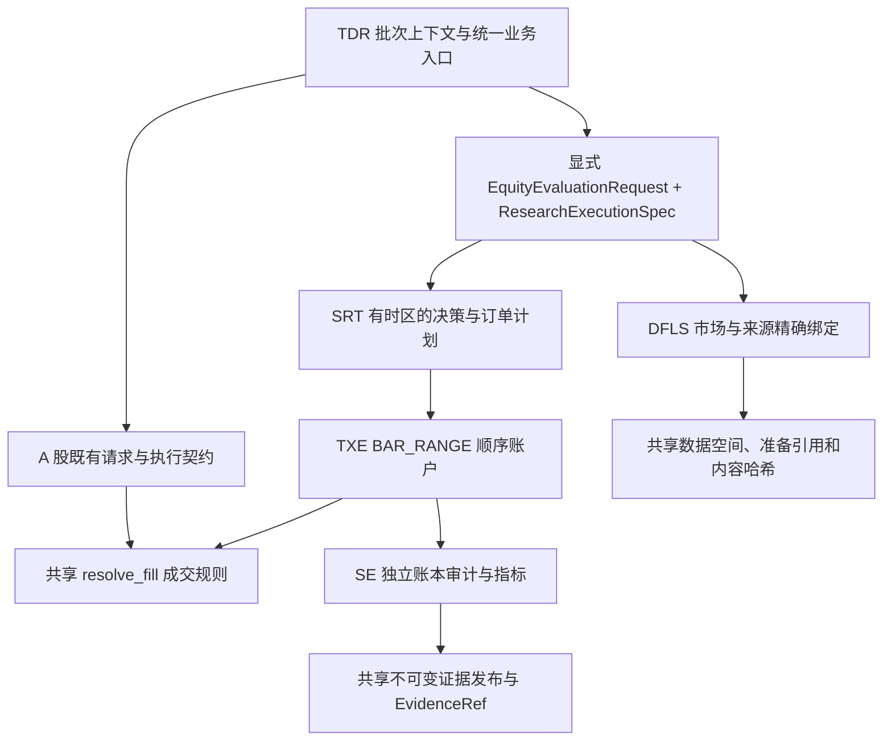

# TDR 研究工具使用说明

TDR 为研究员提供批次上下文、研究概览、账户评价与诊断、回测、实验报告、结果留证、候选登记及五阶段交付。
本文是这些公共工具的统一使用入口，说明调用契约、支持范围、示例及结果处理；研究方法与判断责任由RSCH指南规定。
阶段二、三的探索与搜索由 RSCH 自主组织，平台校验产物、输入身份及数值一致性。
研究目标、授权、候选选择和冻结批准见 [RSCH 契约](../../research/RSCH_AGENT.md)。
用户 CLI 提供 `backtest run`；Python API 与 CLI 的结果保存行为分别说明如下。

第3至8节的既有策略示例使用 `StrategyCandidate`、`EvaluationRequest` 及其已支持的证据契约，原A股股票与ETF调用保持不变。
美股个股30分钟研究通过相同业务入口接收显式类型，模块、数据、API与能力边界集中在
[第10节](#us-equity-research)。公共入口名称相同不代表两类请求支持相同的候选登记、阶段交付或PTE流程。
研究判断分别参阅[通用指南](../../research/RSCH_AGENT.md)、[A股补充](../../research/guides/CN_RESEARCH.md)和
[美股补充](../../research/guides/US_RESEARCH.md)；本文维护平台契约，不代替研究政策。

## 1. 公共契约与能力导航

| 任务 | 公共入口 | 输出与职责 |
| --- | --- | --- |
| 业务操作 | [application](application/__init__.py) | 批次、证据、候选、交付、决定、检验、冻结及发布包升级入口 |
| 研究类型 | [research_tools](research_tools/__init__.py) | 上下文、评价请求／结果和强类型交付内容 |
| 立项与意图 | `create_research_batch`、`update_research_intent` | 研究族、立项凭据及 `ResearchBatchRef` |
| 批次能力与实验分配 | `create_research_context`、`create_experiment` | `ResearchContext`、`ExperimentRef` |
| 账户评价 | `research.evaluation.prepare/evaluate/evaluate_many` | 绑定输入、计算各窗口／成本场景及逐项结果 |
| 完整回测 | `run_backtest` | 既有契约返回`BacktestEvaluation`；美股显式请求返回`EquityEvaluationResult`，支持范围见第10节 |
| 结果留证 | `publish_evidence`、`publish_evidence_many` | 单项 `EvidenceRef`；批量逐项 `PublicationOutcome` |
| 候选登记与读取 | `register_candidate`、`load_candidate` | 保存候选载荷、源码快照及支撑证据，读取已登记实体 |
| 五阶段交付 | `assemble_delivery`、`validate_delivery` | 结论、选定证据快照和不可变修订 |
| 研究概览 | `get_research_overview(repository, batch)` | `ResearchOverview`，读取保留事实、来源及限制 |
| 账户诊断 | `diagnose_accounts(repository, AccountDiagnosisRequest)` | `AccountDiagnosisResult`，正式账户损益、路径差异及覆盖 |
| 实验检查 | `validate_experiment(repository, ExperimentValidationRequest)` | `ExperimentValidation`，实验结构或报告发布一致性 |
| 自检与比较 | `build_assessment_evidence`；SE `assess_candidates/compare_candidates` | 数值事实适配、自检和比较 |
| 技术检验与冻结 | `inspect_candidate`、`record_research_decision`、`freeze_candidate`、`get_freeze_result` | 真实用户决定、技术检验、批准与事务状态 |
| 同版本发布包升级 | `prepare_frozen_runtime_upgrade`、`apply_frozen_runtime_upgrade` | 精确新旧身份、审计材料、归档及提交；独立于研究检验 |
| 目录与模板 | `validate_catalog/list_catalog/show_catalog`、`validate_templates/list_templates/show_template/instantiate_template` | FSC/STC 公开内容与绑定校验 |
| 运行发布 | `list_installed_strategies`、`strategy_info`、`deploy_strategy`、`validate_release_package` | 发布查询和单独获准的部署操作 |

项目复用因子计算由 [FSC](../../packages/factor_signal_catalog/README.md) 提供，策略编写使用
[SRT](../../packages/strategy_runtime/README.md) 公共契约。第三方研究库由研究员组织，见
[RSCH 的使用原则](../../research/RSCH_AGENT.md#62-研究工具使用原则)。

| 对象 | 当前版本 |
| --- | --- |
| 新发布`account_evaluation`证据／请求身份 | 8／7；7／6仅按已支持的历史读取契约处理 |
| 美股`equity_research`证据 | 1；不替代`account_evaluation`，见[美股证据边界](#us-equity-evidence) |
| 已发布账户评价／回测 manifest | 5／5 |
| 实验报告快照 | 1 |
| 阶段一至四交付定义、文档和回执 | 8 |
| INSPECTION交付定义、文档和回执 | 9 |
| 选型对象／冻结计划／技术检验报告 | 2／2／2 |
| SM 候选登记／候选内容身份 | 3／2 |
| SM 冻结版本／SRT 发布记录 | 5／5 |
| SRT 运行定义／运行绑定 | 3／2 |
| SRT 新解释观察／回测图投影 | `strategy_observation.v4`／`tdr_backtest_chart.v2` |
| 同版本升级计划／回执 | 2；既有schema 1升级归档只读 |
| SE 评价标准 | `opc-v3` |

版本按对象独立管理。新写入使用当前契约；历史只读支持以各入口明确范围为准，不自动迁移或改签原件。

## 2. 输入、状态与生命周期

- `RepositoryContext.discover` 定位仓库路径；`create_research_context` 打开已登记批次并配置 DFLS。
- 研究批次、实验和交付采用强类型请求；其他服务是否接收文件路径以各自公开签名为准。
- 单次评价和回测返回计算结果，数据准备可能更新 DFLS 资产，计算缓存位于 `.tmp/`。它们不自动登记候选或保存阶段报告。
- 显式发布的证据、候选快照及阶段修订不可覆盖；同一内容可复用，冲突明确失败。
- 实验 `src/`、`protocols/`、`others/` 和根目录 `notes.md` 可修改，技术修正或重复计算可沿用同一实验。运行结果、搜索数据库及检查点按需要保存于批次 `assets/runs/<实验>/<运行>/`。
- 正式结论的修正通过新交付修订表达。影响判断的有效负面结果、反证和修正说明仍须随结论保存。
- 数据身份、日期或数值不符时明确失败；研究成功、技术通过与用户批准分别判断。

## 3. 批次上下文、实验与数据

### 批次与实验分配

新立项使用 `create_research_batch(repository, ResearchBatchRequest, *, actor, reason)`，返回
`ResearchBatchRef`；调用前取得用户立项授权。更新意图使用
`update_research_intent(repository, batch, ResearchIntentUpdate, *, actor, reason)`。
重复启动同族的研究轮次需要显式且符合该策略ID的立项凭据，既有名称及范围须一致。

下面的连续示例在仓库根目录使用已获准并已登记的 `S900`。实际策略、日期、资源与费率按研究合同填写。

```python
from datetime import date
from pathlib import Path
from czsc_trader.application import (
    RepositoryContext, create_research_context, create_experiment, ExperimentRequest,
)
from czsc_trader.research_tools import ResearchBatchRef, ExecutionResources

repository = RepositoryContext.discover(Path.cwd())
research = create_research_context(
    repository, ResearchBatchRef("S900"),
    resources=ExecutionResources(max_workers=2, native_threads_per_worker=1, random_seed=42),
)
experiment = create_experiment(
    research, ExperimentRequest("收益机会检验", "该机制能否改善账户收益？", date(2026, 10, 7)),
)
experiment_root = experiment.resolve(repository.root)
source = experiment_root / "src"
```

`create_experiment` 在 `research/S900/experiments/EXxxx_YYYYMMDD/` 分配身份，创建 `experiment.json`、根目录初始 `notes.md`、进行中的`report.md`及`src/`、`protocols/`、`others/`。单个实验材料内聚于该目录，正式资产仍由批次`assets/`管理。实验报告独立发布，不要求阶段交付；操作见[实验报告发布](#实验报告独立发布与修订)。
编号在批次内跨日期递增，分配时参考本批次旧目录的现有编号；三位编号耗尽时拒绝。源码、实验方案和其他材料分别保存于对应目录，运行资料由研究程序按需要组织。

上下文的 `data`、`runtime` 和 `evaluation` 共用 `research/<批次>/assets/data/`。DFLS 的只读 `binding`
返回 `DataSpaceBinding(base_dir, space, space_id)`，可核对实际空间；批次上下文拒绝混用另一批次的数据能力。
默认供应商配置使用仓库 `.env`；需要明确的供应商绑定时向 `create_research_context` 提供 `ProviderConfig`。

```python
from dataflows import DataRequest, Dataset, PreparePolicy

requests = (
    DataRequest(dataset=Dataset.ETF_OHLCV, symbol="588080.SH", frequency="daily",
                start="2026-09-14", end="2026-09-15", required_cutoff="2026-09-15"),
)
prepared = research.data.prepare(requests, policy=PreparePolicy.REUSE)
if not prepared.ready:
    raise RuntimeError(tuple((item.status, item.error) for item in prepared.items))
market = research.data.fetch(requests[0], prepared=prepared.reference)
if not market.ready:
    raise RuntimeError(market.error)
```

一次 prepare 对完整请求集合完成校验、适用补丁及质量验收，再形成准备引用。fetch 读取已准备资产，
核对空间、准备身份与实现修订，不对子窗口重新执行质量验收。详情与门槛见 [DFLS 手册](../../packages/dataflows/README.md)。
独立取数与多个账户可复用相同批次空间；完整评价所需行情、分钟执行数据和策略预热由平台按实际依赖准备。

### 研究概览

`get_research_overview(repository, batch) -> ResearchOverview`接受已发现的仓库上下文和批次引用。
研究概览、账户诊断及实验检查均为只读入口，不创建数据准备环境，不访问供应商、PTE生产库或其他研究批次，不重新执行策略。

```python
from czsc_trader.application import get_research_overview
from czsc_trader.research_tools import ResearchBatchRef

overview = get_research_overview(repository, ResearchBatchRef("S900"))
```

返回登记状态、各阶段最高已支持修订、实验报告状态、组件测试声明、原型面板、候选、交接集合、搜索声明、计数、限制及来源快照。来源包含文件/目录位置、存在状态和哈希；调用结束前复核读取清单，检测并发变化即报错，不自动重试。

`ResearchOverview.prototype_panels`包含`PrototypePanelOverview(delivery, panel)`，提供精确交付引用和完整原型面板，包括实现身份、组件职责、账户引用、对照和研究建议。原型不进入候选登记计数，不跨修订累加为独立原型数量；`DEVELOP`等研究建议不代表阶段获批。缺少历史原型交付时返回空元组，不从组件或候选报告自动推断原型。

计数的`basis`为`VERIFIED`（已认证登记事实）、`DECLARED`（已保存的声明）或`UNKNOWN`（`value=None`及原因）。重复交付中的相同搜索声明只展示一次；多个可能重叠的搜索声明不相加。账户评价数只覆盖保留的评价身份声明，不等于账户账本已认证，也不是完整尝试次数。没有受管的经济路径分组声明时，该计数保持未知，不在概览中重算。

概览认证保留记录及关联文件哈希，不重算SE、验证运行资格或判断研究是否充分。最高交付修订不等于阶段获批；登记状态不代替当前用户指令。旧格式明确列为不支持，不按新格式解读。缺失或损坏的必要引用报错，不补零或静默改用旧版本。

报告状态为`MISSING`、`DRAFT`、`PUBLISHED`、`UNPUBLISHED_CHANGES`。历史实验缺少根报告如实显示，不自动搬迁或补写。

### 实验结构与报告检查

创建实验后可用`STRUCTURE`检查结构；以下示例用于完成第5节的独立报告发布后，检查当前报告与正式引用的一致性。

```python
from czsc_trader.application import validate_experiment
from czsc_trader.research_tools import ExperimentValidationRequest, ExperimentValidationScope

check = validate_experiment(repository, ExperimentValidationRequest(
    experiment, ExperimentValidationScope.REPORT_PUBLICATION,
))
```

`STRUCTURE`检查身份、根报告及目录；`REPORT_PUBLICATION`还要求当前报告引用、快照、正文及关联证据一致。`ExperimentArtifactRef(owner, path, sha256)`中`path`相对其所属实验，禁止绝对路径、逃逸、符号链接或junction；共享材料可以属于同批次另一实验。只检查声明的必要材料，不要求完整过程封存，也不能发现未声明材料的语义归属。

返回`ExperimentValidation(status, scope, issues, report)`；`PASS`只表示结构或发布契约成立，不表示研究有效、实验成功、报告充分或阶段获批。

## 4. 策略评价与回测

### 账户评价

本节示例使用既有`EvaluationRequest`。美股的`EquityEvaluationRequest`准备、评价及返回类型见[美股API](#us-equity-api)。

继续前例，先按 SRT 契约在 `src/strategy_runtime/` 编写策略并保存已核对的 `src/payload.json`。
下面的绑定来自该载荷，不能以任意参数替换真实源码身份。

```python
import json
from strategy_runtime import StrategyCandidate
from czsc_trader.research_tools import (
    EvaluationRequest, EvaluationWindow, EvaluationCost, EvaluationBenchmark, NextOpenBuyHold,
)

payload = json.loads((source / "payload.json").read_text(encoding="utf-8"))
candidate = StrategyCandidate("S900", "C0001", payload, source / "strategy_runtime")
request = EvaluationRequest(
    repository_root=repository.root, experiment_id=experiment.experiment_id,
    strategy=candidate,
    runtime_binding={
        "candidate_id": candidate.reference_id,
        "source_files": list(candidate.payload["runtime"]["source_files"]),
        "implementation_sha256": candidate.payload["runtime"]["source_sha256"],
    },
    symbol="588080.SH", asset_type="etf",
    windows=(EvaluationWindow("full", date(2026, 9, 14), date(2026, 9, 15)),),
    data_cutoff=date(2026, 9, 15), initial_cash=1_000_000,
    costs=(EvaluationCost("baseline", one_way_cost=0.001),),
    benchmark=EvaluationBenchmark(NextOpenBuyHold(lot_size=100)),
)
bound_request = research.evaluation.prepare(request)
result = research.evaluation.evaluate(bound_request)
```

保留 `bound_request`，用于结果留证、自检和技术检验的输入绑定。跨进程恢复时，保存请求参数、执行数据准备引用及策略输入绑定，按公开类型重建请求并保留对应数据资产。执行数据和策略输入引用必须来自同一批次空间，
无效引用或内容变化明确失败。普通重复评价会重新计算；显式执行会话的检查点可恢复已完整落盘且通过身份核验的结果。

`signal_cash_fraction / entry_cycle`沿用相同评价、批量和留证入口。策略的`CYCLE_TARGET`信号决定本次资金比例；
SRT生成预算与目标份额，TXE采纳计划并按实际成交更新周期。决策账本保存当前信号、计划采纳前后周期、
周期状态与身份；每日账本保存成交后的周期预算和含费累计买入金额。这些字段完整进入结果身份、跨进程传输和正式账户证据。
SE除普通账户核对外，独立检查开仓预算、数量目标、补买上限、持有锁定、退出释放及成交累计；字段缺失或不一致明确失败。
评价环境身份包含`entry_cycle.py`，技术检验的实际平台源码清单也覆盖该模块。预算锁定策略与每日权益目标策略不能据相同比例认定执行等价。
技术检验的经济比较按引用关系重命名信号、计划和周期身份（含周期JSON内的开仓信号与周期引用）；比例、预算、锁定份额、累计买入金额及阶段状态继续精确比较。
当前账户损益诊断只支持全仓/现金单次买卖，动态周期分配明确返回`UNSUPPORTED`；这不影响账户评价和数值审计。

`evaluate_many(tuple[EvaluationRequest, ...])` 按输入顺序返回 `EvaluationOutcome`：

| 状态 | 含义 |
| --- | --- |
| `SUCCEEDED` | 有经过身份核验的结果，无错误 |
| `FAILED` | 本项准备或计算失败，有错误，无结果 |
| `CANCELLED` | 本项被取消，有错误，无结果 |
| `UNKNOWN` | 工作进程等异常导致结果无法确认，有错误，无结果 |

批量请求为非空 tuple，资源配置统一来自 `ExecutionResources`，`EvaluationRequest` 不再含 `workers`。
先预检全部请求契约；主进程逐项绑定输入，准备完成即提交给 `spawn` 子进程，
使后续准备与已经提交的账户计算重叠。单项准备或传输失败不妨碍其他项；非法类型或批量契约在计算前拒绝整次调用。
平台不自动重试、管理 Optuna study 或决定搜索预算；调用方根据逐项结果组织后续研究。

### 研究库与并行执行

以下配置承接[RSCH研究工具使用原则](../../research/RSCH_AGENT.md#62-研究工具使用原则)，由研究员组织，平台按显式资源请求执行。
本节账户并行及恢复说明适用于既有`EvaluationRequest`链路。当前美股`EquityEvaluationRequest`批量评价顺序执行，
不支持检查点会话，见[美股API](#us-equity-api)；设置相同资源预算不会自动获得相同能力。
这一技术限制不自动豁免RSCH的共同执行约定，研究采用何种调整按指南处理。

| 库 | 解决的问题 | 高效使用方式 |
| --- | --- | --- |
| Optuna | 管理参数提议、搜索轨迹与trial状态，包括联合搜索、固定网格和参数扰动 | 独立使用`InMemoryStorage`，由主进程持有唯一Study并组织提议、调度和结果回填；独立CPU密集评价默认使用多进程，Windows采用`spawn`。采样器与并发方式分别选择，按实际版本验证重复提议和耗尽行为；完整账户评价仍经TDR批次上下文执行 |
| tsfresh | 从时序中批量提取和筛选候选特征 | 适用的特征普查应实际使用该库；按研究问题限定特征集合和窗口，批量提取并使用授权预算内的多核能力，复用相同输入与配置的计算结果；筛选结果仍须接受因果核验和组件职责评审 |
| expr_codegen | 将因子表达式转换为可执行计算代码 | 对同批表达式统一生成代码，复用生成结果，减少逐条解释和重复生成；使用前核对当前版本支持的计算后端，并与参考计算逐值核验 |
| pandas、NumPy及统计库 | 数据对齐、批量数值计算与统计检验 | 优先使用向量化、批量运算和公共中间结果，减少逐行Python循环与重复转换；按内存容量分批，核验缺失值、索引和数值类型对结果的影响 |
| 其他加速评价库 | 降低特定计算环节或策略评价的耗时 | 先用代表性样例确认加速收益与适用交易语义；用于正式比较前，必须完成与SRT/TXE的信号及完整经济账本等价性核验 |

可并行接口内部默认采用`max(1, os.cpu_count() * 75 // 100)`个工作进程／线程，向下取整；
例如16个逻辑核默认12个，实际同时执行数还受独立任务数限制。`ExecutionResources(max_workers=...)`
显式覆盖，默认`native_threads_per_worker=1`。无法识别逻辑核数时明确报错，调用方可显式指定。
预算控制工作进程／线程数量，不承诺CPU利用率；同一会话共享总预算，不同顶层会话不受整机调度器协调。
既有`EvaluationRequest`的`evaluate_many`在请求间并行，子请求内部执行使用一个工作线程；其`evaluate`可在独立窗口／费用场景间使用上下文预算。
资源类型不负责Optuna调度；研究员仍须统筹平台以外的trial及第三方库并发。
`create_research_context(..., resources=...)`设置评价及批量证据发布预算；
`assemble_delivery/validate_delivery(..., resources=...)`使用独立的调用预算，不自动继承研究上下文。
`inspect_candidate(..., control=InspectionControl(max_workers=resources.max_workers))`可显式复用同一上限。
同一个资源值不代表多个顶层调用共用执行额度；调用方须统筹同时运行的任务。

既有`EvaluationRequest`的正式批量评价调用`context.evaluation.evaluate_many(tuple_of_requests)`，由TDR使用Windows `spawn`
进程池执行研究员已确定的请求。主进程持有Study和批次上下文，核对逐项结果并选择必要证据；子进程只计算，
不得按worker或计算分片创建实验。进程数取`ExecutionResources.max_workers`。
单次`evaluate`返回`EvaluationResult`，失败抛出异常；批量`evaluate_many`逐项返回`EvaluationOutcome`，
区分`SUCCEEDED/FAILED/CANCELLED/UNKNOWN`。研究员据此决定Optuna回填及显式重试，
平台不管理研究预算或自动重试；正式发布使用`evaluation.prepare`绑定后的请求和对应结果。
正式批量运行前，用最小样例验证公共API、传输、目录隔离和结果一致性。默认配置不适用时，报告阻断证据和调整方案，不得静默串行或增加兜底。
披露实际配置、种子、搜索范围、评价及独立配置数量、选择依据和方法局限；保存正式结论所需结果与反证。
内存Study不替代必要的持久证据，无须保留全部trial和技术失败日志；并行采样的复现范围须如实说明。
安装、升级及跨角色修改仍需另行授权；研究依赖不得自动进入冻结运行时依赖。

### 执行会话与显式恢复

`open_research_execution(research, experiment=..., checkpoint=None, on_progress=None)`返回
`ResearchExecutionSession`上下文管理器。连续批次通过`execution=session`共享同一个有界`spawn`池，
评价和证据序列化按完成顺序收取结果，返回tuple仍保持输入顺序。正式证据仅由主进程提交。
不传会话时，批量API内部创建并关闭一次相同执行器。一个研究上下文同时只允许一个显式会话；
会话活动期间必须明确传入它，避免隐式创建第二个资源预算。

```python
from czsc_trader.application import open_research_execution, publish_evidence_many
from czsc_trader.research_tools import (
    CheckpointMode, ExecutionCheckpointRequest, EvaluationEvidenceWrite,
)

with open_research_execution(
    research, experiment=experiment,
    checkpoint=ExecutionCheckpointRequest("stage4-round1", CheckpointMode.CREATE),
) as session:
    outcomes = research.evaluation.evaluate_many(bound_requests, execution=session)
    selected = tuple(
        EvaluationEvidenceWrite(experiment, f"account-{i}", request, outcome.result)
        for i, (request, outcome) in enumerate(zip(bound_requests, outcomes, strict=True))
        if outcome.status.value == "SUCCEEDED"
    )
    if selected:
        publications = publish_evidence_many(research, selected, execution=session)
stats = session.stats
```

重启后用相同运行标识和`CheckpointMode.RESUME`打开会话，重新提供准备后的请求。
检查点位于`.tmp/research-execution/<批次>/<运行标识>/`，包括绑定实验与实现身份的`manifest.json`、
`results/<请求哈希>.json`和`publications/<发布身份哈希>.json`。使用结构化JSON、校验和、原子写入及单写锁，
恢复时重新核对请求、源码／实现、数据、参数、数值结果及当前证据字节；不读取磁盘pickle。
同一请求可恢复已完整保存的计算结果，继续显式发布；不同名称的发布不会错误复用旧名称引用。
缓存损坏或身份不符明确失败，不自动重新计算掩盖问题。未保存的结果需要调用方明确决定重试。
缓存可清理，正式交付不依赖检查点；`CREATE`不覆盖已有运行，`RESUME`不创建缺失运行。

工作进程丢失时，计算结果按`UNKNOWN`表达；仅在序列化阶段丢失工作进程且主进程未提交文件，
发布状态为`FAILED`。文件提交无法确认时仍为`UNKNOWN`。进程池损坏或收取结果中断后禁止继续使用该会话，
调用方需关闭它并显式开启新的会话。平台不自动重试、不重建损坏池、不静默改为串行。

`ExecutionProgress`报告阶段、完成数、失败／未知数和耗时，回调在主进程执行；回调异常使调用失败。
`session.stats`区分会话墙钟时间、分阶段墙钟区间、累计工作进程时间、进程池创建次数及恢复命中数。
准备与计算、发布与序列化可能重叠，分段区间不能直接相加；累计工作进程时间也不等于端到端耗时。
资源变化不改变策略参数，平台源码变化可能改变评价环境／结果身份，应比较经济账本与数值并核验新身份。

### 显式基准执行合同

`EvaluationRequest.benchmark` 必填。`NextOpenBuyHold(lot_size)` 使用下一交易日开盘价，
`LimitBuyHold(lot_size, premium, price_tick, price_limit_ratio, maximum_order_quantity)` 使用 SRT 限价规划。
两者要求显式整手单位，限价合同还约束溢价、价格档位、涨跌停比例和最大委托数量。
基准身份纳入评价及 SE 场景上下文；阶段一通过 `BenchmarkRequirement` 确认，阶段四核对实际基准。

成本场景名称、费率及计量层级由 RSCH 决定。`EvaluationCost` 要求非空且唯一的安全场景名、
有限 `0 <= one_way_cost < 1` 费率；计量层级为 `FORMAL/SCREENING/STRESS`，默认 `FORMAL`。
平台不从场景名推算费用。SE 的标准／压力配对诊断另外要求费用、层级和公共上下文可比，见 [SE 手册](../../packages/strategy_evaluator/README.md)。

### 完整回测

```python
from czsc_trader.application import BacktestRequest, run_backtest

backtest = run_backtest(
    research, candidate,
    BacktestRequest("588080.SH", "etf", date(2026, 9, 14), date(2026, 9, 15),
                    initial_cash=1_000_000, lot_size=100),
)
print(backtest.manifest["audit"]["status"], backtest.metrics)
```

`run_backtest(research, strategy, request) -> BacktestEvaluation` 接受本批次 `StrategyCandidate` 或已认证 `StrategyVersion`，
返回账户、基准、指标与审计，不自动保存 CSV、报告或图表。`lot_size` 必填正整数，并须与策略执行合同一致。
输入价格、时间、成交及费用通过 SRT/TXE 计算，SE 复算账户审计；完整回测包含 BuyHold、MA5/MA20 基准。
回测 manifest 为 schema 5，研究指标语义版本为 `candidate-srt-txe-v4-explicit-benchmark`。

基准估值与图表投影使用独立的数值容器，避免在 pandas 派生操作中反复深复制行情的质量元数据。
原始输入及其元数据保留用于认证；同次基准计算的 BuyHold 和 MA 共用已构造的估值表，
数值结果保持隔离，不修改调用方行情。复用仅发生在本次内存调用中，不新增磁盘缓存或跨调用认证缓存，
输入身份、当前字节及数值校验继续执行。端到端性能验证需同时计入报告生成和实际写盘，
不得将纯计算时间直接当成完整交付耗时。

普通`FROZEN_RULE`目标仓位策略采用`DAILY_RANGE_V3`日范围成交模型，含普通限价单；该路径不请求分钟成交数据，
也不按成交量约束成交数量。当前声明`11:30_CLOSE`检查点的日内执行策略请求5分钟DFLS不复权产品；
仅声明`OPEN`检查点不增加分钟需求。
数据已准备不表示某个账户执行路径实际消费了该频率。具体成交与时点精度见[TXE](../../packages/trading_execution_engine/README.md)。
SRT独立规划策略预热，完整回测的MA5/MA20基准另需20个先前交易日。
缺少必需频率、日期或截止日时失败，不静默缩窗。

多档位策略须显式声明`FROZEN_RULE`资金模式`target_equity_fraction`、作用范围`decision`及
`allocation_fraction=1`。TDR评价保留小数目标，由SRT按实际账户权益计算份额、TXE执行及记账；
原`entry_cycle`资金模式仍仅接受0/1目标。计算规则见[SRT执行计划](../../packages/strategy_runtime/README.md#执行计划)。
公开账户归因诊断的全仓/现金、单周期单次买入等限制不因新增仓位能力而扩大。

用户 CLI 从仓库根目录执行，仅接受已登记冻结版本；对应研究族须已登记。CLI 明确创建实验并保存报告证据，
JSON 输出的 `artifacts` 给出内容寻址文件路径，报告内图表链接保持可用。

```powershell
.\.venv\Scripts\czsc-trader.exe backtest run `
  --strategy S900 --strategy-version v1 `
  --symbol 588080.SH --asset etf `
  --start 2026-09-14 --end 2026-09-15 --init-cash 1000000 --lot-size 100
```

### 账户损益与路径诊断

`diagnose_accounts(repository, request) -> AccountDiagnosisResult`要求强类型`AccountDiagnosisRequest`，引用正式证据及精确评价身份。
以下示例在完成第5节的账户证据发布后执行，沿用前例单窗口、单成本场景的`result`及`bound_request`；多个场景须显式选择对应评价和窗口。

```python
from czsc_trader.application import diagnose_accounts
from czsc_trader.research_tools import (
    AccountDiagnosisRequest, AccountRunRef, AccountDiagnosisStatus,
)

selected_run = result.runs[0]
if selected_run.identity is None:
    raise ValueError("账户评价缺少完整身份")
diagnosis = diagnose_accounts(repository, AccountDiagnosisRequest(
    baseline=AccountRunRef(account_evidence, selected_run.identity),
    alternative=None,
    window=bound_request.windows[0],
))
if diagnosis.status is AccountDiagnosisStatus.COMPUTED:
    print(diagnosis.reconciliation)
else:
    print(diagnosis.status.value, diagnosis.issues)
```

`account_evidence`须是`account_evaluation` schema 8正式证据或只读历史schema 7证据，`AccountRunRef.identity`精确选中一个评价；平台核验原始哈希、账户及账本认证，不凭候选编号找最近一次结果。`alternative`可传同批次另一账户；标的、市场执行数据、费用、单位、初始资金及会话等上下文不同则不可比。候选实现可以不同。

窗口是原连续账户的切片，继承此前资金和持仓，不重置本金。首版支持单标的、只做多、全仓/现金、单周期一次买入和至多一次卖出的账本；加减仓、多次成交、日内往返等不支持，不降级为简化收益计算。

在原账户一致的价格及数量单位下，每日互斥分解为：

| 分项 | 金额 |
| --- | --- |
| 入场日 | 买入数量 ×（当日估值价 − 买价） |
| 其他持有日 | 持仓数量 ×（当日估值价 − 前一估值价） |
| 退出日 | 卖出数量 ×（卖价 − 前一估值价） |
| 费用 | 当日实际成交费用的负值 |

分项合计核对实际权益变化，费用不重复扣除。返回逐日、逐年明细及完整切片残差；年度贡献使用本账户该诊断年度期初权益，单位为比例。部分年度标识是诊断窗口边界说明，不改变原研究年度目标。跨年周期不把全部利润记入入场年。SE协议固定为`single-long-full-position-v1`，精度固定，调用方不能放宽容差。

返回状态为`COMPUTED`、`INCOMPARABLE`、`UNSUPPORTED`、`INVALID_EVIDENCE`，失败保留原因。结果包含原证据、评价身份、决策/订单/成交/周期标识。两账户返回共同或仅一方入场周期及逐日资金路径差异，不把差额解释为独立因果贡献，也不据此计算取消交易的反事实。

可选`DecisionPopulationRef(evidence, population_id)`引用研究员显式提供的人群。材料JSON必须是以下精确结构：

```json
{"schema_version":1,"population_id":"entry-population","evaluation_id":"<64位评价身份哈希>","memberships":[{"decision_id":"<原决策身份>","member":true}]}
```

`member`仅允许`true`、`false`、`null`；未列决策保持未知，未知/重复决策和跨账户身份拒绝。平台按真实订单、成交与持仓记录计算覆盖，不寻找分类条件，不认证研究员的金融解释或真实历史可得性。

`coverage_summary`按评价、人群及买入意图/成交/持有决策类别汇总总数、组内、组外及未知数。比例分母为该类别总数；分母为零或存在未知成员时`member_fraction=None`，不把未知改为组外。

结果的`to_dict()`可交给现有材料证据发布入口保存；诊断调用本身不写证据、不新增账户。

## 5. 显式发布和读取证据

### 账户与材料证据

计算完成后，按交付需要选择结果留证。完整账户证据保存请求身份、策略输入绑定、信号、账户账本、基准、指标和 SE 适配事实，
发布时核验请求与结果一致。新发布格式是 `account_evaluation`／schema 8，请求身份使用 schema 7，
包含实际策略输入绑定及可选的具名邻域点绑定。历史账户schema 7／请求schema 6仅按原配对读取认证，不可重新发布为新评价；版本不得交叉拼接。

```python
from czsc_trader.application import publish_evidence
from czsc_trader.research_tools import EvaluationEvidenceWrite, EvaluationEvidenceRef

account_evidence = publish_evidence(
    research, EvaluationEvidenceWrite(experiment, "baseline-account", bound_request, result),
)
evaluation_reference = EvaluationEvidenceRef(account_evidence)
```

多项留证使用 `publish_evidence_many(research, requests)`，`requests` 必须是非空
`tuple[EvidenceWriteRequest, ...]`，返回与输入顺序一致的 `tuple[PublicationOutcome, ...]`。
账户认证及 JSON 序列化按 `research.evaluation.resources` 的进程数和原生线程预算计算；
子进程只返回证据字节，主进程逐项原子发布，已完成项无需等待前面的慢项。材料字节由主进程直接发布。
`max_workers=1` 明确采用串行计算；多进程失败不重试或切换串行计算。

批量调用先检查全部请求类型、批次、已分配实验和数据空间归属；非法调用整体抛出异常，且不发布任何项。
账户结果认证、序列化和实际写入失败按项返回，不撤销其他已发布项。
`PublicationOutcome.index` 是输入的零起始位置，`status` 使用 `PublicationStatus`：
`PUBLISHED` 只携带 `reference`，`FAILED`、`CANCELLED`、`UNKNOWN` 携带 `PublicationError`；
除基本错误外，报告发布错误还可保留阶段、快照引用及当前引用的提交状态，见[实验报告发布](#实验报告独立发布与修订)。
计算进程失败时正式证据尚未写入，返回 `FAILED`；计算取消返回 `CANCELLED`。
若原子写入之后发生异常，或无法确认写入状态，返回 `UNKNOWN`，不会自动重试。

```python
from czsc_trader.application import publish_evidence_many
from czsc_trader.research_tools import PublicationStatus

publications = publish_evidence_many(research, (
    EvaluationEvidenceWrite(experiment, "baseline-account", bound_request, result),
))
for item in publications:
    if item.status is PublicationStatus.PUBLISHED:
        retained = item.reference
    else:
        print(item.index, item.status.value, item.error.code, item.error.message)
```

`EvaluationEvidenceRef.evaluation_ids` 为空表示引用该结果全部评价；可显式指定其中的评价ID。
协议、组件实现说明、反证或其他选定材料通过 `MaterialEvidenceWrite` 发布：

```python
from czsc_trader.research_tools import MaterialEvidenceWrite

note = publish_evidence(research, MaterialEvidenceWrite(
    experiment=experiment, name="mechanism-conclusion",
    content="机制结论与边界待按真实结果填写".encode("utf-8"),
    media_type="text/markdown", suffix="md",
))
verified_path = note.resolve(repository.root)
```

上例说明材料发布格式，实际结论须来自已完成研究。`EvidenceRef` 保存业务名、实验身份、内容哈希、媒体格式及可选 schema。
`path` 为交付包内的 `evidence/<hash>.<suffix>`，`repository_path` 为仓库内的
`research/<批次>/assets/evidence/<实验>/<hash>.<suffix>`；`resolve(repository.root)` 核验文件哈希。
TDR 按内容哈希保存证据，同内容可复用，已有内容冲突拒绝覆盖。
证据引用可通过 `to_dict/from_dict` 保存和恢复。完整评价留证必须使用对应已绑定请求，材料发布不会自动变成账户评价证据。

正式账户及五张账本保存在`research/<批次>/assets/evidence/<实验>/<哈希>.json`；`assets/runs/`中的运行资料不作为账户诊断的默认输入。

### 实验报告独立发布与修订

先将实际结论写入实验根`report.md`并选择结果声明。下例假定报告已完成，使用前例正式账户证据作为来源；发布接口不判断研究结论或报告内容是否充分。

```python
from hashlib import sha256
from czsc_trader.application import publish_evidence
from czsc_trader.research_tools import ExperimentOutcome, ExperimentReportWrite

report_bytes = (experiment.resolve(repository.root) / "report.md").read_bytes()
report_ref = publish_evidence(research, ExperimentReportWrite(
    experiment=experiment,
    expected_report_sha256=sha256(report_bytes).hexdigest(),
    outcome=ExperimentOutcome.COMPLETED,
    evidence=(account_evidence,),
    previous=None,
))
```

`outcome`由RSCH声明：`COMPLETED/FAILED/CANCELLED/INCOMPLETE`。没有阶段交付也能发布，阶段报告与实验报告不要求相同。

通过`publish_evidence`提交`ExperimentReportWrite`，返回报告快照的`EvidenceRef`。快照为`experiment_report` schema 1，保存UTF-8原文、字节哈希、声明结果、来源及前版，不转换换行；根`report_ref.json`指向当前正式快照。前版冲突或正文哈希变化拒绝，同一请求可幂等确认。发布不会改写根报告。

引用提交前失败可能留下不可变但未被当前引用指向的快照，不删除或冒称提交完成。`ReportPublicationError`及批量`PublicationError`提供`phase/reference/pointer_committed`；发生异常且指针已提交或提交结果不确定时批量状态为`UNKNOWN`，明确未提交为`FAILED`，取消按实际状态表达。正常提交仍返回`PUBLISHED`。不自动重试。`publish_evidence_many`逐项报告，参数预检失败仍在任何写入前拒绝整批。

根报告以后可继续编辑；已发布快照仍不变，正文不同于当前快照即为未发布修改，修订时传入准确的`previous`。原始阶段交付、候选及旧实验报告不迁移、不重签。

## 6. 候选登记与自检

候选键为策略ID和 `C` 加四位数字。实现、有效参数或执行规则变化时使用新候选身份；评价不自动登记。
在阶段三授权范围内，继续前例登记交接候选：

```python
from czsc_trader.application import CandidateRegistrationRequest, register_candidate

registration = register_candidate(repository, CandidateRegistrationRequest(
    candidate=candidate, experiment=experiment, evidence=(account_evidence,),
    dependencies=bound_request.dependencies,
))
```

`evidence`可以显式传入空元组，也可引用同批次已发布的普通材料或账户评价，可来自多个实验。
所有引用核验路径、存在性、哈希及唯一性；普通材料只作为可追溯附件，不解释其研究结论。
声明为`account_evaluation`的引用额外核验账户事实、实验及候选内容身份，不接受损坏或错配账户。
登记成功只表示内容身份和来源已保存，不表示实验完成、策略合格或已取得交付资格。
`CANDIDATES`交付中每个`CandidateEntry`仍须显式关联真实账户评价，包括未进入`handoff`的条目。
TDR 保存 `assets/candidates/<候选>/payload/<hash>.json` 和 `assets/candidates/<候选>/source/<hash>/strategy_runtime/` 快照；SM 登记 schema 3，内容身份仍为 schema 2。
文件引用相对批次根 `research/<策略ID>/`，`source_root` 记录快照源码根。
同键同登记内容复用，冲突拒绝；`load_candidate(repository, CandidateKey(...))` 认证记录及源码后返回候选。
登记记录、源码快照和支撑证据须一起保留，修改原实验源码不影响已登记候选。

未交接的搜索点无须逐个登记。`CandidateDerivation` 记录参数、实现或执行规则派生；
补充评价关系可使用 `EvaluationLineage`，不能据此覆盖已登记内容。

```python
from czsc_trader.research_tools import build_assessment_evidence

assessment_evidence = build_assessment_evidence(bound_request, result)
```

该适配器核验请求与结果，返回 `tuple[AssessmentEvidence, ...]`，供 SE `assess_candidates` 与 `compare_candidates` 使用。
实际费用、计量层级、基准、窗口及输入身份须可比，不能仅依赖相同场景名。
账户比较使用 SE `compare_ledgers`，按目的选用 `STRICT/ECONOMIC` 并读取实际状态；计算口径见 [SE 手册](../../packages/strategy_evaluator/README.md)。

### 参数扰动评价

SE生成`ParameterNeighborhoodDesign`，RSCH按具名点准备实际策略载荷；TDR认证声明值与载荷路径、同源执行条件和真实账户。新局部设计使用v2协议及`BoundedLocalStep(RelativeChangeLimit(...) | AbsoluteChangeLimit(...))`，按合法域和最小步长判断幅度上限，仅展开适用变化，其他参数保持中心值。全部变化不适用时仍保存零点设计及适用性依据，不制造邻域账户。类型、完整点集与分位数口径见[SE参数扰动](../../packages/strategy_evaluator/README.md)。

默认五项独立检验时，参数计划中的中心和全部子候选只声明同一基准窗口、标准费用；
中心费用压力另建独立请求，不与子点交叉。完整非参数契约包含整个窗口及费用列表，
不得用双费用中心请求搭配单费用子请求，也不得改写已有证据的请求身份来复用。
中心标准账本同时支撑时间稳定性、收益集中性及收益区间；完整身份核对通过的既有结果可复用。
没有可复用证据时，每中心需要N+2个策略账户场景：N个邻域点、中心标准与中心压力；整项不适用时只需中心标准与中心压力，研究族补证另计。

先用 `MaterialEvidenceWrite` 发布坐标映射及可行性约束材料；其原始字节哈希应分别等于
`ParameterNeighborhoodSpace.mapping_sha256`、`feasibility_sha256`。中心和全部子候选通过
`research.evaluation.prepare` 准备后，构造完整计划：

```python
from czsc_trader.research_tools import ParameterEvaluationPlan, EvaluationLineage

plan = ParameterEvaluationPlan.create(
    design, prepared_center, prepared_children,
    mapping_evidence=mapping_reference, feasibility_evidence=constraint_reference,
    dataflows=research.data,
)
plan_reference = publish_evidence(research, MaterialEvidenceWrite(
    experiment, "parameter-evaluation-plan",
    json.dumps(plan.to_dict(), ensure_ascii=False).encode("utf-8"), "application/json", "json",
))
if design.is_applicable:
    point_binding = plan.bind_point(plan_reference, 0, repository_root=repository.root)
    child_request = replace(prepared_children[0], lineage=EvaluationLineage(derivation, point_binding))
    child_result = research.evaluation.evaluate(child_request)
```

上例需导入 `json` 及 `dataclasses.replace`；`derivation` 为实际中心与该子候选的 `PARAMETERS` 派生关系。
新`ParameterEvaluationPlan`使用schema 3，保存中心和各子候选的完整规范 JSON 载荷、内容身份、
规定点集、中心请求身份、中心输入准备身份、固定执行契约和映射／约束材料引用。
各子载荷及有效内容必须互不相同，也必须不同于中心；相同行为不构成拒绝理由。
每个轴的`payload_path`相对于载荷`parameters`；中心值须匹配声明的精确类型和值，子载荷只允许在这些路径替换为对应具名点值。缺路径、隐藏改参、声明外变更、类型替换及多个点坍缩到同一内容均拒绝。不适用设计允许`children=()`，仍核验中心载荷、真实请求、输入、映射与约束材料，禁止`bind_point`。旧plan schema 1（球面）和2（v1邻域）保留读取与证据认证；`create`、`bind_point`及新评价均拒绝旧版本，不自动转换旧点集。
schema 3计划以`design.space.axes`为RSCH声明的检验范围，不从`parameters`的全部叶子字段推断研究参数全集。
未映射的列表、空值或其他配置不参与参数域检查；声明路径仍须存在、互不重叠，中心值及类型须与真实载荷一致。
子候选只能改变声明参数，其余载荷保持一致。空轴允许表达空的声明范围；`is_applicable=False`仅表示声明空间内没有合法非中心扰动点，
不证明策略全部生效参数均已检查。参数识别、遗漏说明及结论适用范围由RSCH通过现有`mapping_evidence`和研究报告说明。
`ParameterEvaluationBinding` 保存已发布计划引用及 SE `ParameterNeighborhoodBinding`，进入请求哈希和账户证据。
普通评价可以不提供该绑定；带绑定的评价必须核验计划已经发布、文件字节一致、点序号及实际载荷匹配。

参数计划读取每次核验计划及两份材料的实际字节。内部只复用最近一份已验证内容的不可变解析结果，
不缓存文件核验成功状态。一次交付发布或校验内，相同实际账户字节可复用已通过的解析、账本认证及结构化事实，
仍在每次引用时重新读取文件、核验哈希和证据归属。不同公开调用各自认证，FULL交付仍独立复算SE面板与比较结果。

计划和实际评价固定源码、依赖、非参数结构、标的、窗口、截止日、资金、费用场景、价格单位、基准和频率口径。
同时核验 SRT 实际执行政策、订单能力及决策时间规则，不能通过参数切换执行契约。
参数导致的预热起点变化允许存在；策略原始输入用已固定的 DFLS 准备引用，在中心与子候选共同日期范围内
通过公开 `Dataflows.fetch` 核对来源、原始值及时间契约。除起点与预热所需最小观测／交易日数量外，
输入源请求须相同；共同范围使用两者中较小的历史覆盖要求，范围不足或数据失败明确拒绝。
中心范围以外新增的预热内容保留其准备身份，不能据共同范围校验声称已与不存在的中心区间逐值复验。
这些校验不调用实时供应商重新获取数据，也不比较整个可能随参数变化的派生输入哈希。

`build_assessment_evidence` 把已认证点绑定传给 SE；缺失或失败账户仍按实际状态处理，不能填零。
阶段四 `CandidateAssessmentDelivery.parameter_plans` 显式引用计划。交付浅快照计划及其映射／约束材料，
核对实际中心请求、全部规定父子关系和保存账户的点身份，并在 `FULL` 范围重算 SE。不适用设计也必须关联计划；缺计划或缺账户不能冒充不适用。部分参数适用时，固定轴仍进入映射核验；全不适用时校验真实中心，不要求子账户。
发布后的校验读取交付快照，不依赖实验工作目录、原计划材料文件或可变源码。一次调用内按完整身份、位置及校验范围复用已完成节点的递归展开和语义计算；循环检测独立维护，每次引用仍认证当前文件，结束前再次核对输入。不同调用不复用成功状态。`validate_delivery`返回`stats`记录不同交付数、引用访问、展开、语义复用、文件哈希次数/字节量及耗时；统计不进入交付身份。
平台只认证声明、身份及确定性计算；坐标业务含义、映射合理性及研究授权由 RSCH 负责。

## 7. 五阶段交付

`assemble_delivery(repository, DeliveryDefinition, DeliveryContent, *, resources=None, on_progress=None) -> DeliveryAssemblyResult` 直接接受强类型数据。
返回值包含 `receipt: DeliveryReceipt` 和 `validation: DeliveryValidation`；后者是包含安装后完整性复核的本次 `FULL PASS`，无需紧接着再调用一次完整校验。
同内容修订的重复组装也重新执行 FULL。后续独立调用 `validate_delivery(..., resources=None, on_progress=None)` 时重新读取当前文件，绝不以历史 PASS 代替认证。
两个入口的独立账户认证默认采用 `ExecutionResources` 的本机 75% 逻辑核预算，显式资源可覆盖；单项认证直接执行。
认证缓存只在本次调用内保存按 SHA-256 标识的必要事实，每次消费仍核验文件当前字节和账户引用所属实验；最终复核覆盖前驱及公开副本。
`DeliveryValidationProgress` 回调报告 `PACKAGE_LOAD`、`AUTHENTICATION`、`RECOMPUTATION`、`FINAL_RECHECK` 阶段、完成数量及累计墙钟耗时。
`PACKAGE_LOAD` 在读取每个交付包之前立即发出；`package_load_seconds` 累计包封装读取、清单哈希与强类型解析的墙钟时间，包含失败读取，排除递归前驱、账户认证和 SE 复算。
`DeliveryValidationStats` 记录认证墙钟时间（含并行进程启动及结果传输）、SE 复算时间、最终复核时间、认证账户数和缓存复用数；阶段数值不包含其他序列化及 I/O，不将这些局部计时之和称为端到端时间。
`file_read_task_seconds` 和 `file_hash_task_seconds` 是校验路径的主进程及工作进程逐项文件读取／哈希累计耗时，含在认证与最终复核阶段内；并行任务累计时间不可相加或当作墙钟耗时。
这些执行统计和组装返回包装不写入交付文件，不改变交付 schema 或内容身份。
研究员提供结论、必要事实、解释、人工报告和关联证据，自主组织实验过程。
平台核验结论与已声明证据的存在、身份、完整性及契约一致性，无法判断研究结论是否正确。
研究方法、证据是否充分及结论解释由 RSCH 负责。

`DeliveryContent` 必须以关键字参数提供非空字符串 `report`。RSCH 决定报告内容和组织方式，
平台将其 UTF-8 字节原样写入 `report.md`；目前不提供报告模板或自动生成报告。
报告使用的额外材料通过 `evidence: tuple[EvidenceRef, ...] = ()` 显式关联，
与内容契约中的证据一起核验和浅快照；平台不会从报告文字自动提取证据引用。

所有位置上显式声明 `schema="account_evaluation"` 的 `EvidenceRef` 都须通过账户认证，
包括组件测试、顶层 `DeliveryContent.evidence`、`SearchSummary.evidence` 和候选评价引用。
新账户采用schema 8／请求身份7；历史schema 7／请求身份6保留只读认证。引用头与正文版本必须一致，认证请求、结果身份、保存账本及数值一致性；其他或交叉版本明确拒绝。
`INTEGRITY` 和 `FULL` 均执行此认证，不重跑策略。普通材料仍检查归属、路径及文件哈希，
平台不会扫描材料 JSON 或 Markdown 中嵌套的账户声明；支撑正式账户结论的引用必须直接纳入强类型交付。
同批次可以复用其他实验账户，但账户内来源必须与该引用自身的实验身份一致；
`CandidateEntry.evaluations`及`PrototypeEntry.evaluations`还须匹配所声明实现的编号、内容哈希及`evaluation_ids`。

未登记原型可通过现有评价与发布 API 形成正式账户，不要求先登记候选。
RSCH 应用普通材料显式保存完整参数、源码文件及依赖，并直接关联所需材料引用；账户身份哈希本身不构成原型恢复包。
组件信息诊断和否定结论仍可使用普通材料，不要求每项测试都产生账户。
账户认证不判断组件有效性、基线与变体是否只改变一个因素，或研究目标是否达成。

证据不合法时，`assemble_delivery` 抛出 `DeliveryValidationError`，不留下本次未完成的正式修订；
`validate_delivery` 返回 `FAIL` 及 `DeliveryIssue`。错误参数类型仍抛出 `TypeError`，
同修订不同内容仍抛出 `DeliveryConflictError`。进入引用与账户认证后的错误分类如下；
初始证据复制、交付包清单等前置检查失败时，仍报告各自阶段的错误，例如 `ASSEMBLY_FAILED` 或 `DELIVERY_FILES`：

| 错误码 | 含义 |
| --- | --- |
| `EVIDENCE_OWNER` | 引用属于其他批次 |
| `EVIDENCE_HASH` | 当前证据字节与引用哈希不符 |
| `EVALUATION_REFERENCE` | 不支持的账户版本、账户来源不符，或声明的运行编号不存在 |
| `ACCOUNT_AUTHENTICATION` | 账户 JSON、请求、账本或结果认证失败 |
| `CANDIDATE_CONFLICT` | 账户候选身份与交付声明不一致 |
| `PROTOTYPE_REFERENCE` | 原型来源未列入精确前驱，或来源交付中不存在所声明的原型编号 |

单个故障的分类不因串行或并行认证改变；多个故障并存时不保证首先返回哪一个。
工作进程失败明确失败，不自动回退到串行或普通材料校验。历史交付原件保持不变；
此前仅通过文件哈希检查的非法账户附件会在新的校验中被拒绝，不自动改写历史回执或研究资格。

| 阶段 | 交付内容 | 主要校验 |
| --- | --- | --- |
| `MANDATE` | `ResearchMandate` | 目标、约束、基准及明确确认依据 |
| `COMPONENTS` | `ComponentPanel` | 组件定义、测试结论、边界及证据；引用 FSC 定义时核对所提交定义快照的身份 |
| `PROTOTYPES` | `PrototypePanel` | 阶段二原型、组件职责与对照、定义及账户身份、精确来源引用；不要求候选登记 |
| `CANDIDATES` | `CandidateSet` | 候选内容及真实账户证据；handoff 对象须已登记且来源完整 |
| `ASSESSMENT` | `CandidateAssessmentDelivery` | 精确交接范围、已确认目标／窗口／基准、保存事实，以及 SE 自检和比较重算 |
| `INSPECTION` | `CandidateInspectionDelivery` | 实际选型、技术检验、决定及冻结事务证据 |

`FactValue` 的数值和不可用状态分别表达；`Explanation` 区分事实、假设、统计证据和研究判断。
`SearchSummary` 保存方法、范围、评价次数、独立配置数、选择依据、局限和必要证据，不要求完整 trial 历史。
组件测试仍需协议及结果证据，包含影响结论的负面结果；协议可共享，材料可来自同批次多个实验，
实验划分由 RSCH 决定。FSC 定义引用不依赖当前可变目录，提交的定义快照须与声明身份一致。
研究方法与用户要求由 RSCH 保证，平台校验产物契约。

### 策略原型交付

`PrototypePanel`包含`prototypes`、`components`、`comparisons`及`conclusion`。原型与组件、对照编号在面板内分别唯一；组件条目复用`ComponentEntry`。`PrototypeComponentUse(component_id, role, rationale)`说明组件在某一原型中的职责与采用依据，必须指向同面板中的组件；同一组件可承担不同职责。

`PrototypeEntry`保存以下内容：

| 字段 | 语义 |
| --- | --- |
| `prototype_id`、`identity` | 面板内原型编号及`CandidateIdentityRef`实现身份；复用编号与内容哈希类型，不触发SM候选登记 |
| `definition`、`evidence` | `ExperimentDefinitionRef`定义快照与入口说明，以及显式发布的源码、参数、依赖、反证等材料引用 |
| `hypothesis`、`components` | 收益或风险机制假设及组件职责 |
| `evaluations` | 正式账户引用；空集合时必须填写`missing_evaluation_reason`，有账户时不得同时声明缺少账户 |
| `disposition`、`judgment` | `PrototypeDisposition.DEVELOP/INVESTIGATE/STOP`分别表示建议发展、继续研究、停止，并附研究员判断 |
| `limitations`、`next_step` | 局限与下一步；平台不据此增加经济门槛或批准阶段推进 |
| `sources` | `PrototypeReference(delivery, prototype_id)`来源；精确来源交付须列入`DeliveryDefinition.predecessors`，来源面板中必须存在该编号 |

`PrototypeComparison`声明`subject_id`、`control_id`、比较问题、协议引用、结果证据及结论。两端须为当前面板中不同的原型，结果证据不能为空；跨修订承接使用条目的`sources`关联精确旧版本。发布与校验认证材料字节、来源与账户实现身份，不执行定义入口，也不证明文字说明与源码语义一致、组件有效或对照公平。实现可恢复性由RSCH通过完整的源码、参数及依赖材料保证；单个定义引用或账户哈希不构成恢复包。

完整负面交付允许空原型面板；未取得完整账户的原型也能保留判断和缺证原因。`DeliveryStatus.COMPLETE`表示本次交付工作完成，不等于原型验证充分或策略达标。以下函数展示尚缺账户的原型交付；调用者传入同批次真实的实现身份、已发布定义与材料引用、组件条目，并按实际研究改写说明。它不运行实验或登记候选。

```python
from czsc_trader.application import assemble_delivery
from czsc_trader.research_tools import (
    DeliveryContent, DeliveryDefinition, DeliveryStage, DeliveryStatus,
    PrototypeComponentUse, PrototypeDisposition, PrototypeEntry, PrototypePanel,
)

def publish_prototype_without_account(
    repository, batch, revision, identity, definition, component, implementation_evidence, facts=(),
):
    prototype = PrototypeEntry(
        prototype_id="P01", identity=identity, definition=definition,
        hypothesis="价格过程持续期间可能保留可执行的后续收益，尚待账户验证",
        components=(PrototypeComponentUse(
            component.component_id, "判断过程是否持续", "检验剩余机会的工作假设",
        ),),
        evaluations=(), disposition=PrototypeDisposition.INVESTIGATE,
        judgment="保留工作原型，尚不能评价整体账户价值",
        limitations=("尚未形成完整账户及必要基线对照",),
        next_step="按已授权方案形成完整账户与必要对照",
        evidence=implementation_evidence,
        missing_evaluation_reason="账户验证尚未执行",
    )
    return assemble_delivery(
        repository,
        DeliveryDefinition(batch, DeliveryStage.PROTOTYPES, revision, schema_version=10),
        DeliveryContent(
            payload=PrototypePanel((prototype,), (component,), (), "保存待验证原型及证据缺口"),
            status=DeliveryStatus.COMPLETE, facts=facts, explanations=(),
            report="本次保存待验证原型。账户尚缺，不能据此建议阶段推进或宣称策略达标。",
        ),
    )
```

定义和关联材料随交付浅快照保存；后续验证不依赖可变实验工作目录。通过原有`validate_delivery`和`get_research_overview`读取验证结果与面板，无须新增原型查询服务。既有`COMPONENTS`、`CANDIDATES`保持原格式与语义，新交付显式引用既有证据即可，不自动迁移或改变历史研究资格。

### 候选交付与公共存储规则

继续前例，用该候选形成阶段三交付；实际修订号与前驱引用由 RSCH 按已发布记录指定。

```python
from czsc_trader.application import assemble_delivery
from czsc_trader.research_tools import (
    CandidateEntry, CandidateIdentityRef, CandidateSet, DeliveryDefinition,
    DeliveryStage, DeliveryContent, DeliveryStatus, ValidationStatus,
)

candidate_set = CandidateSet(
    candidates=(CandidateEntry(CandidateIdentityRef(registration.key, registration.content_sha256),
                               "按实际机制填写收益假设", "提交自检", (evaluation_reference,)),),
    handoff=(registration.key,), searches=(), conclusion="交接该候选进行自检与比较",
)
assembled = assemble_delivery(
    repository, DeliveryDefinition(research.batch, DeliveryStage.CANDIDATES, revision=1),
    DeliveryContent(
        candidate_set, DeliveryStatus.COMPLETE, facts=(), explanations=(),
        report="交接该候选进行自检与比较。关联账户评价支持本次交付，后续结论待自检完成。",
        evidence=(),
    ),
)
receipt, checked = assembled.receipt, assembled.validation
if checked.status is not ValidationStatus.PASS:
    raise RuntimeError(checked.issues)
```

完整交付位于 `research/<批次>/assets/deliveries/<阶段>/<修订>/`，包含 `delivery.json`、`report.md`、`receipt.json`、
选定证据的 `evidence/` 浅快照及必要的决定／检验 `support/`。
公开目录 `research/<批次>/deliveries/<阶段>/<修订>/` 保存对应的 `report.md` 和 `receipt.json`。
发布与校验核对两处报告及回执的字节一致性；完整包只包含已选定材料。
新`MANDATE`和`ASSESSMENT`的`DeliveryDefinition`、`DeliveryReceipt`与`delivery.json`使用schema 12；旧schema 8、11仅只读认证，不允许新写。`COMPONENTS`、`CANDIDATES`保持schema 8，`INSPECTION`保持schema 9且`predecessors=()`，`PROTOTYPES`保持schema 10；构造时省略版本按阶段选取当前版本，序列化记录必须保存明确整数版本。
旧阶段五schema 8仅在概览展示有限元数据并列出限制，显式交付校验拒绝，不解释为新版通过，不自动迁移历史原件。新账户评价证据使用schema 8，请求身份使用schema 7；历史7/6只读，`StrategyVersion`继续使用schema 5。
修订号在“批次＋阶段”内唯一，同内容重复发布复用，冲突拒绝覆盖，失败不留下可见的半成品修订。
前驱为同批次的 `DeliveryReference`；同阶段前驱只能是更早修订。

`PARTIAL/BLOCKED` 须列明未完成项，完整交付不能同时声称有未完成项。
ASSESSMENT的中心候选ID及内容哈希集合须与前驱`CandidateSet.handoff`完全一致，部分交付也保留完整名单；
尚未完成的计算可通过缺失证据和`IncompleteEvaluation`如实表达，不要求所有计算先完成才能交付。
`CandidateAssessmentDelivery.pending_decisions`及`CandidateInspectionDelivery.pending_decisions`均可为空元组，
不因未冻结而强制新增待决事项；已填写事项仍须为非空文本。
校验默认 `DeliveryValidationScope.FULL`，核对文件身份和关联事实，并重算阶段四 SE 结果；
`INTEGRITY` 仍核对文件、引用及保存事实，但不重新执行阶段四 SE 自检和排序计算。两者都不重跑整个研究过程。
两种范围均核验 `report.md` 与提交的 `report` 字节一致；该检查不判断文字解释或研究结论的正确性。
阶段四使用 SE 自检公式 `research-assessment-v7` 与排序公式 `research-ranking-v4`，
按中心收益和回撤分层、同层稳健性优先及交易频率最后比较；指标、分箱与频率口径见
[SE 比较政策](../../packages/strategy_evaluator/README.md#比较请求与政策)。
盈利年份合并频率由已保存基准净值与实际退出日计算，频率硬门仍须绑定已确认的目标及精确窗口。
新交付拒绝旧自检或排序字段；受支持的历史交付按原版本只读认证，不自动改写历史排名。
参数项正式不适用时，两项邻域指标保留`NOT_APPLICABLE`及空实测值，验收不将其计为通过或失败；排序仍包含该候选，通过`floor_metrics`明确两项最低得分来源，不用0收益、0回撤或中心值填补。其余条件和证据继续校验，真实缺失与执行失败仍按原政策处理。帕累托层级优先，同层最低得分相同后继续比较后续指标。
阶段五继续核验实际决定、检验及冻结状态；交付快照不取代运行发布和批准事实。

### 完整目标集合的交付绑定

阶段一`PerformanceRequirement.targets`接受SE的`ResearchTarget`、`FrequencyCoverageTarget`和
`ParameterNeighborhoodTarget`。标准成本、压力成本、条件分支、联合通过比例及内层全部点条件都属于获批目标内容。
历史`ParameterGroupTarget`仅随旧目标读取，不允许新MANDATE继续写入或自动转换为比例目标。
具体字段、完整标准构造示例、逐项输出及精确计算口径见[SE验收契约](../../packages/strategy_evaluator/README.md#经济频率及稳健性验收)。

| 入口 | 输入要求 | 输出及检查 |
| --- | --- | --- |
| `assemble_delivery`阶段一 | 在`ResearchMandate.items`的`PerformanceRequirement.targets`保存完整目标；每项有真实`ConfirmationRecord`；基准使用`BenchmarkRequirement` | 保存目标及确认引用，供后继交付精确绑定；不推断确认文本语义 |
| `assemble_delivery`阶段四 | `CandidateAssessmentDelivery`携带自检请求/面板、比较请求/结果、账户正式证据，以及每个外层目标的`TargetMandateBinding(target_id, mandate_item_id)` | 所有已确认绩效目标必须完整保留且值一致，包括参数组内层；漏项或改阈值拒绝 |
| `validate_delivery(..., scope=FULL)` | 当前schema交付引用及其前驱 | 认证账户、参数设计和阶段一绑定，再用`assess_candidates/compare_candidates`复算覆盖事实、逐点和压力验收及排序；不一致拒绝 |

两项频率验收共用`ResearchTargets.frequency_window_days`，在已确认的执行条目中保存
`NumericRequirement("frequency_window_days", "sessions", lower=60.0, upper=60.0)`，
由`frequency_window_item_id`引用；`benchmark_item_id`绑定已确认基准。
新自检协议使用`NeighborhoodSelfCheckProtocol`，显式设置`frequency_min_closed_cycles=3`及
`parameter_protocol=ParameterNeighborhoodProtocol(...)`，不再设置`minimum_perturbations`。
适用邻域固定N，`ParameterNeighborhoodTarget("parameters", 13, 16, ...)`要求至少ceil(13N/16)点联合通过；N=17时需14点且全部17点满足全部点条件。经完整设计确认整项不适用时，目标仍须绑定原约定，结果为`NOT_APPLICABLE`，不以0/0通过率伪装达标。不要用排序频率替代双频率目标。
`target_bindings`只绑定参数组外层ID，内层条件随整个组的强类型值精确核对。

技术校验`PASS`表示交付真实、可复算；研究验收读取`comparison.rows[*].acceptance_status`及
`target_checks`，推荐排序还须满足可比性和完整证据政策。研究未达标或证据不足的真实报告可正常留存，
不能将保存成功当作研究通过。`INTEGRITY`不重算数值，不得替代FULL声称复算成功。

schema 7阶段交付仍不支持；schema 12的MANDATE/ASSESSMENT保留指定旧schema 8、11的读取认证，不改写历史原件。FULL验证按旧封装分别重算v5/v3及v6/v3；不以新公式重解释旧结果。新ASSESSMENT包含邻域设计时须使用v2 `NeighborhoodSelfCheckProtocol.parameter_protocol`，无自动协议转换。
邻域可仅用于诊断，不强制新增`ParameterNeighborhoodTarget`；已有确认目标仍须完整保留并精确绑定原约定。
无设计的缺失诊断可以如实留存，但不会取得不适用待遇。
已有schema 7账户证据可经认证显式引用。旧MANDATE中的32点/26点目标不能自动变成新比例目标；新研究需经确认建立新MANDATE和相应交付，历史资格与结论不变。
StrategyVersion和运行发布合同不变，不更改已冻结策略、SM状态或PTE运行行为。

### 交付校验与运行统计

`validate_delivery`返回`DeliveryValidation`，范围与技术成功状态按上文处理。共享前驱在单次调用内避免重复展开，文件完整性及结束前的一致性复核保持；不同调用不复用文件校验结果。

返回`stats`：`unique_deliveries/reference_visits/recursive_expansions/semantic_reuses/files_hashed/bytes_hashed/elapsed_seconds`。哈希计数统计交付服务显式执行的文件内容哈希，不含下游库内部操作系统读取量；最终复核包含在计数和耗时内。运行统计不参与交付身份或业务结果相等性。发布前驱检查沿用相同校验保证；运行统计不代表研究充分性或阶段批准。

## 8. 技术检验、用户决定与冻结

首次冻结使用下面的检验与批准流程。同版本发布包升级使用本节后文的独立审计API；
研究员仍负责本次变更约定的验证，平台不将研究报告结论转换为升级许可。

阶段五只回答两个问题：同一技术输入下，Candidate和最终格式StrategyVersion是否行为等价；该发布包能否在隔离环境通过真实PTE部署加载、决策、订单、账户与恢复链路。研究判断及阶段推进由RSCH负责。

1. `record_research_decision`保存真实选型：`CandidateSelectionSubject(candidate, content_sha256, registration_sha256)`，schema 2，不绑定阶段四回执。
2. `describe_inspection_environment(repository)`读取实际执行的平台源码清单、构建哈希、依赖版本及SRT/PTE契约，用于构造PTE环境要求。
3. 构造`CandidateInspectionRequest(candidate, selection, research, experiment, target, protocol, replays, data_kind, additional_files=(), remaining_risks=())`，调用`inspect_candidate(repository, request, control=InspectionControl(...))`。
4. 交付两目标结果、精确`FreezePlan`及`InspectedRelease`、风险和待决定事项；取得用户对该报告、计划和版本的冻结批准。
5. 调用`freeze_candidate`，以`get_freeze_result`核实事务；只有`COMMITTED`表示已冻结。部署、账户和生产生效分别授权。

公共输入从`czsc_trader.application`导入；控制及环境从`strategy_runtime.inspection`导入；PTE场景从`paper_trading_engine.inspection`导入。

| 类型 | 核心字段 |
| --- | --- |
| `FreezeTarget` | version、parent_version、change_summary、date类型selection_data_cutoff和forward_start |
| `InspectionReplay` | coordinate、候选StrategyInputBinding、完整BacktestExecutionData、initial_cash、one_way_cost、可选baseline |
| `InspectionProtocol` | `candidate-inspection-v2`、`ECONOMIC_V1`、float_tolerance、PteInspectionProtocol |
| `InspectionControl` | 总timeout_seconds、max_workers、cancelled、on_progress；默认预算为本机75%逻辑核，实际并发受独立任务数限制 |
| `CandidateInspectionReport` | schema 2；run_id、owner、origin、selection、request/protocol/environment引用、plan/release、behavior_equivalence、pte_runtime、measurements、remaining_risks |
| `InspectedRelease` | 最终version_record、manifest、文件闭包，以及release_sha256和package_sha256 |
| `CandidateInspectionDelivery` | inspection报告引用、decisions、freeze、pending_decisions；无source_assessment |

回放输入必须为显式准备的DFLS资产，包含日历、行情、价格单位及市场规则；不需要基准收益、SE排序或研究历史档案。候选加载核验登记元数据、payload、源码及依赖，不解引用登记中的研究来源和派生证据。原回测baseline缺省时保存`NOT_REQUESTED`辅助事实；提供时精确核对身份、窗口、输入和执行条件并比较账本，差异使目标A失败。

先构造最终schema 5版本及manifest 1发布包，再用同一包做两目标检验。`FreezePlan` schema 2不含研究历史闭包；manifest的既有`candidate_package_hash`字段绑定plan哈希。冻结直接提交报告保存的同一版本与发布字节，既有冻结事务请求ID、幂等性和状态保持。

目标A通过正常SRT/TXE路径运行候选及发布实现，比较信号、决策、订单、成交、账户、交易与观察事实。只归一化纯运行身份；离散数量、状态、时点严格一致，明确金融浮点字段才适用容差。目标B使用正常PTE业务组件和独立的离线成交渠道；检查进入／持有／退出、无成交或部分成交、重复决定／回报、重启后与连续运行一致，以及适用故障。多档持仓调整按能力声明验证。测试许可、数据库及部署回执受隔离路径和包身份约束，普通PTE入口拒绝技术检验数据库。

检验提供PREPARE、EQUIVALENCE、PTE、PERSIST、FINALIZE进度；长回放和PTE场景使用可终止子进程。取消或总超时先停止并等待worker退出，再保存已完成事实和未完成原因。回调错误明确失败。发布失败抛`InspectionPublicationError(phase, partial_evidence, report_reference, message)`，不得把未发布结果当作已交付。
EQUIVALENCE按独立回放并行，PTE按普通场景及故障场景并行，两阶段顺序执行并使用同一`max_workers`上限。
单个PTE恢复场景内的重启与连续对照顺序执行；每个子进程原生线程为1。结果按协议顺序返回，
PTE摘要`effective_workers`记录本次运行峰值活动worker数，不能将配置上限或并发数解释为加速倍数。

技术报告独立保存于`research/<策略>/assets/evidence/<实验>/inspection/<sha256>`。临时运行位于`.tmp/strategy-inspection/<run_id>/`，包含候选工作区、隔离repository、私有DFLS输入、场景状态和进度；成功后清理，失败可保留诊断。输入复制通过DFLS公开fetch/prepare完成；`content_mapping.role`是规范DataRequest的SHA256键，用来区分同名角色的不同窗口，源与隔离内容哈希须一致。实际数据来源与元数据随技术证据保存。请求必须显式提供`InspectionDataKind.HISTORICAL/SYNTHETIC`，标记为调用方声明；PTE离线成交渠道始终标为SYNTHETIC，不能作为真实账户收益。

报告只有两目标均PASS且plan/release/environment完整才PASS。技术故障保存FAIL，未启动目标为NOT_RUN，取消／超时或覆盖不足为INCOMPLETE；无计划、缺证或未通过均不能冻结。`INSPECTION`交付不递归研究前驱；概览识别合法`inspection/<hash>`证据但不把它计入账户数量。旧八项检验报告、旧选型与旧InspectionReplay执行接口已经移除，历史原件保持不变。

冻结返回`NOT_FOUND/IN_PROGRESS/COMMITTED/FAILED/UNKNOWN`。同请求同内容复用既有状态，同请求不同内容或版本冲突拒绝；不自动换号或重试。冻结初始资格仍是`RESEARCH`。

更完整字段、API和目录表见[阶段五公共契约](../../docs/superpowers/specs/2026-10-22-stage5-public-contracts.md)。

### 同版本发布包升级

TDR负责升级的可追溯、审计和发布事务完整性。是否沿用策略版本号、修改是否合理、需要哪些验证及
验证结论由责任方决定并留痕；升级入口不裁决策略语义，不要求研究选型、历史等价或技术检验PASS。
观察声明可以位于父类，源码可以重构，依赖和参数可以变化；新包自身仍须满足SRT类型及运行契约，
源码、payload、运行绑定和manifest必须一致。研究员负责信号解释与实际交易分支的一致性验证，
见[SRT使用说明](../../packages/strategy_runtime/README.md)。

`FrozenRuntimeUpgradeRequest`字段如下：

| 字段 | 类型及含义 |
| --- | --- |
| `original` | `FrozenVersionReference`；被替换版本的精确发布和包身份 |
| `candidate` | `StrategyCandidate`；同一策略族的新实现及其payload、源码身份，不要求先登记研究候选 |
| `confirmation` | `ResearchEvidenceRef`；真实升级授权的材料引用，调用方负责如实提交 |
| `change_summary` | 非空字符串；修改目的、范围和影响声明，原样保存 |
| `operator` | 非空字符串；调用方声明的执行者，用于审计，不表示平台完成身份认证 |
| `evidence` | `tuple[ResearchEvidenceRef, ...]`；可为空；提供时核对引用完整性，不裁决报告结论 |
| `output_directory` | `Path`；仓库`.tmp/`内尚不存在的准备目录 |

`prepare_frozen_runtime_upgrade(context, request)`返回`PreparedFrozenRuntimeUpgrade`。
它核对旧身份和新实现，将payload与源码保存为准备快照，独立构建新发布包，生成包含新旧身份、
候选标识、源码及内容哈希、文件变化、修改声明及证据引用的schema 2升级计划；不调用技术检验，
也不修改当前冻结包。已登记候选可由调用方先用`load_candidate`加载；升级本身不要求候选登记，
直接认证新实现及其审计材料。验证报告为可选审计材料，关联FAIL报告不会仅因
该结论阻止升级；缺失、损坏或内容哈希不符的引用仍明确失败。

`apply_frozen_runtime_upgrade(context, prepared)`返回`FrozenRuntimeUpgradeReceipt`。
它加锁后再次核对旧状态、计划和准备字节，归档原发布包、版本记录及已有本地部署回执，并在
归档的`audit/`中保存授权与证据材料副本及哈希，再提交精确准备字节并保存含`committed_at`提交
时间的审计回执。版本号、父版本和原历史日期保持；新实现来源记录在升级审计链中。
重复提交核验已有回执，准备后变更或并发冲突拒绝；写入失败执行恢复，非终态须明确调查。
`COMMITTED`只表示发布事务完成，不表示策略正确、验证通过或生产可运行。

新写入仅使用schema 2升级计划；既有schema 1升级归档只读核对完整性，保留原字节与结论，不恢复
旧升级写入流程。首次冻结和独立技术检验沿用各自契约。新发布身份的资格为`RESEARCH`，不自动
继承旧身份资格；PTE账户改绑、资格授予和生产生效另行授权，升级接口不操作生产账户。
既有专用迁移、观察源码校验器不参与此升级入口；调用方主动使用时，其结果属于相应诊断材料。

以下示例假定`repository`、`original: FrozenVersionReference`、`candidate: StrategyCandidate`及
`confirmation: ResearchEvidenceRef`已准备，授权引用对应真实用户决定。研究员先完成本次约定的验证，
再将所选验证报告作为`evidence`关联；空元组表示未附验证材料，不表示验证通过。

```python
from pathlib import Path
from czsc_trader.application import (
    FrozenRuntimeUpgradeRequest,
    prepare_frozen_runtime_upgrade,
    apply_frozen_runtime_upgrade,
)

prepared = prepare_frozen_runtime_upgrade(repository, FrozenRuntimeUpgradeRequest(
    original=original,
    candidate=candidate,
    confirmation=confirmation,
    change_summary="升级信号解释；具体修改范围与验证结论见所附材料。",
    operator="RSCH",
    evidence=verification_evidence,  # tuple[ResearchEvidenceRef, ...]
    output_directory=Path(".tmp/frozen-upgrade/reviewed-package"),
))
# 准备阶段已快照源码、payload与审计材料；核对prepared.plan_path中的精确升级计划。
receipt = apply_frozen_runtime_upgrade(repository, prepared)
assert receipt.status.value == "COMMITTED"
```

提交使用准备阶段的快照；准备后修改研究工作区不会替换待发布字节。计划或暂存内容被改动、
原发布身份已变化、证据引用损坏时明确拒绝，不能把准备成功当作提交完成。

### 回测运行复盘与观察解释

回测报告在绩效指标之后嵌入“策略运行复盘”，与PTE使用同一
[共享图表组件](../../packages/strategy_chart/README.md)。展示顺序为价格、持仓、信号、事件；
解释展开保留当前判断与事件区，日期选择联动全部区域。HTML内嵌共享资源，可独立离线打开。

`tdr_backtest_chart.v2`完整投影回放中已记录的SRT观察，包括v4解释快照、观察身份及不可用原因，
不依赖当前策略代码重算历史文案。没有解释的历史观察明确标注；基准策略只展示其已有事实。
成交使用实际费用字段，只有交易日的成交明确保留日期精度，不补造时刻或PTE订单。

回测观察错误隔离使用SRT的`observe_execution_plan`：先严格校验发布和计划身份，再隔离展示错误；
不可用记录携带已校验计划身份和日期，不能附带部分信号。账户计算可继续，图表如实显示原因。
其持久化使用`tdr_plan_observation.v1`计划信封，内含原始SRT不可用观察，避免把计划身份字段
混入SRT的不可用观察合同；检查点恢复仍执行同样的类型及身份校验。
技术检验另行要求观察可用，双方相同的观察失败不构成等价通过。策略解释的金融正确性由RSCH验证，
平台检查引用、格式、状态覆盖和身份一致性。

## 9. 目录与保存责任

精确的路径指定及落盘模块见 [研究导航](../../research/README.md#批次空间与落盘职责)。
批次 DFLS 空间、候选快照和已发布证据属于正式引用的一部分；数据资产按实际 Git 规则单独保存。
`.tmp/`、准备引用或 Git clone 均不能替代缺失的数据资产。正式交接说明引用、资产位置及同步责任。

旧实验、旧交付和旧候选原件保持原位，继续研究时按授权生成当前契约证据，见 [历史实验说明](../../experiments/README.md)。
运行策略加载核验自己的版本、发布包与部署身份，运行合同独立于可修改实验材料。

<a id="us-equity-research"></a>

## 10. 美股个股30分钟研究接口

本节维护当前美股只做多研究计算链路的模块分工、强类型契约、数据产品和调用方式。
研究目标、决策频率的研究含义与证据判断见[美股研究补充](../../research/guides/US_RESEARCH.md)。
接口计算通过不代表真实成交、研究达标或获准上线；以下限制按当前实现理解，不作为市场永久属性。

### 10.1 隔离层与复用层



| 模块 | 隔离责任 | 复用责任 |
| --- | --- | --- |
| TDR | 上下文固定执行合同；拒绝异市场候选及混合请求 | 批次、实验、prepare/evaluate/evaluate_many、run_backtest、publish_evidence |
| DFLS | `InstrumentId`、市场日历、产品、来源及修订精确匹配 | `Dataflows`、`PreparedDataRef`、持久化与不可变内容身份 |
| SRT | `ResearchExecutionSpec`、有时区的决策边界、整数股单位 | 策略规划职责；与既有运行时共用包但不改写 A 股时间契约 |
| TXE | `EquityHistoricalExecutor` 管理区间订单、公司行动及交收 | `resolve_fill`；费用、持仓、现金、应收款和净值的同一会计恒等式 |
| SE | 独立核对美股区间成交和账户事实 | 数值计算职责；不导入 TXE、不调用成交执行器证明自身正确 |

保留原 A 股股票及 ETF 的 `StrategyCandidate`、`EvaluationRequest` 和回测类型。
未指定 `execution_spec` 的既有上下文继续使用这些契约；美股请求必须显式绑定执行合同。
这是按业务能力选择确定的实现，不进行出错降级，也不会把美股请求转成 A 股请求。
`CnEquitySpec` 可以表达市场身份，但本版不接纳 CN 的 BAR_RANGE 执行；A 股走原有执行能力。

### 10.2 强类型契约

| 类型 | 关键字段与约束 |
| --- | --- |
| `InstrumentId` | `market/asset_class/symbol`；A 股为 `600722.SH` 等规范代码，美股为 `LITE`，供应商前缀只在适配器生成 |
| `SourceRef` / `ProviderKey` | 来源名、不可变修订；产品 × 市场 × 来源精确寻址，找不到即失败 |
| `TradingSession` | 交易日、市场时区、显式交易段；UTC 存储，根据当地时区生成 30 分钟网格 |
| `ResearchExecutionSpec` | 市场规则版本、频率、币种、现金可用规则、数量步长、价位、买入溢价、滑点、触价与延迟假设 |
| `EquityCandidate` | 批次、候选名、标的、执行合同哈希、实现哈希、预热根数、决策函数 |
| `DecisionPoint` | `observed_through <= decision_at <= execution_interval.start`，时间全部带时区 |
| `EquityEvaluationRequest` | 实验、候选、评价区间、历史起点、四类来源、资金、费率及可选准备引用 |
| `EquityEvaluationResult` | 固定请求哈希、不可变 JSON 字节及内容哈希；读取 `payload` 返回独立副本 |

策略函数签名为 `decide(history, portfolio) -> 0 | 1`：0 表示空仓目标，1 表示可用现金范围内买入并持有。
历史输入为当时已经完成且已经可得的行情副本，账户快照不可变。
`research.runtime.create(candidate)` 使用同一上下文执行合同创建实例；显式美股运行时拒绝 A 股请求。
本版不包含分批建仓、多标的组合、卖空、杠杆、碎股或可变价位制度。
实现身份绑定加载函数及其所在源码文件；外部依赖、全局状态和运行环境仍由研究材料固定，
该身份不是正式候选登记或冻结包的认证替代品。

### 10.3 数据产品

四个产品均经现有 DFLS 管理，使用同一准备引用。各产品声明的交易时段必须完全一致。

| 产品 | 必需字段 | 发布时检查 |
| --- | --- | --- |
| `equity.bars` | `Date/BarStart/AvailableDate/Open/High/Low/Close/Volume/Amount` | 完整独立日历网格、OHLC 范围、非负量额、可用时间不早于结束时间 |
| `equity.sessions` | `Date/AvailableDate/SessionDate` 及交易段元数据 | 唯一顺序交易日、市场时区、请求覆盖 |
| `equity.actions` | `Date/AvailableDate/EventId/Kind/Ratio/CashPerShare/PayAt` | 唯一事件、正拆股比例、现金分红金额及支付时点 |
| `equity.constraints` | `Date/AvailableDate/QuantityStep/PriceTick/Tradable` | 逐执行区间完整覆盖、当时可得；不沿用上一段过期约束 |

`Date` 对行情表示区间结束，对约束表示对应执行区间开始，对公司行动表示生效时间。
现金交收模式还要求卖出区间具有 `SettlementAt`。约束来源由宿主显式提供并固定修订；
不能把最新快照、统一一美分假设或自建工作日日历伪装成已核实的历史事实。
约束中的数量步长和价位必须与执行合同相同，遇到制度切换明确拒绝，另行划分合同。

无公司行动也必须有来源核实记录：一条 `Kind=NONE` 和 `no_actions_verified=true`。
缺行情、缺约束、日历冲突、来源修订不符、无合法准备引用等均失败，不补齐、不换源。
执行始终使用未复权价，公司行动另行记账；不把复权价格当作可成交报价。

`futu_equity_bindings(source=..., quote_context=...)` 仅绑定 US 的行情、日历和公司行动。
宿主管理行情连接生命周期，适配器不打开交易连接，不提交券商订单。
历史 K 线使用 RTH 和分页；美东本地时间转换成 UTC，支持正常交易日、半日和夏令时。
适配器记录 `BAR_CLOSE_RESEARCH_ASSUMPTION`，它是研究中的行情可用时间假设，不是历史发布延迟实测。
对 `get_rehab` 的现金分红及复杂行动明确拒绝，因为该产品不足以提供所需支付凭据；
可由宿主绑定具有明确支付日期的独立行动来源。拆股比例遵循已安装 SDK 的新股数/旧股数定义。
接口时区及分页依据见 [Futu 历史 K 线文档](https://openapi.futunn.com/futu-api-doc/quote/request-history-kline.html)。

### 10.4 决策与执行语义

1. 在下一执行区间开始前，只暴露已经结束且 `AvailableDate + data_latency_seconds` 不晚于该时点的 K 线。
   预热不足即失败，不静默缩短窗口。半日、跨日及夏令时由交易段决定。
2. 空仓转持仓时，按最近可见收盘价、显式买入溢价及价位向下取整生成限价；
   买入数量按可用现金、费率、数量步长向下取整。持仓转空仓使用市价卖出。
3. 订单只在对应下一段 K 线内有效；未成交记录 `EXPIRED`，新决策可以生成新订单。
   开盘满足限价或段内低价满足声明的触价规则时，调用共享成交函数。
   滑点导致买价超过限价时不成交；停牌约束、零成交量或订单大于整段成交量也不成交。
4. BAR_RANGE 无法还原段内先后顺序和真实成交时刻。段内触价记录 `BAR_INTERVAL`，
   模型开盘成交记录 `MODEL_BAR_OPEN`；不生成假的精确成交秒数，也不模拟部分成交。
5. 拆股同步调整持仓和跨事件订单，不能表示的碎股权益失败。
   同一时点先处理拆股，再按拆股后股数及来源声明的每股金额处理现金分红；来源须按此单位规范化。
   现金分红在权益生效时计应收款，在支付时转成现金，避免凭空增加可用资金。
   生效时间落在执行区间内部的公司行动拒绝执行。
6. `IMMEDIATE_RESEARCH` 明确假设卖出款即时可用；`SETTLED_ONLY` 在 `SettlementAt` 前保留应收款。
   两者均禁止负现金及卖空，不把研究模式自动解释为某种券商账户资格。
7. 每段执行有账户修订号；同计划同事实重复提交不重复记账，事实改变或过期修订拒绝。
   任一转换失败回滚现金、持仓、应收款、事件与证据行。

基准为同标的、同初始资金、同起止点、同预热、同买入规则、同费用及公司行动处理的买入并持有账户。
首个买单未成交时，后续区间继续尝试；不强制按理论起始价持仓，也不在窗口末尾虚构平仓。

<a id="us-equity-api"></a>

### 10.5 API 调用流程

以下为集成片段；`repository/batch/experiment/quote_context/rule_bindings/action_bindings` 由宿主按已授权范围提供。
真实研究前必须准备交易约束来源；不能直接把测试夹具用于研究。

```python
from dataflows import AssetClass, BarFrequency, InstrumentId, MarketId, ProviderConfig, SourceRef
from dataflows import futu_equity_bindings, TimeInterval
from strategy_runtime import AccountPolicy, CashAvailabilityPolicy, UsEquitySpec
from strategy_runtime import ResearchExecutionSpec, EquityCandidate, equity_implementation_hash
from czsc_trader.application import create_research_context, run_backtest, publish_evidence
from czsc_trader.research_tools import EquitySources, EquityEvaluationRequest, EvaluationEvidenceWrite

spec = ResearchExecutionSpec(
    market=UsEquitySpec(), decision_clock=BarFrequency.M30,
    account=AccountPolicy("USD", CashAvailabilityPolicy.IMMEDIATE_RESEARCH),
    quantity_step=1, price_tick=0.01, buy_premium=0.01, slippage_bp=0,
)
quotes = SourceRef("futu", "host-validated-revision")
providers = ProviderConfig(equity_bindings={
    **futu_equity_bindings(source=quotes, quote_context=quote_context),
    **rule_bindings, **action_bindings,
})
research = create_research_context(repository, batch, providers=providers, execution_spec=spec)
candidate = EquityCandidate(
    batch.strategy_id, "C001", InstrumentId(MarketId.US, AssetClass.STOCK, "LITE"),
    spec.fingerprint, equity_implementation_hash(decide), warmup_bars=60, decide=decide,
)
request = EquityEvaluationRequest(
    experiment=experiment, candidate=candidate,
    window=TimeInterval(start_at, end_at), history_start=history_start,
    sources=EquitySources(quotes, quotes, action_source, rule_source),
    initial_cash=100_000, fee_rate=0.001,
)
prepared = research.evaluation.prepare(request)
result = research.evaluation.evaluate(prepared)
same_contract_result = run_backtest(research, candidate, prepared)
reference = publish_evidence(research, EvaluationEvidenceWrite(experiment, "account", prepared, result))
```

`evaluate_many` 接受同一类请求的非空元组，每项返回 `EvaluationStatus.SUCCEEDED/FAILED` 及结果或结构化错误。
本版 BAR_RANGE 批量计算为顺序执行，不支持并行检查点会话；明确拒绝而非降级。
多个费用场景或窗口通过多份显式请求组织，不能把不同市场请求混装一个批量调用。

<a id="us-equity-evidence"></a>

### 10.6 审计、指标及证据

SE 从序列化事实独立重建现金、持仓、应收款、公司行动及闭合交易，
检查时序、成交价、限价、费率、成交量、交易约束、权益及交收，核对各期账户恒等式。
收益与复合年化使用连续扣费账户，年化按观测交易日数及 252 日惯例计算。
同时报告日末净值回撤与 30 分钟收盘采样回撤；后者不是逐笔或段内最大回撤。
闭合交易按完整入场—退出周期计数，同日多次独立周期分别记录，未平仓不计闭合交易。
完整滚动 60 交易日闭合次数及其中位数单独输出；不足 60 日返回空窗口和 `None`，不当成零频率。
这些是事实与诊断，是否满足研究目标由用户确认的研究合同决定。

结果保存请求、执行合同及哈希、来源/修订、准备清单哈希、各产品内容身份、交易日历元数据、
决策、订单、成交、公司行动、区间账户、日末账户、闭合周期及指标。
请求身份同时绑定本链路的 TDR/SRT/TXE/SE 模块源码哈希及 Python/pandas 版本。
发布复用 `EvaluationEvidenceWrite` 和原有不可变写入流程，返回
`EvidenceRef(schema="equity_research", schema_version=1)`；不能冒充 A 股的 `account_evaluation/v8`。
发布前再次核对准备数据身份和独立审计指标。

当前美股证据可用于研究复核和实验留证；正式候选登记、五阶段数值交付适配、账户诊断、
冻结版本回放及 PTE 接纳尚未接入该证据类型，会由既有类型/模式校验拒绝。
采用该研究入口不迁移或改写历史证据、候选资格及冻结包，也不改变生产账户。

<a id="us-equity-verification"></a>

### 10.7 聚焦验证

新增用例见 [美股公共链路](../../tests/functional/test_equity_research.py)、
[DFLS 隔离契约](../../packages/dataflows/tests/functional/test_equity_products.py) 和
[Futu 适配器](../../packages/dataflows/tests/functional/test_futu_equity.py)。
覆盖同日往返、整数股、下一段执行、未来行情不影响此前决策、资金交收、拆股分红、支付日期缺失、
半日/夏令时、分页异常、数据缺失、跨市场拒绝、重复提交、失败回滚、独立审计及不可变发布。
同时运行原 A 股股票/ETF 执行、数据准备、批量评价与证据发布的相关测试。
验证基于隔离夹具，不等同于真实历史公司行动验证、全仓回归或券商验收。

以下为2026-10-28开发验证的历史记录，不代表文档拆分后重新运行测试：

改动前 A 股相关基线 95 项通过；最终运行时/业务入口 115 项、
数据链路 98 项、补充契约 25 项全部通过（补充契约包含重复执行的用例）。
变更 Python 文件 Ruff 及 `git diff --check` 通过。两条 pandas 日期解析警告与基线一致。
当次JUnit文件位于仓库的 `.tmp/us-stock-30m/`，该次验证没有运行仓库级全量回归。
